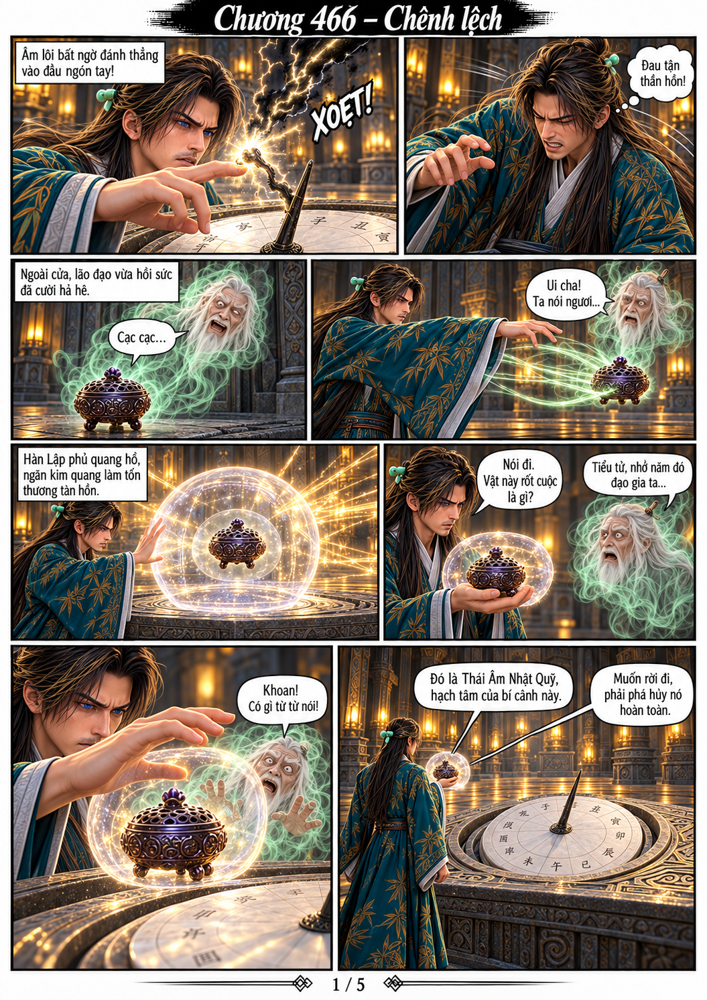
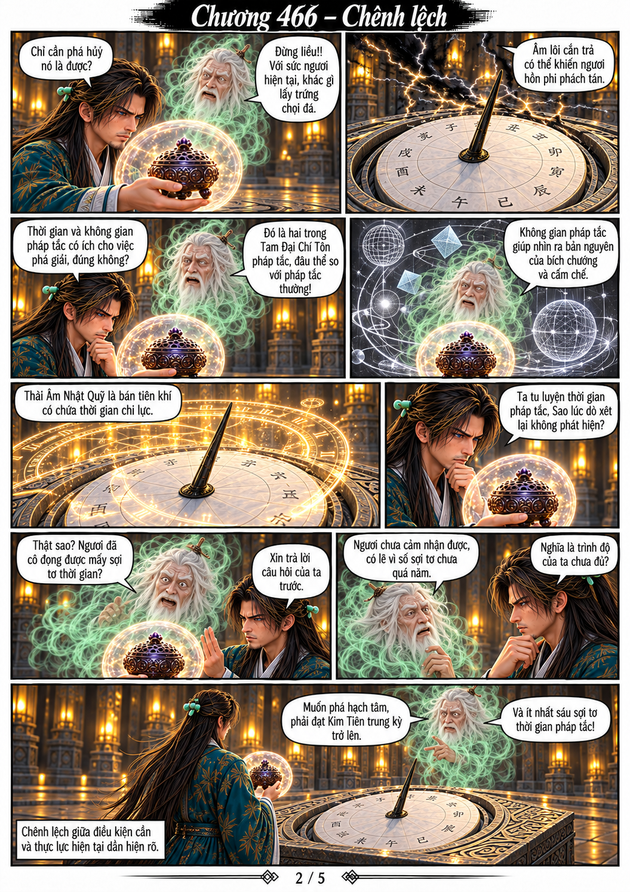
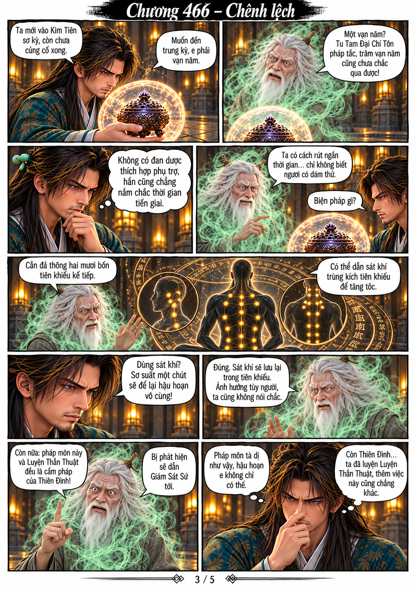
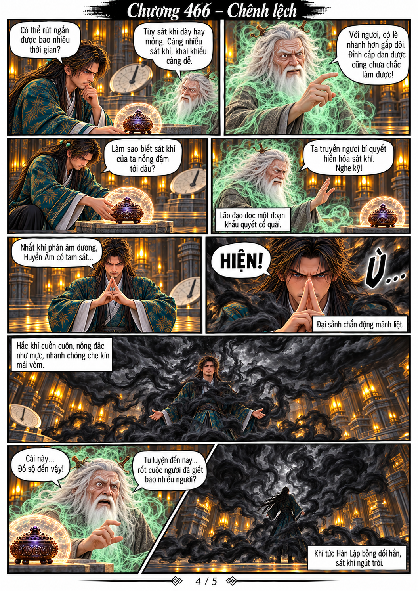
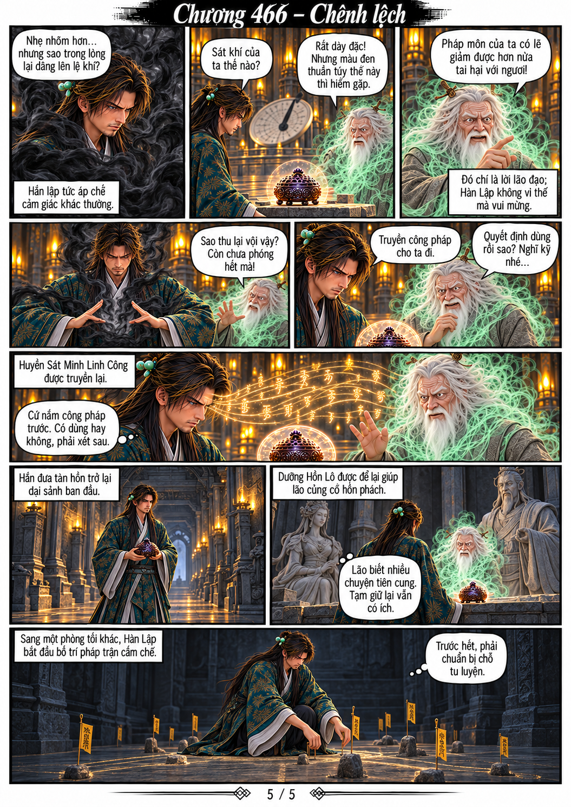

# Chương 466 — Chênh lệch

Bản chuyển thể 5 trang từ toàn bộ nội dung người dùng cung cấp, có thoại, suy nghĩ và lời dẫn. Dùng Hàn Lập v2 và các model hiện hành. Mỗi PNG một trang dọc theo tỷ lệ A4.

## Trang 1

## Trang 2

## Trang 3

## Trang 4

## Trang 5

