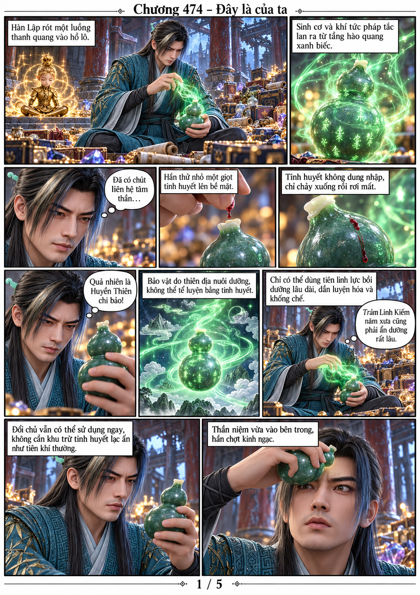
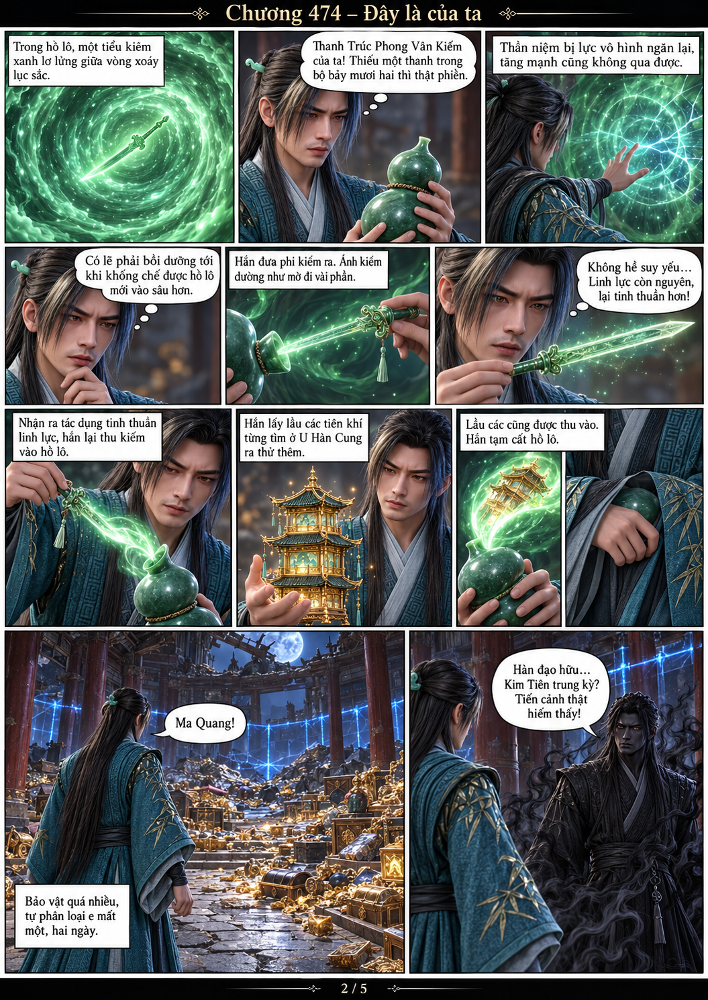
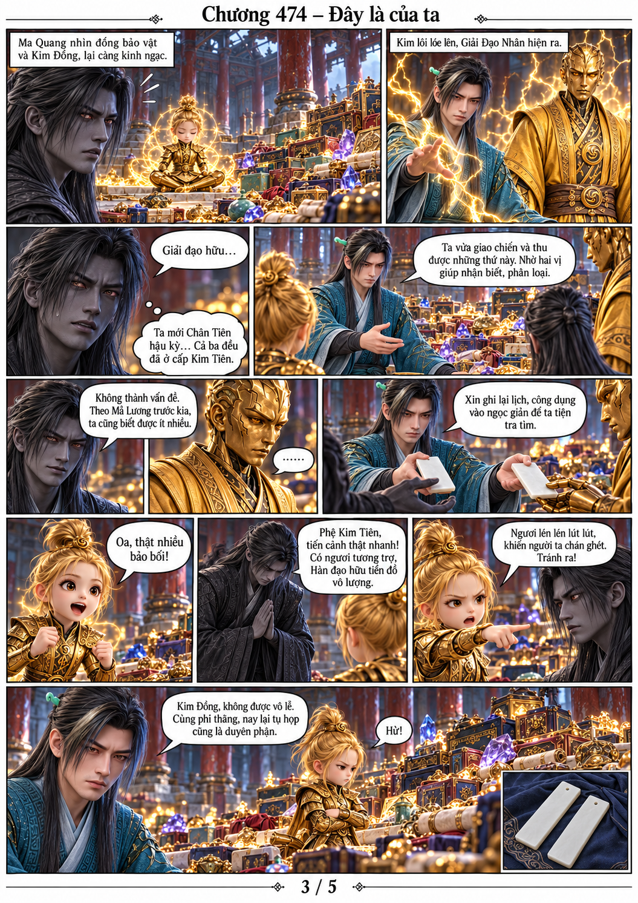
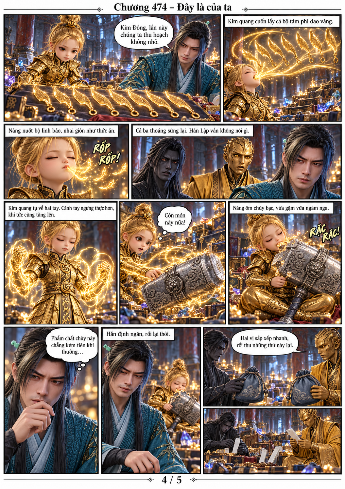
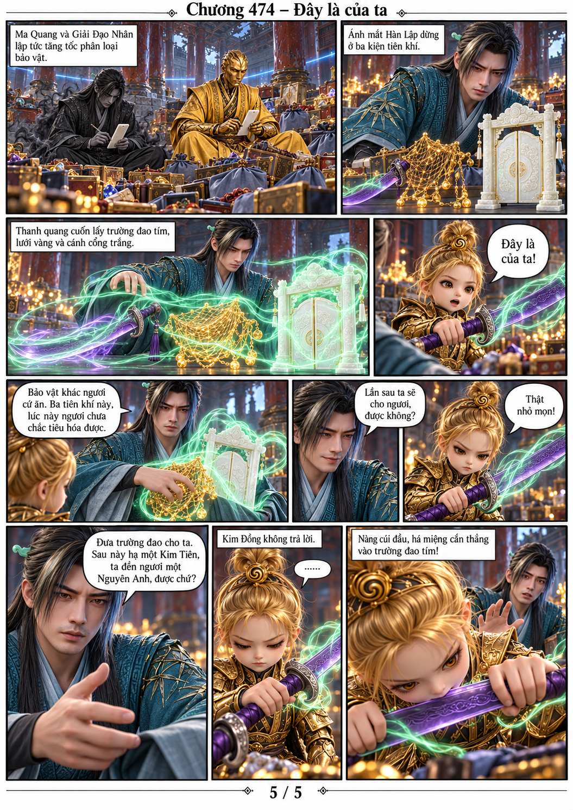

# Chương 474 — Đây là của ta

Năm trang, chuyển thể từ văn bản người dùng cung cấp. Mỗi lần tạo gắn trực tiếp model gốc: Hàn Lập V2, Kim Đồng KD-ND-01, Ma Quang MQ-01, Giải Đạo Nhân GDN-01 hoàng bào.

[Đọc PDF A4](chuong-474.pdf)

Kết chương: Kim Đồng cúi xuống cắn trường đao tím, chưa xác nhận kết quả. Thanh kiếm bản mệnh tìm lại và lầu các ba tầng đều ở trong hồ lô đã cất.
