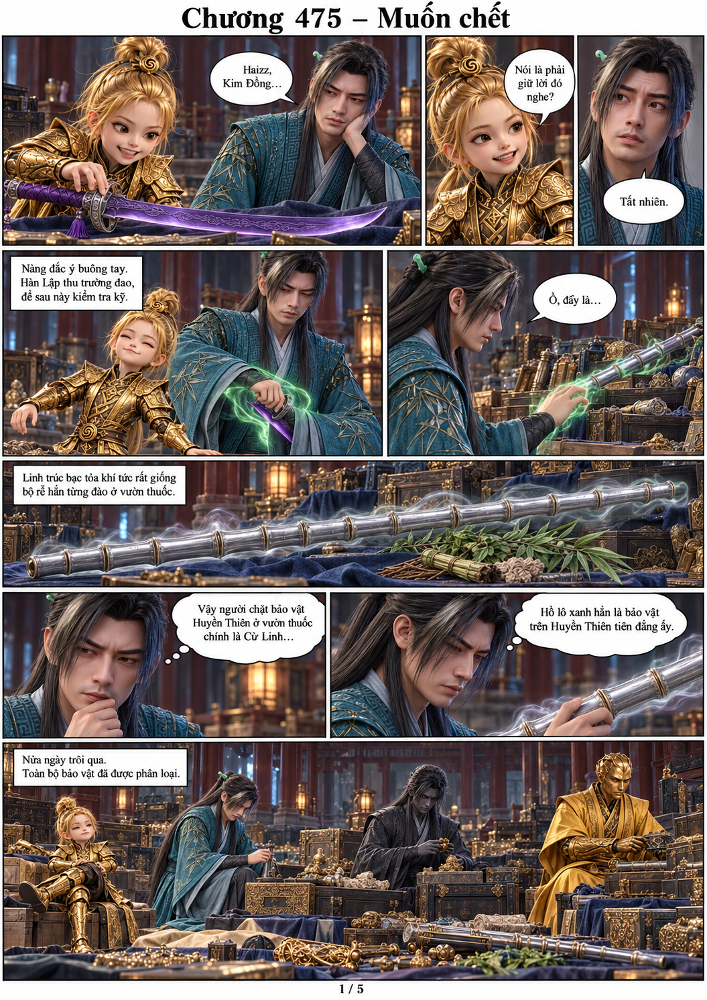
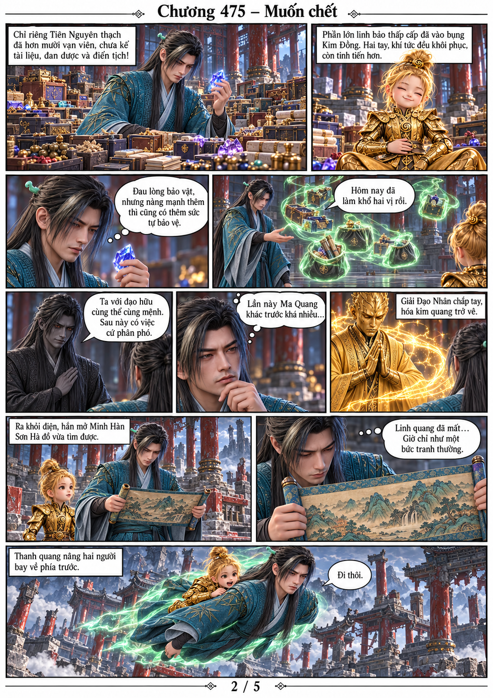
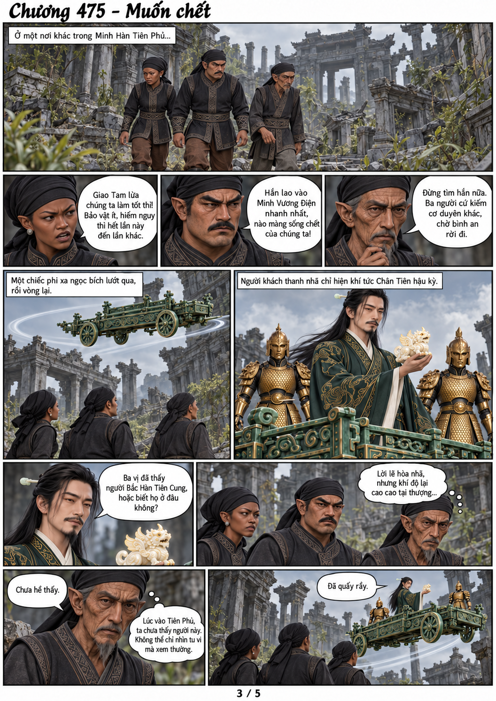
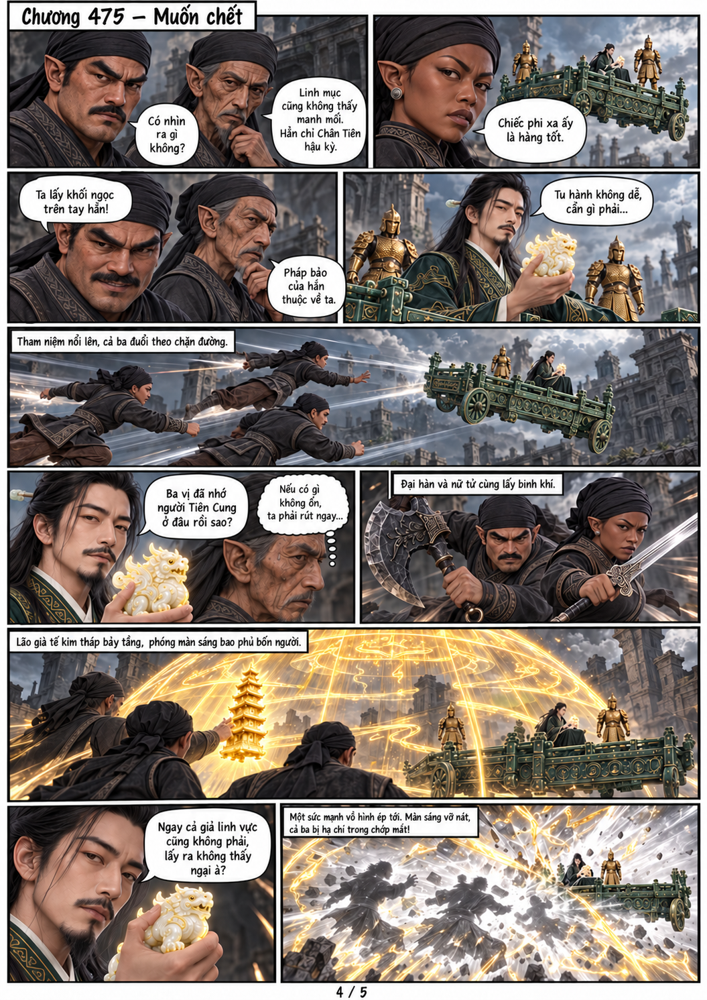
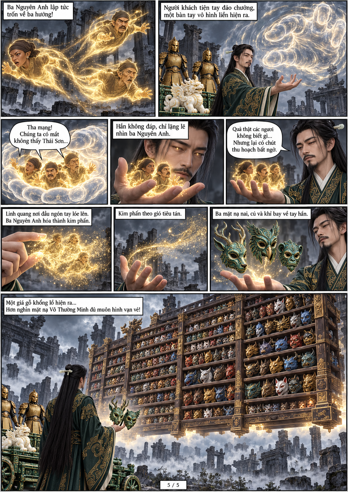

# Chương 475 — Muốn chết

Năm trang chuyển thể từ văn bản người dùng cung cấp. Dùng trực tiếp model gốc của nhân vật, tạo/lưu model cho nhân vật mới trước khi đưa vào tranh. Nhóm khách phi xa chưa được gán danh tính hay cảnh giới thật.

[Đọc PDF A4](chuong-475.pdf)

Kết chương: người khách hiện giá gỗ chứa hơn nghìn mặt nạ Vô Thường Minh. Hai tuyến Han/Kim Đồng và khách phi xa ở hai địa điểm khác nhau.
