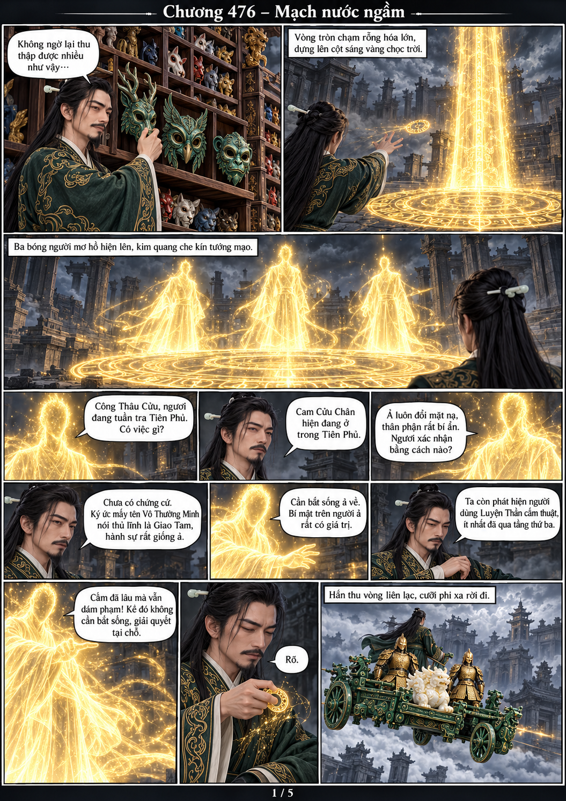
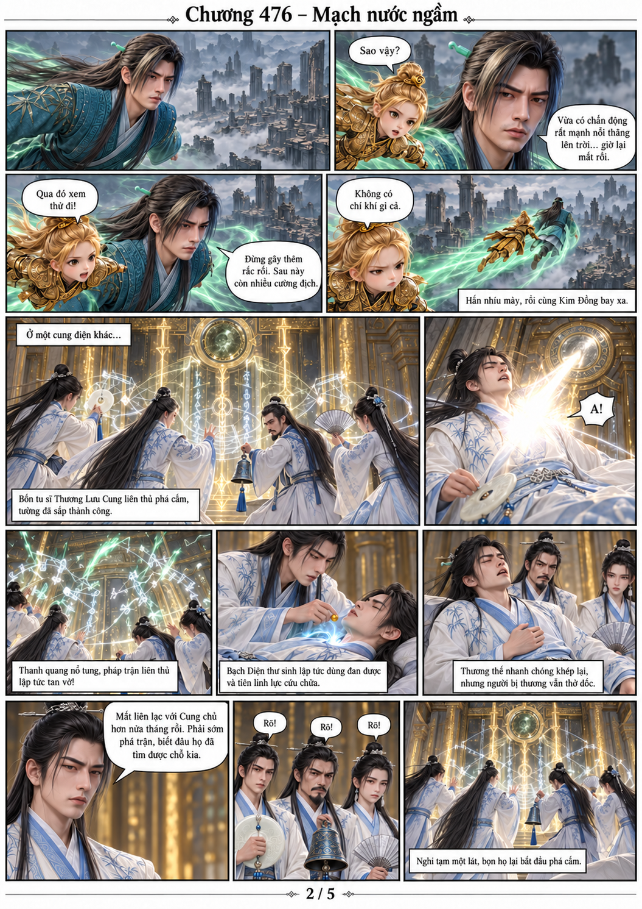
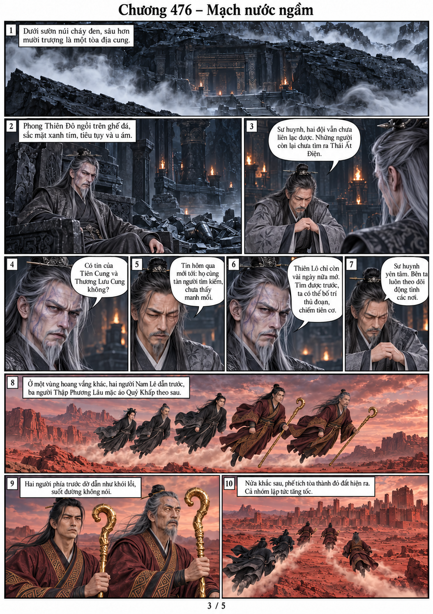
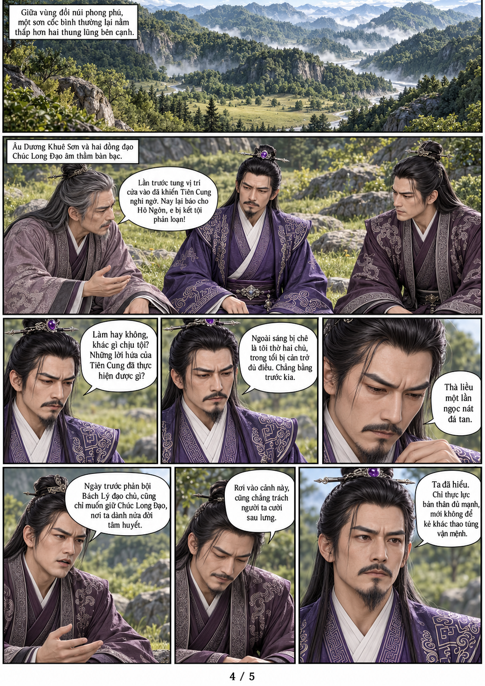
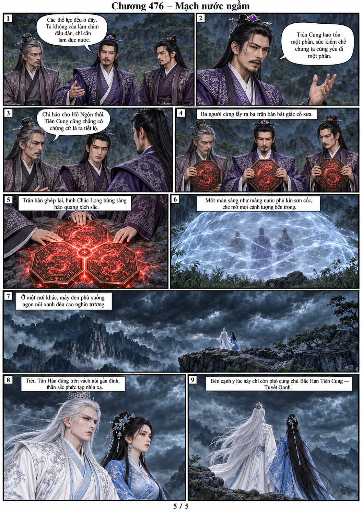

# Chương 476 — Mạch nước ngầm

Năm trang từ văn bản người dùng cung cấp, gắn trực tiếp PNG model gốc theo từng nhân vật/phe.

[Đọc PDF A4](chuong-476.pdf)

Kết chương: Tiêu Tấn Hàn và Tuyết Oanh đứng trên vách núi. Các tuyến khác vẫn ở địa điểm riêng.
