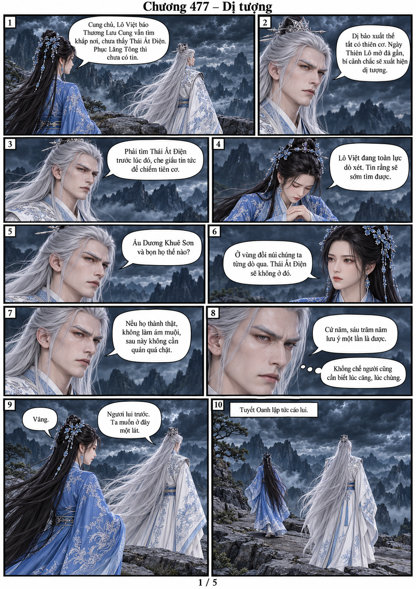
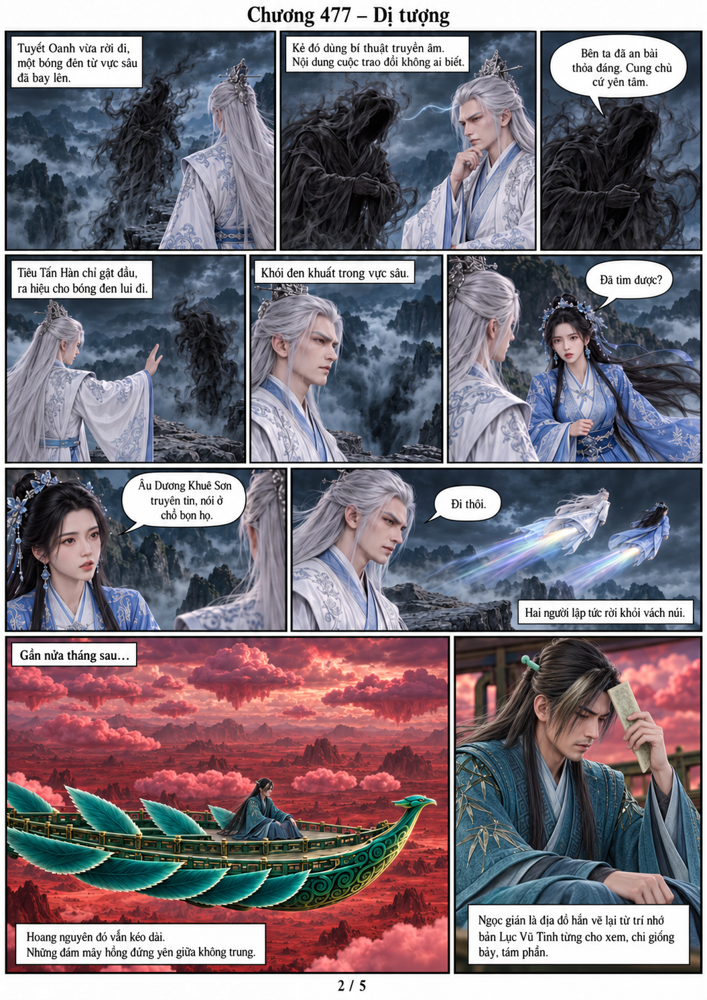
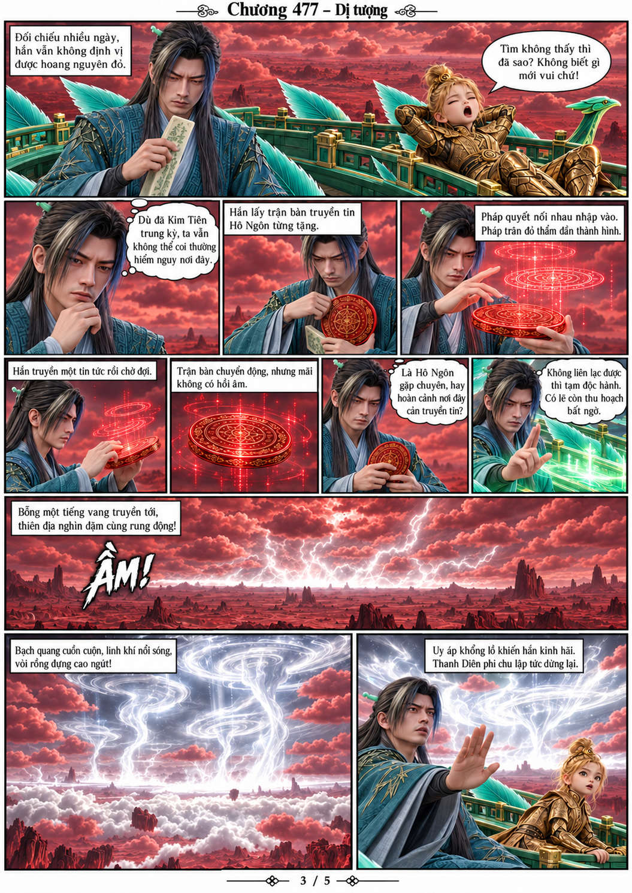
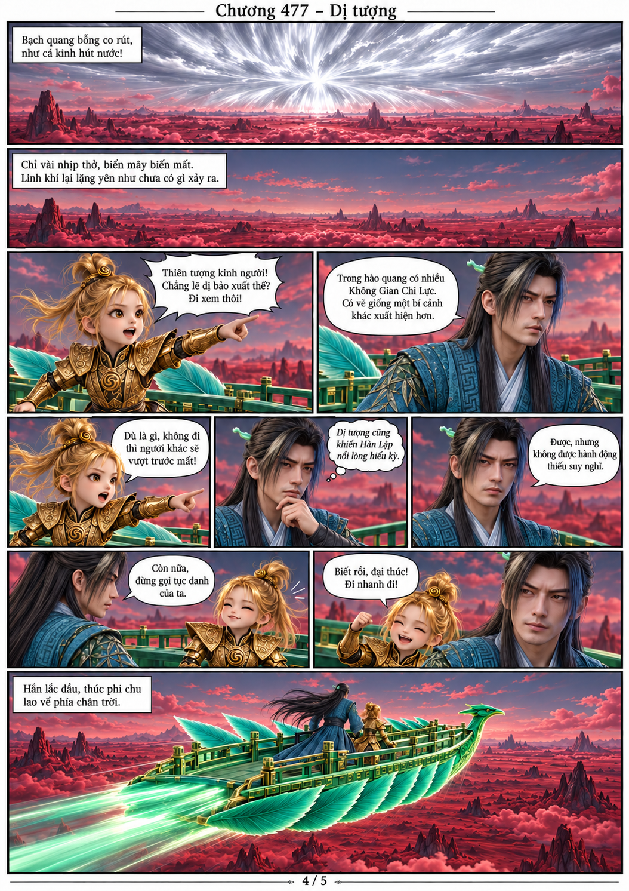
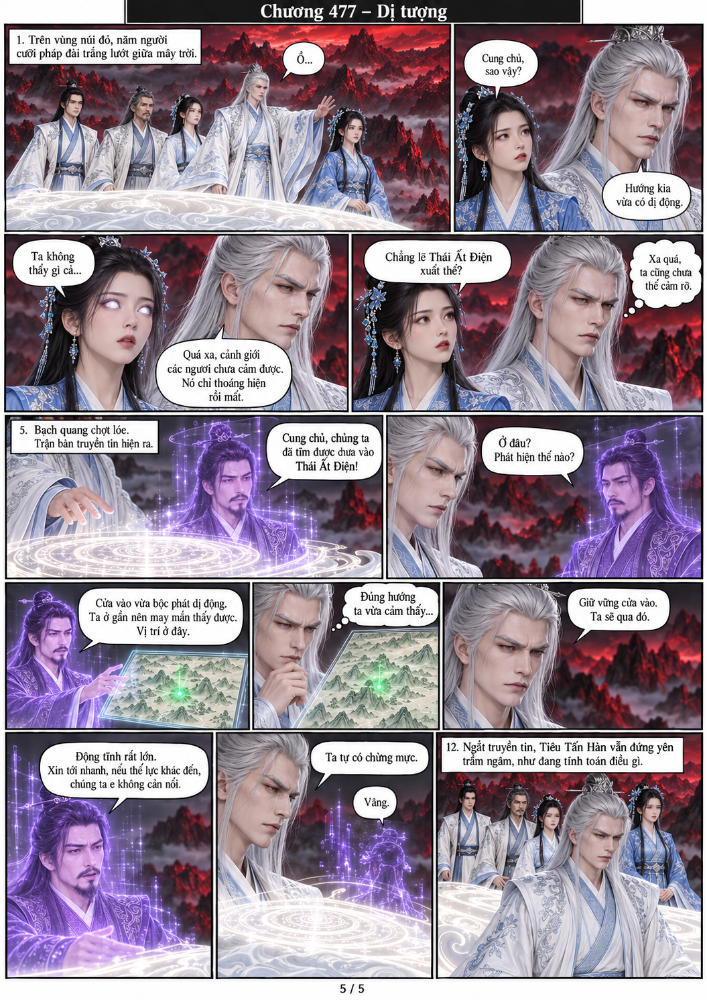

# Chương 477 — Dị tượng

Năm trang chuyển thể từ văn bản người dùng cung cấp. Từng trang gắn trực tiếp PNG model gốc; giữ riêng Tiêu Tấn Hàn tóc trắng và Hàn Lập V2 tóc đen áo TEAL.

[Đọc PDF A4](chuong-477.pdf)

Kết chương: Tiêu Tấn Hàn ngắt truyền tin với Âu Dương Khuê Sơn rồi đứng trầm ngâm; Hàn Lập và Kim Đồng vẫn đang tới hướng dị tượng đã tan. Chưa ai được tự vẽ đến cửa điện.
