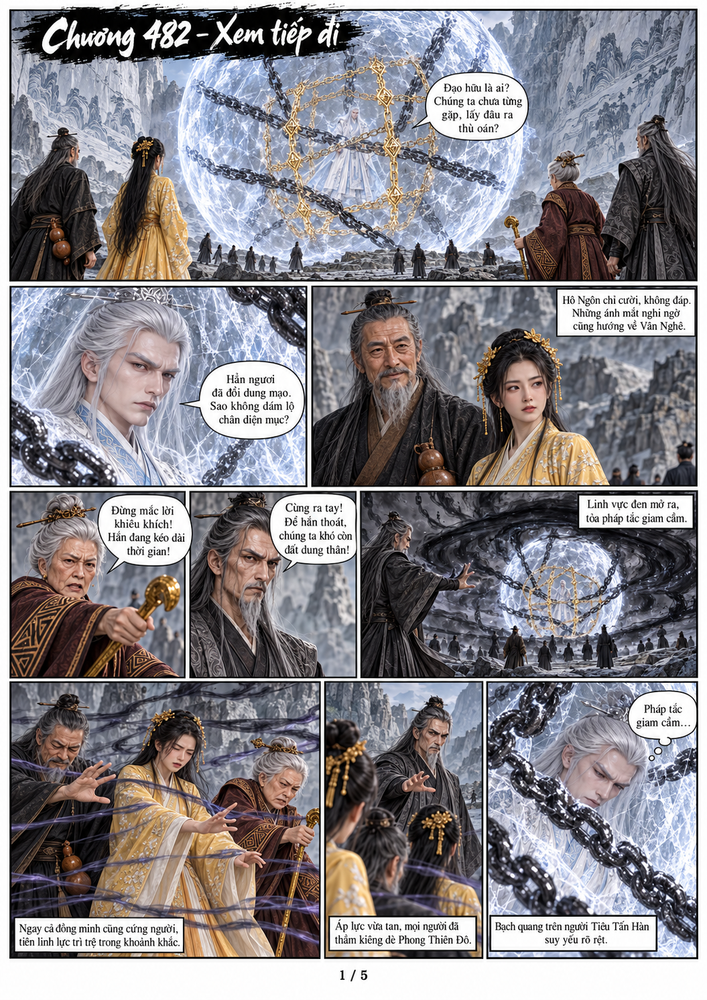
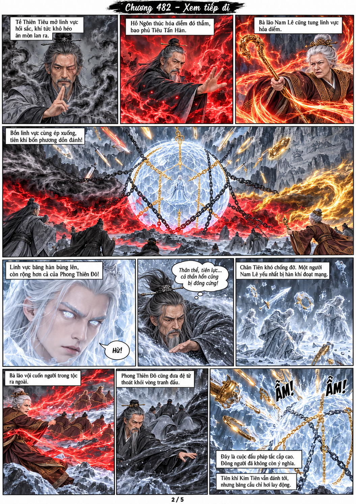
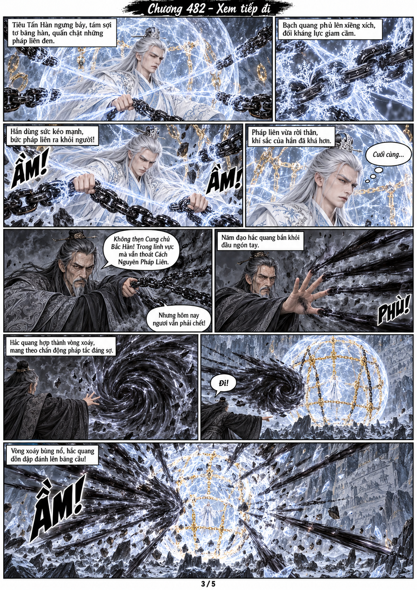
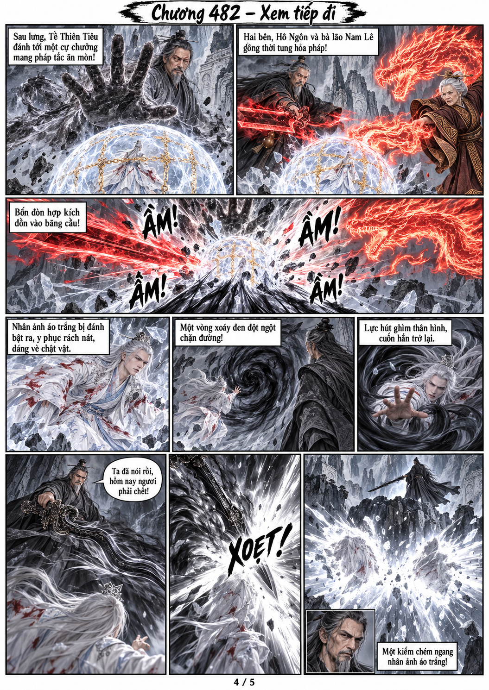
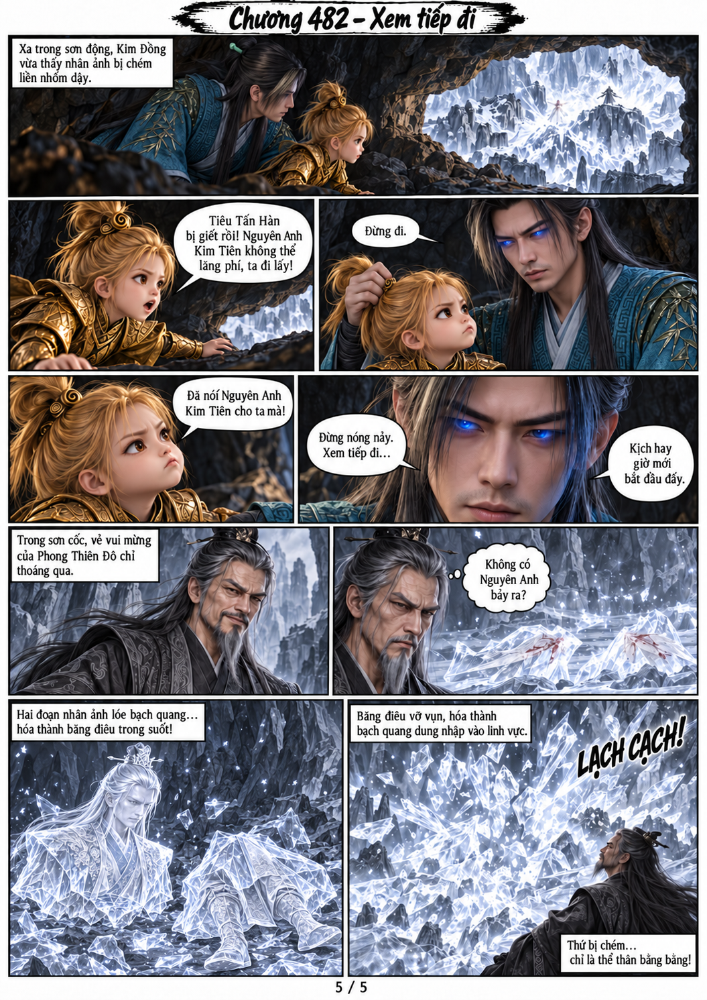

# Chương 482: Xem tiếp đi

Chuyển thể từ toàn văn người dùng cung cấp. Gồm **5 trang PNG riêng**, tỉ lệ A4 dọc, và [PDF A4 5 trang](chuong-482.pdf). Dùng lại model đã lưu trong bộ nhớ dự án, có thoại, suy nghĩ và lời dẫn diễn biến.

1. Tiêu chất vấn Hô Ngôn; Phong Thiên Đô mở linh vực giam cầm.
2. Bốn linh vực ép xuống; Tiêu đáp trả bằng băng hàn.
3. Tiêu rút pháp liên; Phong phản kích bằng vòng xoáy đen.
4. Bốn phía hợp kích; Phong tưởng đã giết Tiêu.
5. Hàn Lập giữ Kim Đồng lại; hai mảnh thế thân băng vỡ, không có Nguyên Anh.

Hàn Lập và Kim Đồng vẫn ẩn trong hang xa. Kết ở bạch quang thế thân hòa vào linh vực, chưa tiết lộ vị trí Tiêu thật hoặc diễn biến chương sau. Không thay model nhân vật cũ. Model và ghi chú nối truyện nằm trong bộ nhớ dự án.

