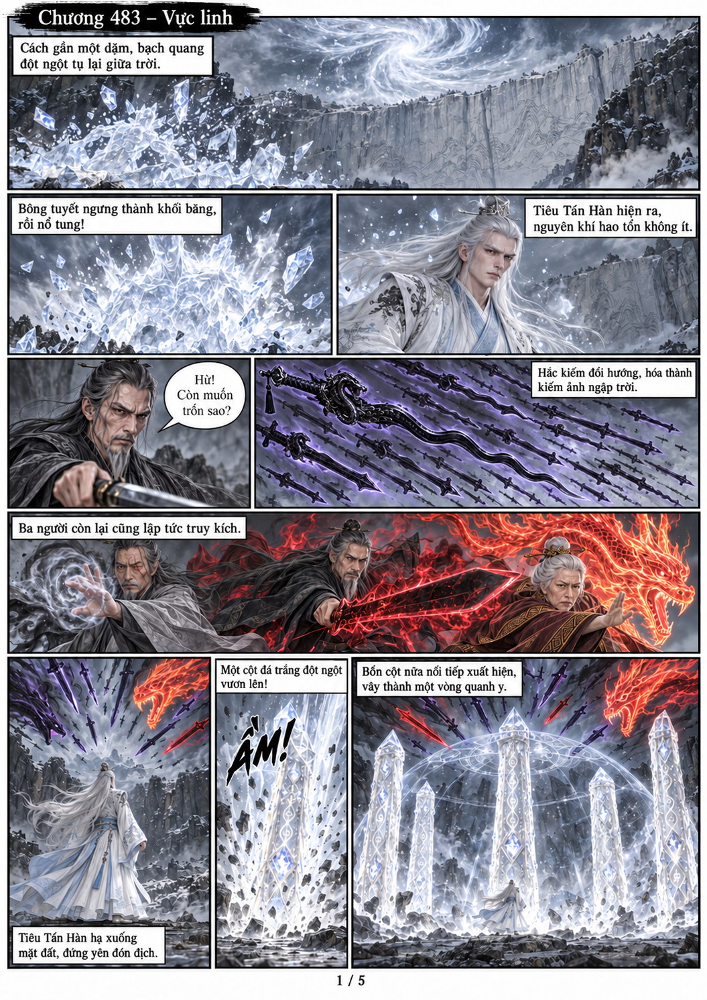
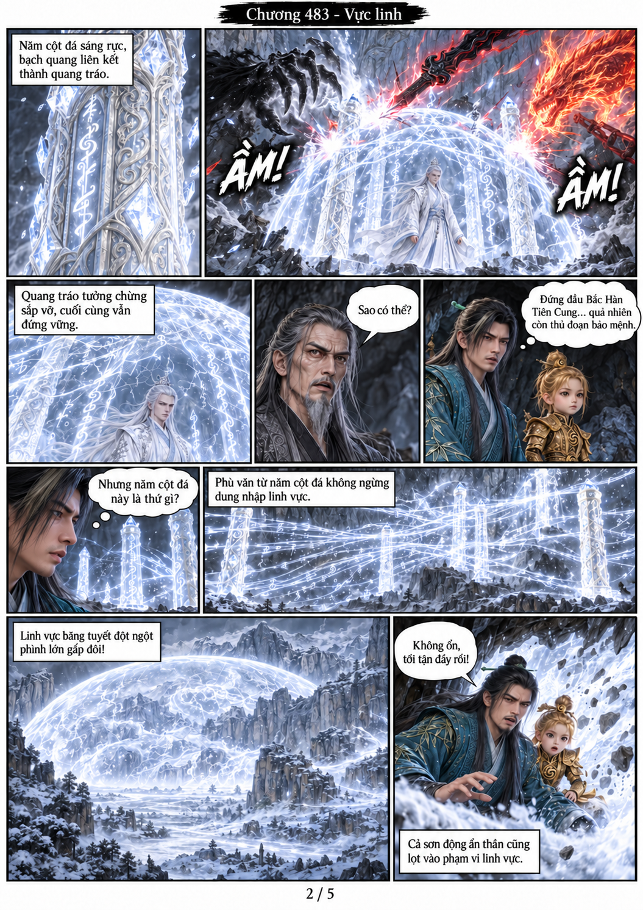
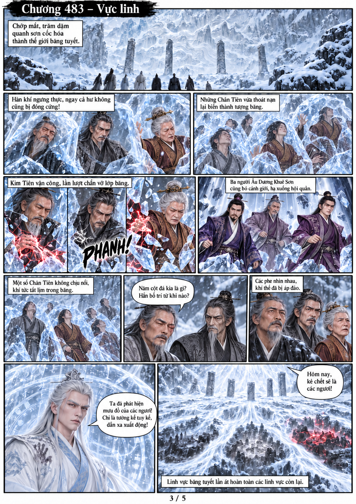
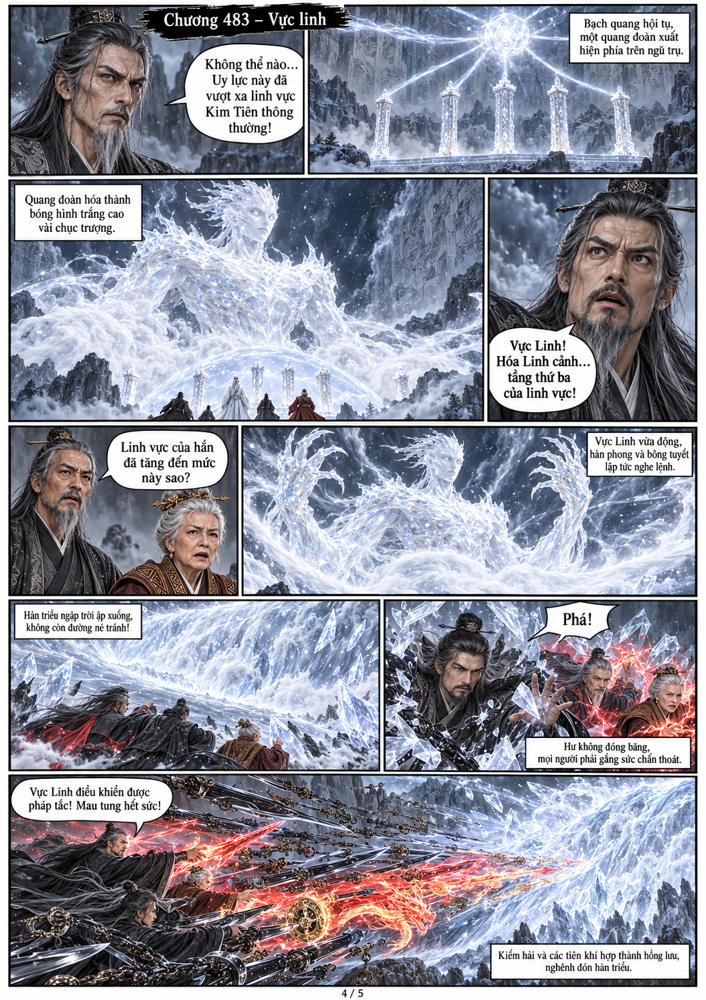
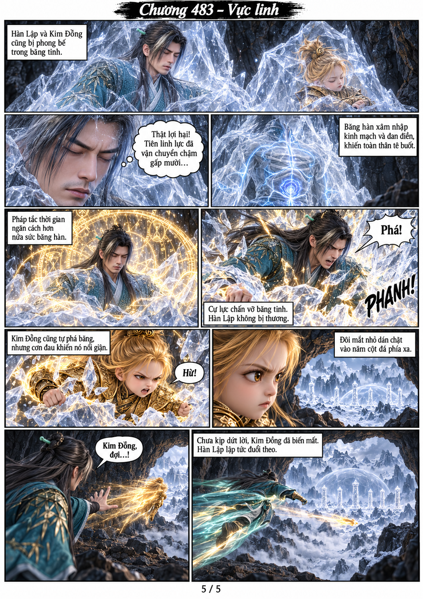

# Chương 483: Vực linh

5 trang PNG riêng, tỉ lệ A4 dọc; chuyển thể từ văn bản người dùng đính kèm, có thoại, suy nghĩ và lời dẫn. Dùng model tham chiếu trong bộ nhớ dự án.

[PDF A4](chuong-483.pdf) · [Văn bản nguồn](SOURCE.txt)

Tiêu Tấn Hàn thoát bằng thế thân, dựng năm cột đá tăng cường linh vực. Vực Linh xuất hiện; các phe hợp lực chống hàn triều. Hàn Lập và Kim Đồng phá băng trong hang; Kim Đồng nổi giận lao ra, Hàn Lập đuổi theo.

