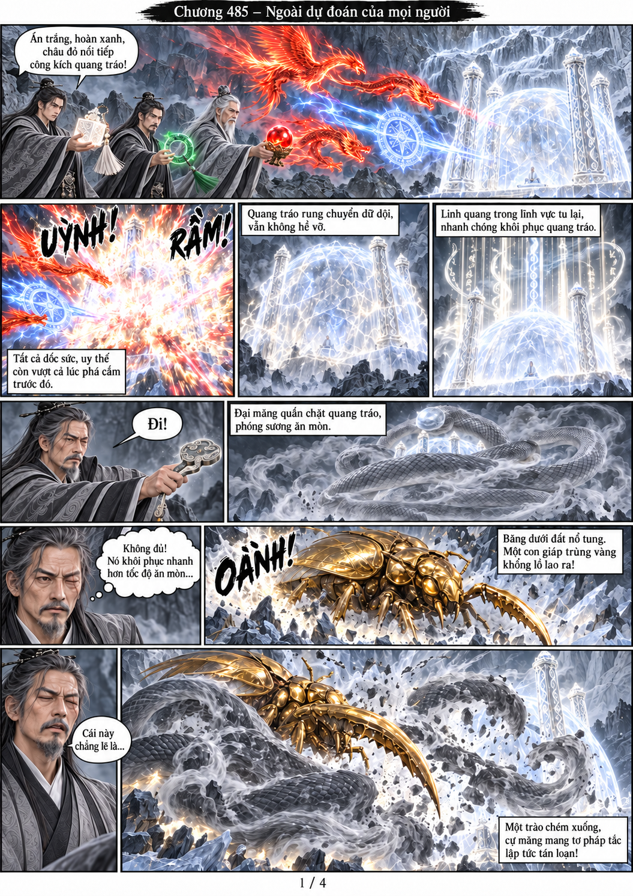
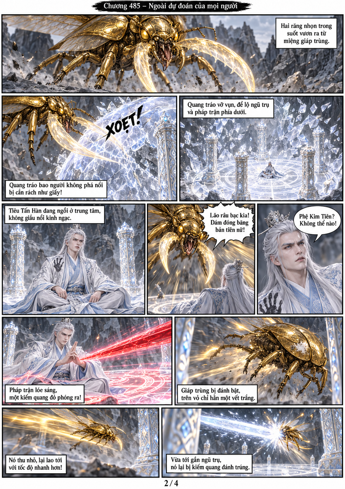
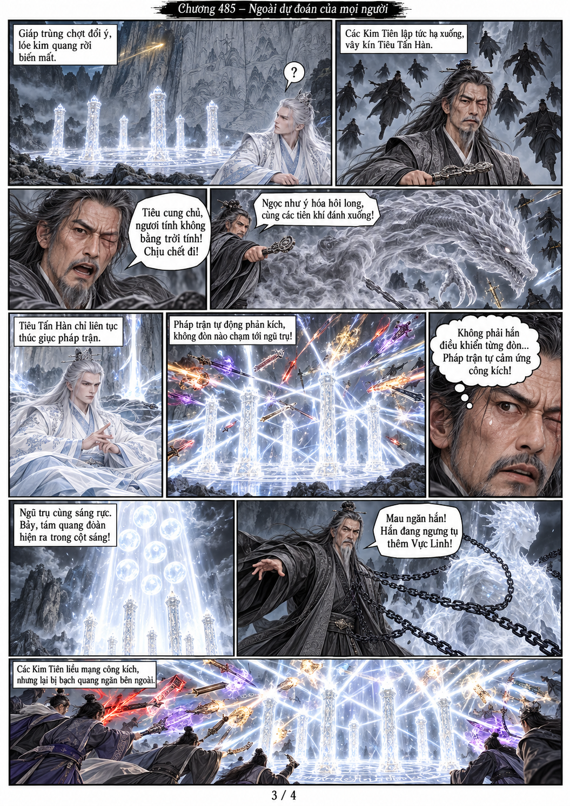
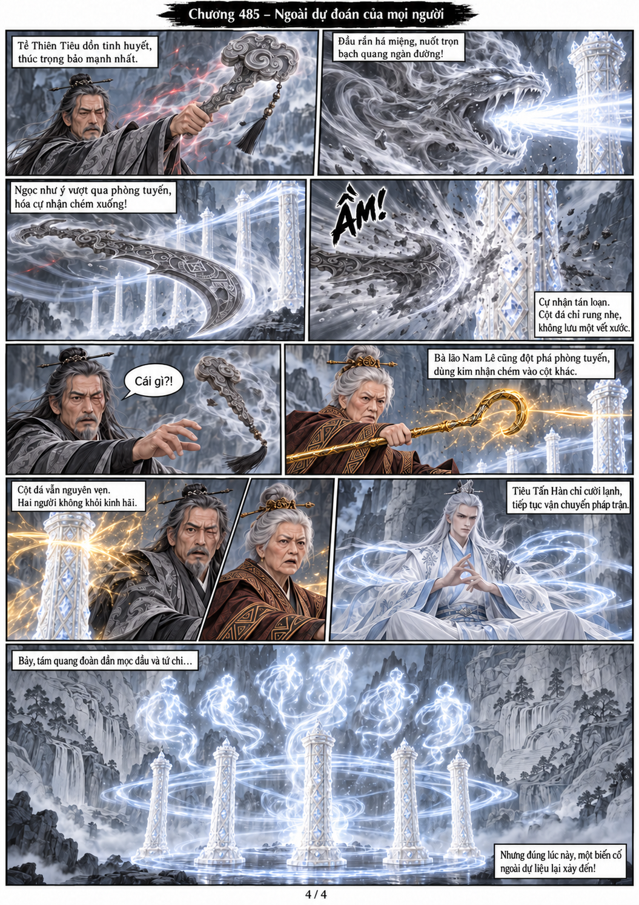

# Chương 485: Ngoài dự đoán của mọi người

4 trang PNG riêng, tỉ lệ A4 dọc; chuyển thể từ văn bản người dùng đính kèm, có thoại, suy nghĩ và lời dẫn. Dùng model tham chiếu trong bộ nhớ dự án.

[PDF A4](chuong-485.pdf) · [Văn bản nguồn](SOURCE.txt)

Kim Đồng hiện bản thể giáp trùng vàng, chém tan cự mãng và cắn vỡ quang tráo. Pháp trận tự động phản kích khiến các Kim Tiên không phá được ngũ trụ; Tiêu Tấn Hàn sắp ngưng tụ thêm Vực Linh.

