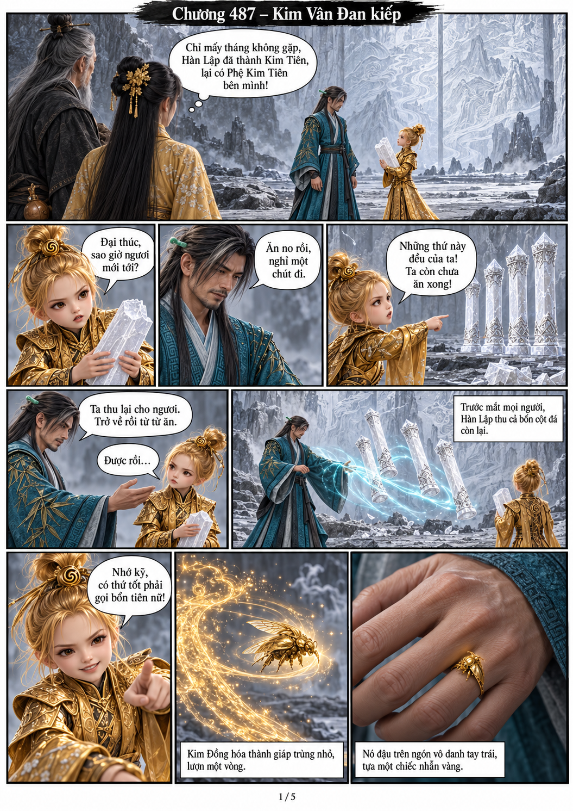
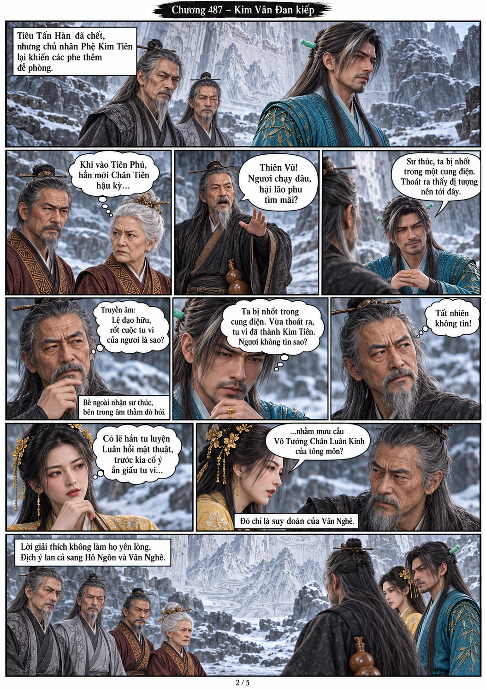
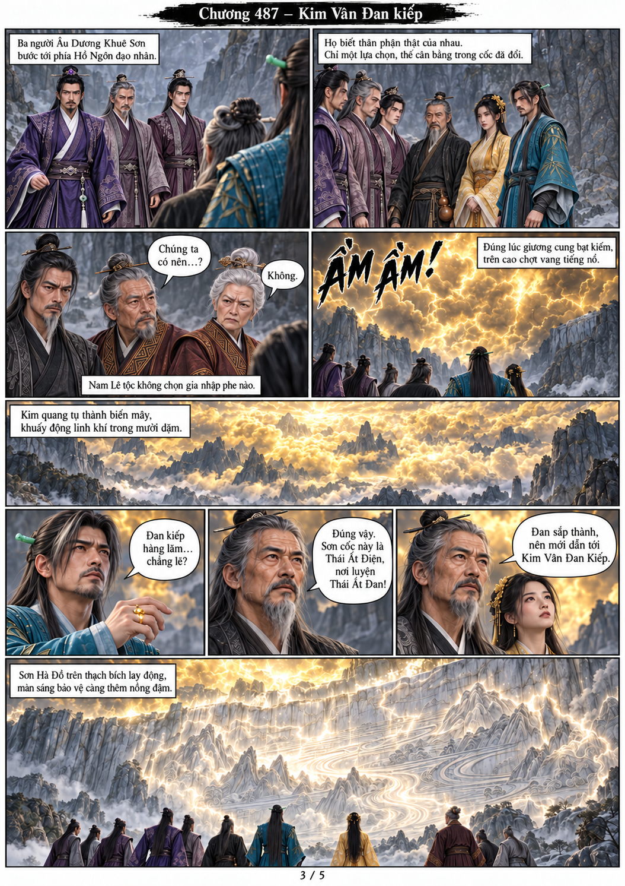
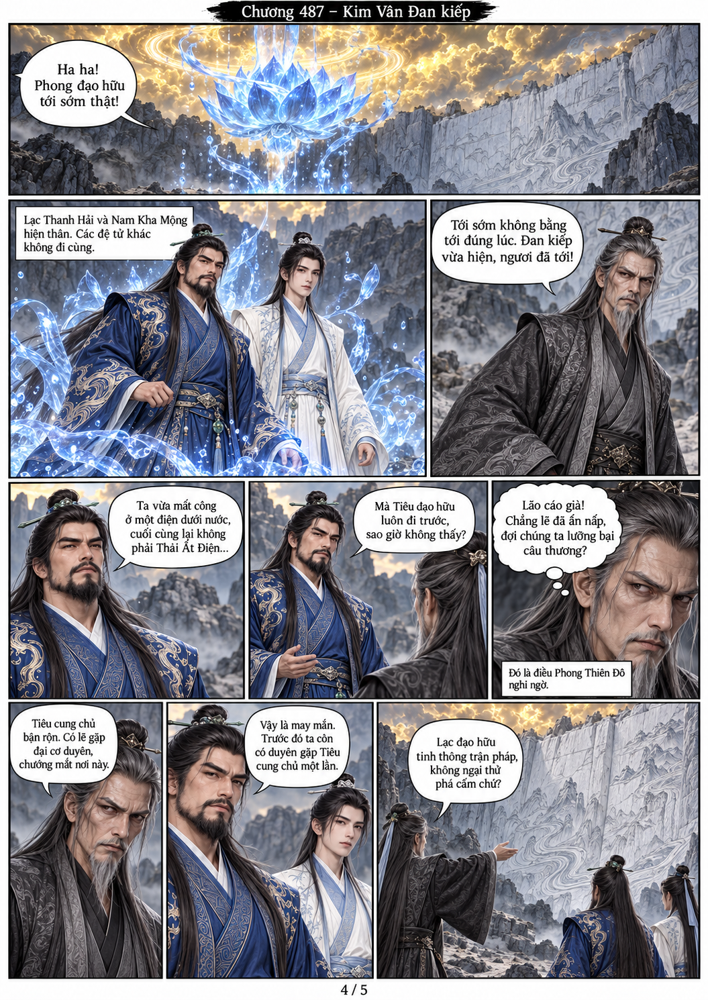
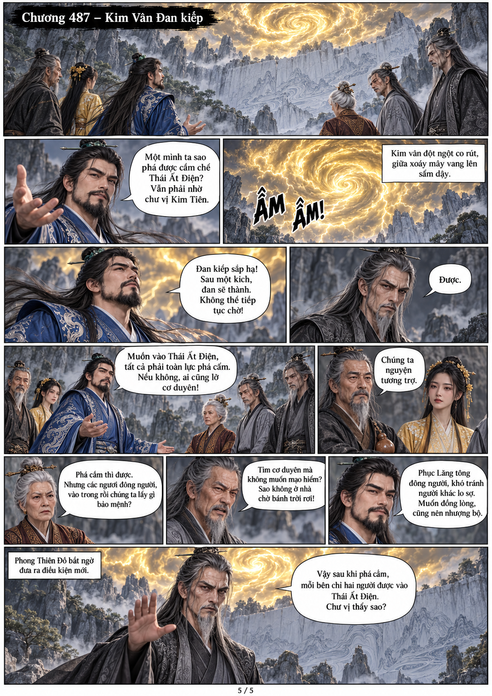

# Chương 487: Kim Vân Đan kiếp

5 trang PNG riêng, tỉ lệ A4 dọc; chuyển thể từ văn bản người dùng đính kèm, có thoại, suy nghĩ và lời dẫn. Dùng model tham chiếu trong bộ nhớ dự án.

[PDF A4](chuong-487.pdf) · [Văn bản nguồn](SOURCE.txt)

Hàn Lập thu bốn cột đá, Kim Đồng hóa nhẫn vàng trên tay trái. Các phe đổi thế đứng, Đan kiếp xuất hiện; Lạc Thanh Hải cùng Nam Kha Mộng tới. Trước việc phá cấm, Phong Thiên Đô đề nghị mỗi phe chỉ hai người được vào điện.

