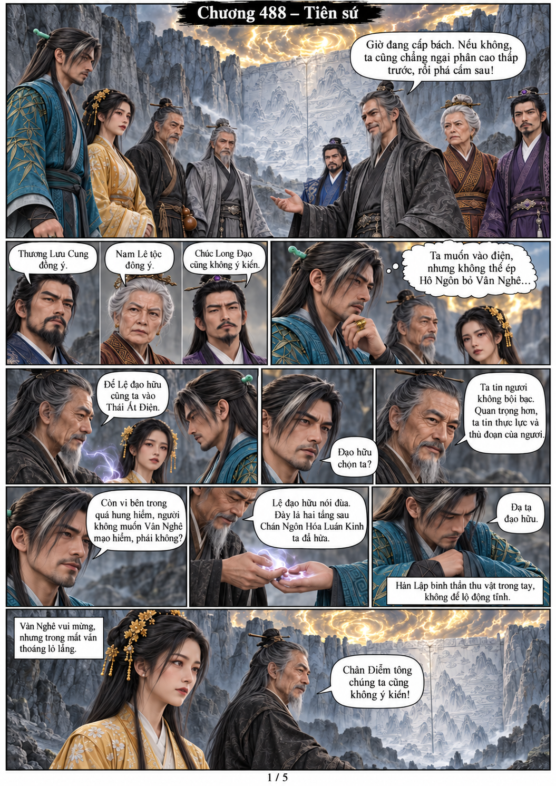
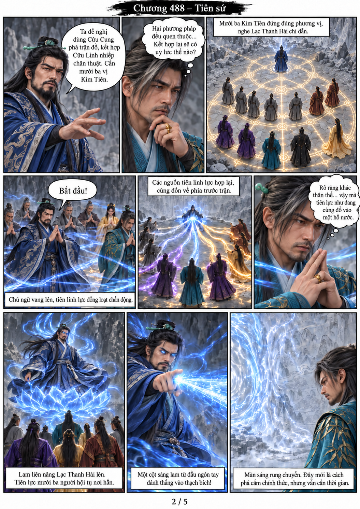
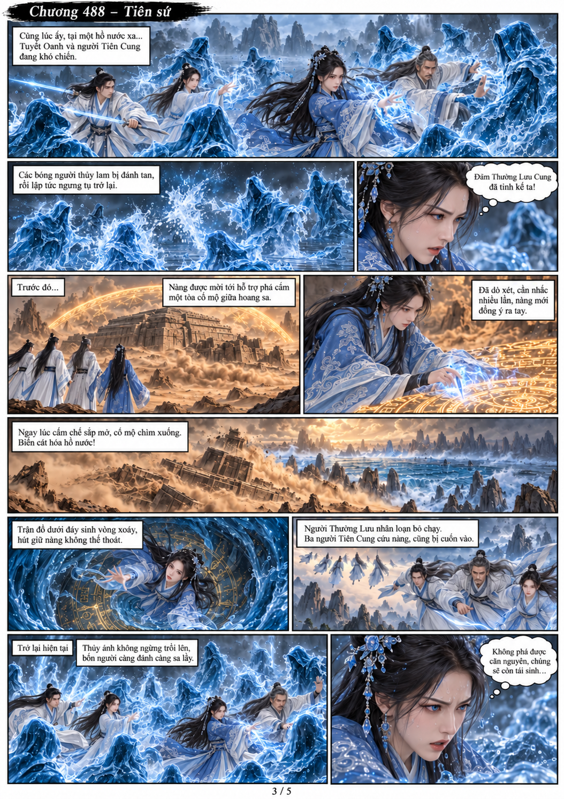
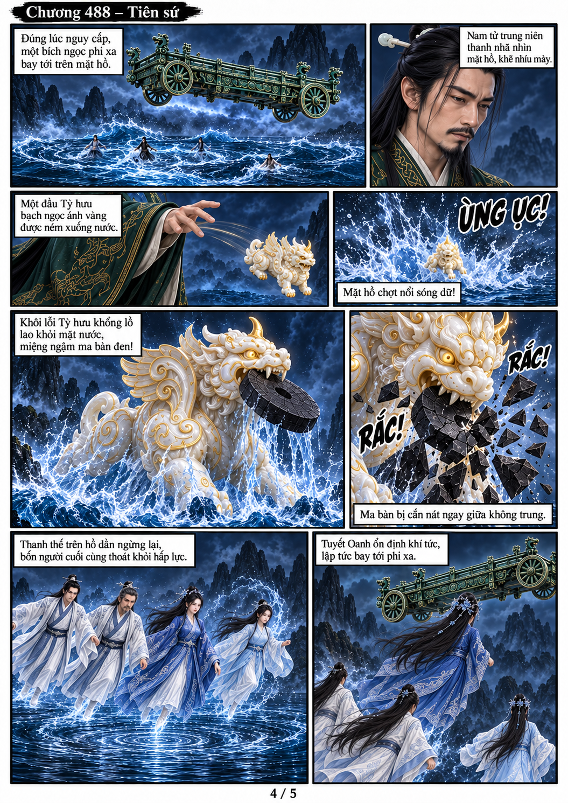
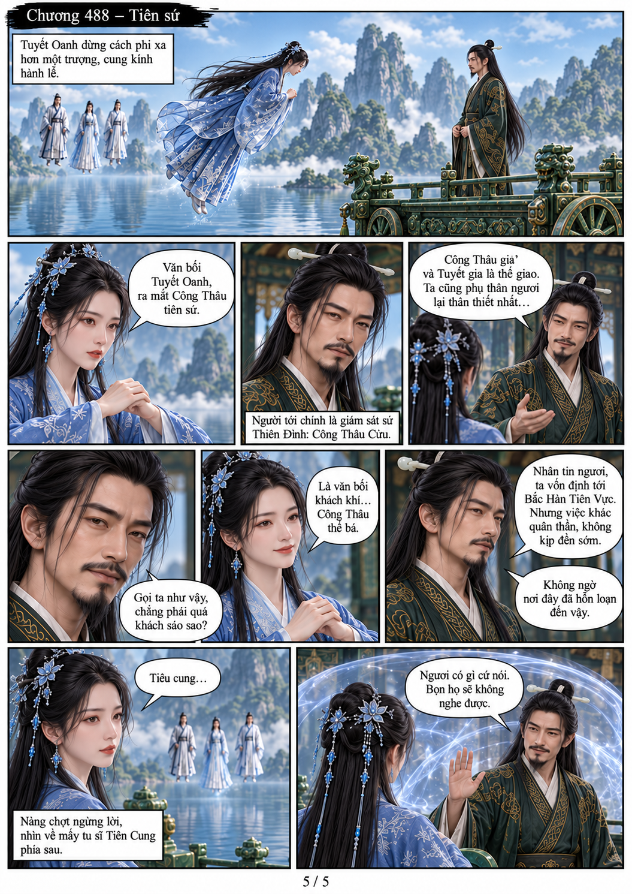

# Chương 488: Tiên sứ

5 trang PNG riêng, tỉ lệ A4 dọc; chuyển thể từ văn bản người dùng đính kèm, có thoại, suy nghĩ và lời dẫn. Dùng model tham chiếu trong bộ nhớ dự án.

[PDF A4](chuong-488.pdf) · [Văn bản nguồn](SOURCE.txt)

Các phe đồng ý mỗi bên hai người vào điện; Hô Ngôn chọn Hàn Lập. Mười ba Kim Tiên hợp lực phá thạch bích. Ở tuyến khác, Công Thâu Cửu dùng Tỳ hưu cứu Tuyết Oanh khỏi hồ nước và cho nàng nói chuyện riêng.

