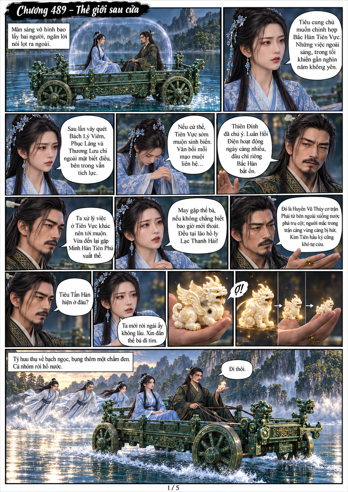
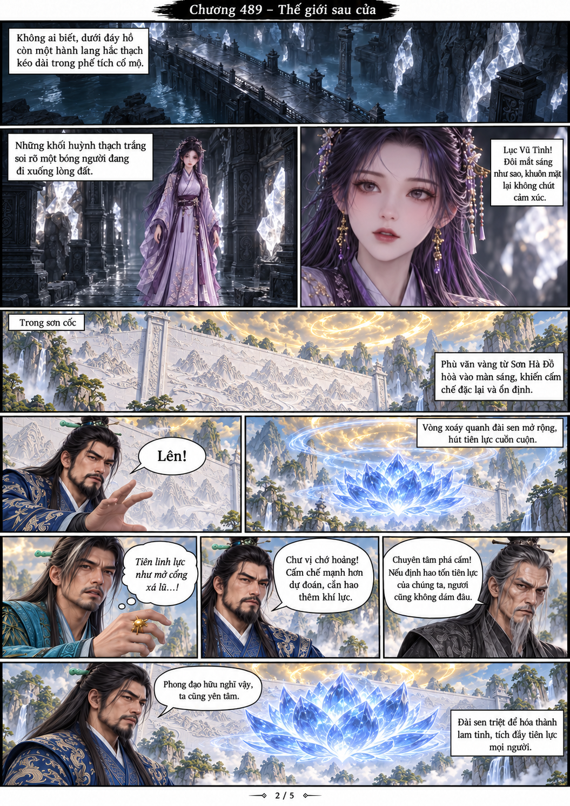
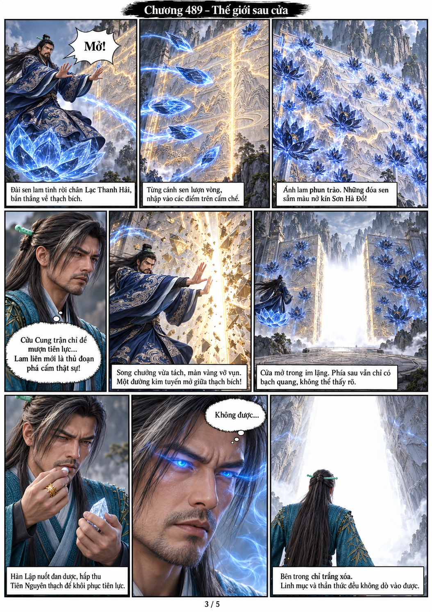
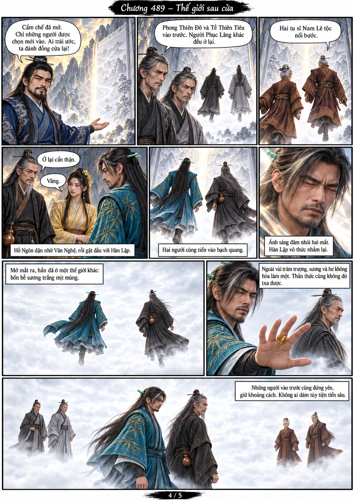
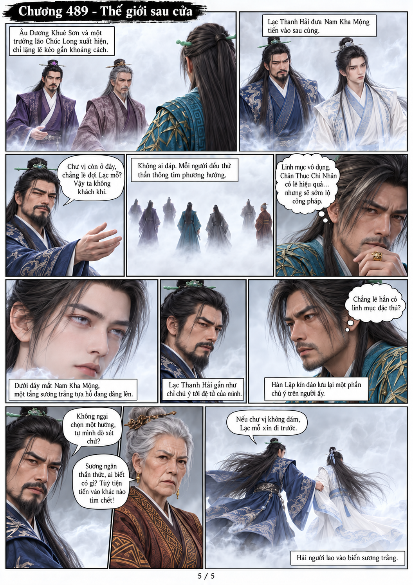

# Chương 489: Thế giới sau cửa

5 trang PNG riêng, tỉ lệ A4 dọc; chuyển thể từ văn bản người dùng đính kèm, có thoại, suy nghĩ và lời dẫn. Dùng model tham chiếu trong bộ nhớ dự án.

[PDF A4](chuong-489.pdf) · [Văn bản nguồn](SOURCE.txt)

Công Thâu Cửu cùng Tuyết Oanh rời hồ, trong khi Lục Vũ Tình âm thầm tiến vào cổ mộ bên dưới. Lạc Thanh Hải phá thạch bích bằng lam liên. Các phe qua cửa vào biển sương trắng; Hàn Lập nghi Nam Kha Mộng có linh mục đặc thù.

