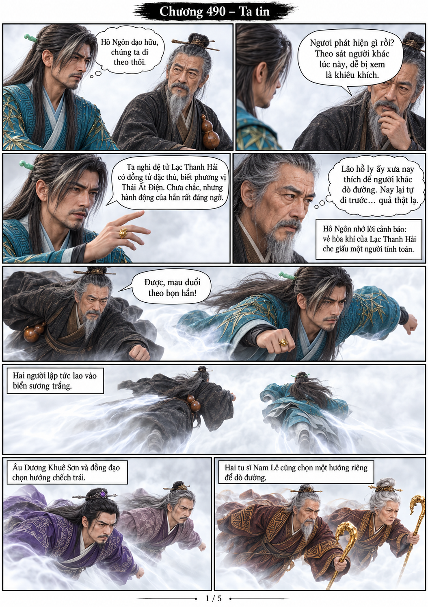
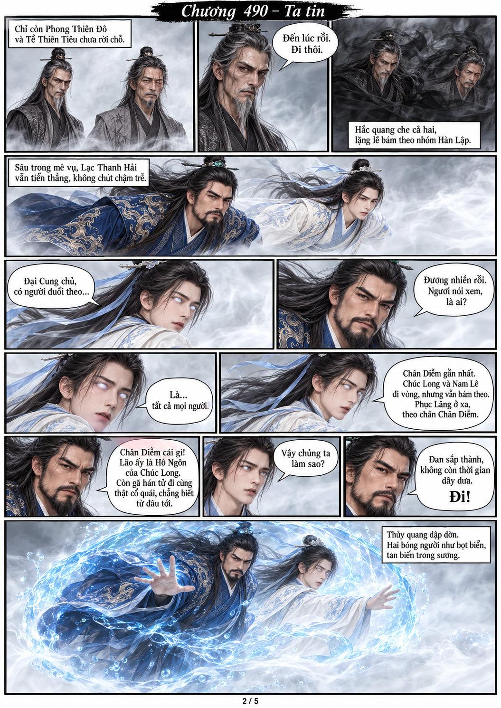
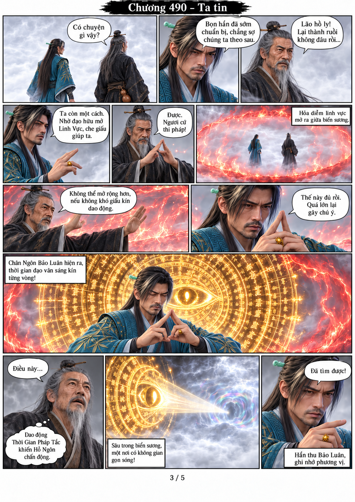
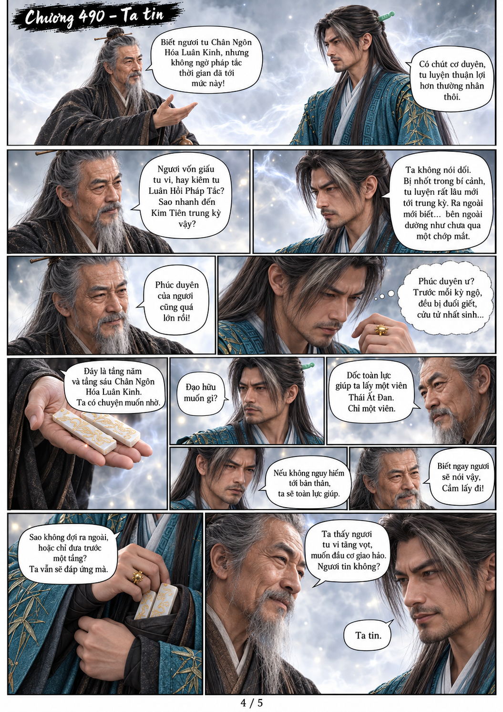
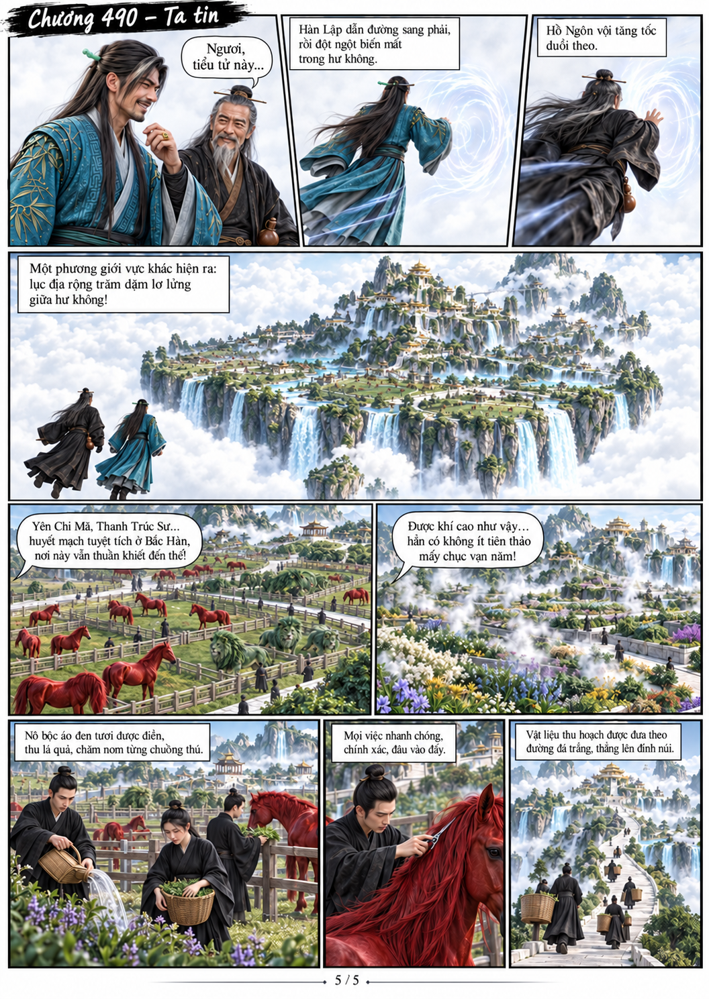

# Chương 490: Ta tin

5 trang PNG riêng, tỉ lệ A4 dọc; chuyển thể từ văn bản người dùng đính kèm, có thoại, suy nghĩ và lời dẫn. Dùng model tham chiếu trong bộ nhớ dự án.

[PDF A4](chuong-490.pdf) · [Văn bản nguồn](SOURCE.txt)

Hàn Lập và Hô Ngôn bám theo Lạc Thanh Hải, rồi dùng Chân Thực Chi Nhãn tìm đường sau khi mất dấu. Hô Ngôn giao hai tầng công pháp đổi lời giúp lấy đan. Qua mê vụ, hai người phát hiện lục địa nổi với linh thú, dược viên và nô bộc áo đen.

