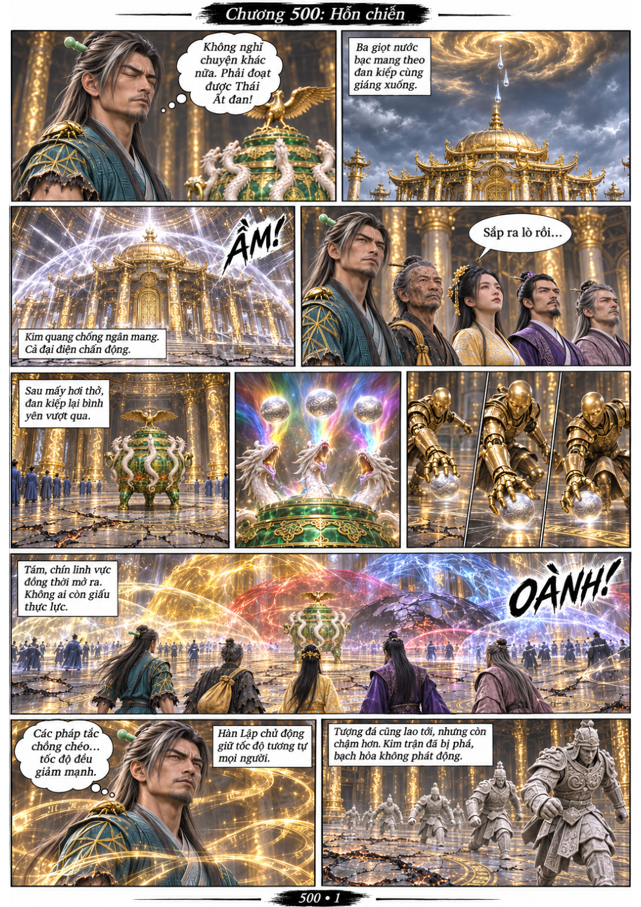
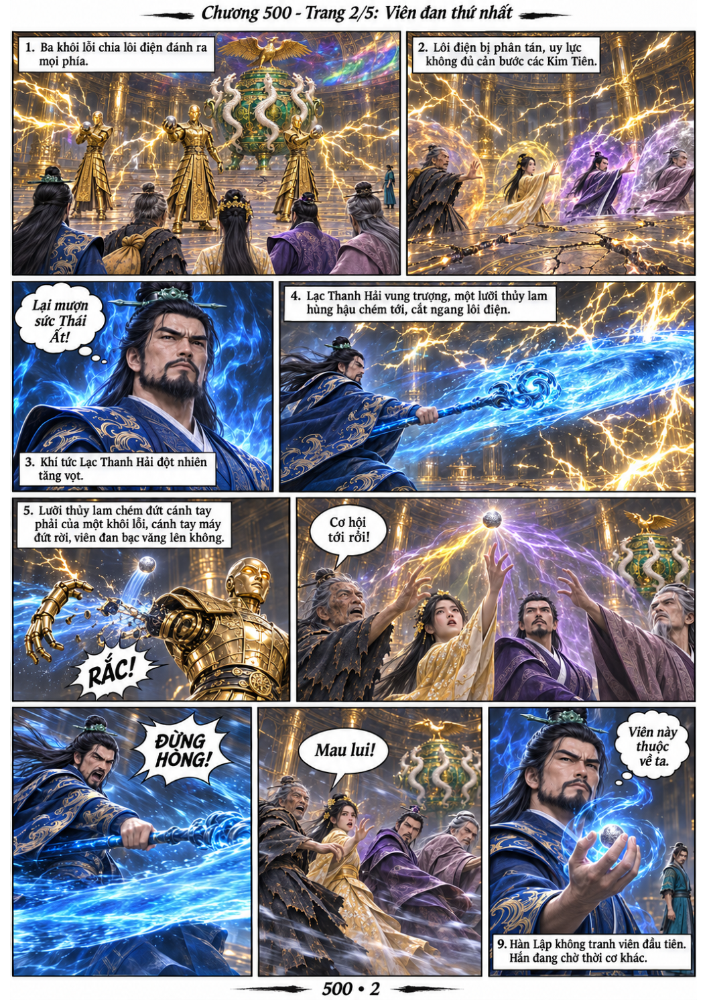
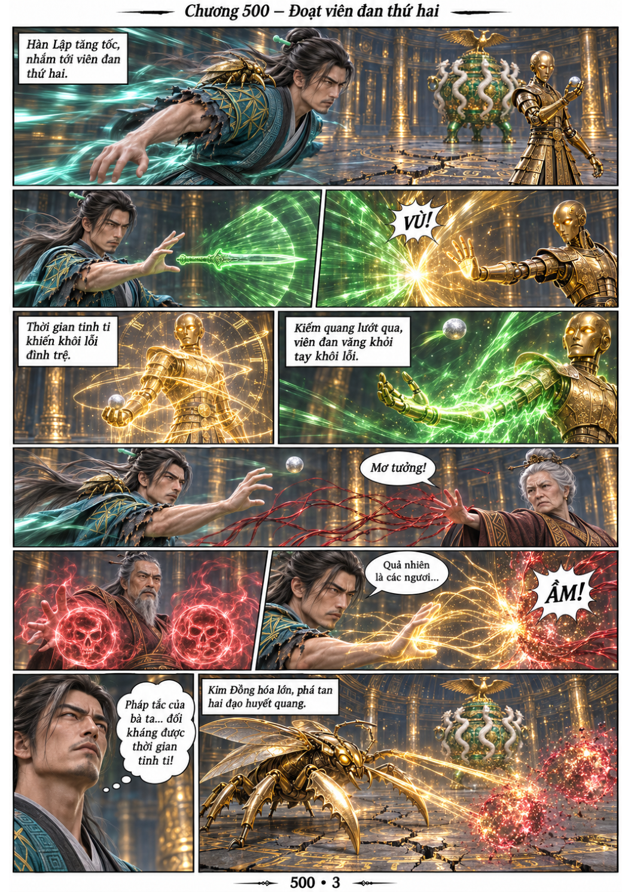
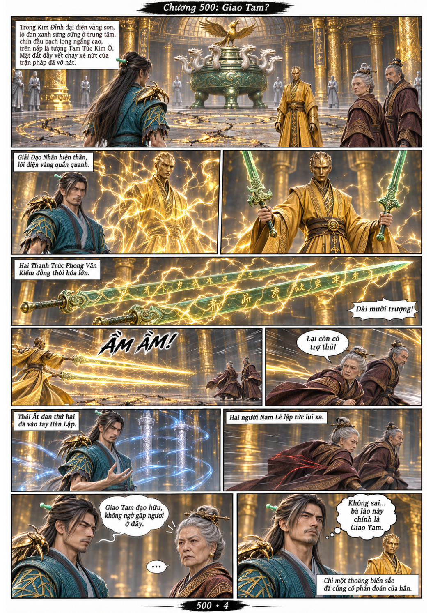
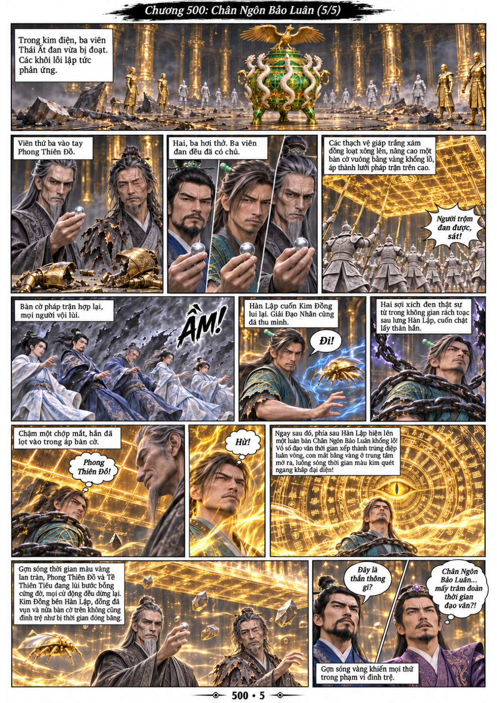

# Chương 500: Hỗn chiến

5 trang PNG riêng, tỉ lệ A4 dọc; chuyển thể từ văn bản người dùng đính kèm, có thoại, suy nghĩ và lời dẫn. Dùng model tham chiếu trong bộ nhớ dự án.

[PDF A4](chuong-500.pdf) · [Văn bản nguồn](SOURCE.txt)

Đan kiếp qua, ba viên Thái Ất đan ra lò giữa cuộc tranh đoạt của các phe. Hàn Lập giành một viên nhờ Kim Đồng và Giải Đạo Nhân, rồi bị Phong Thiên Đô ám toán khi thạch khôi lỗi hợp trận.

