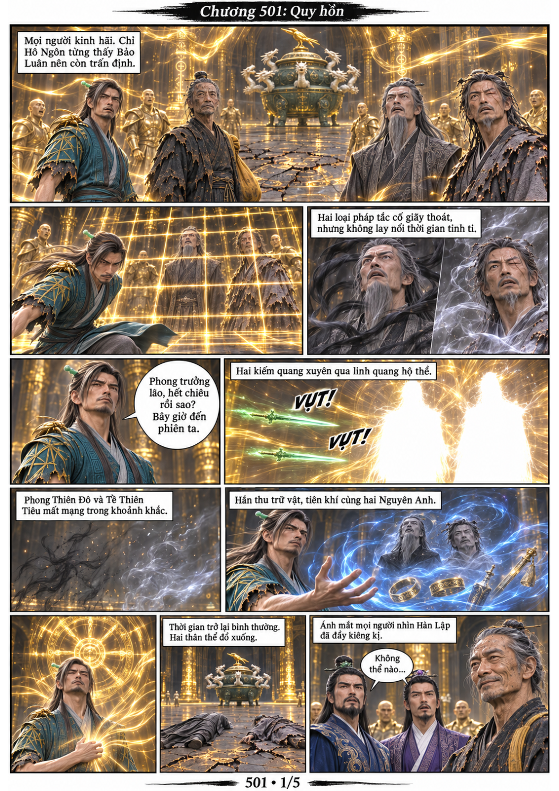
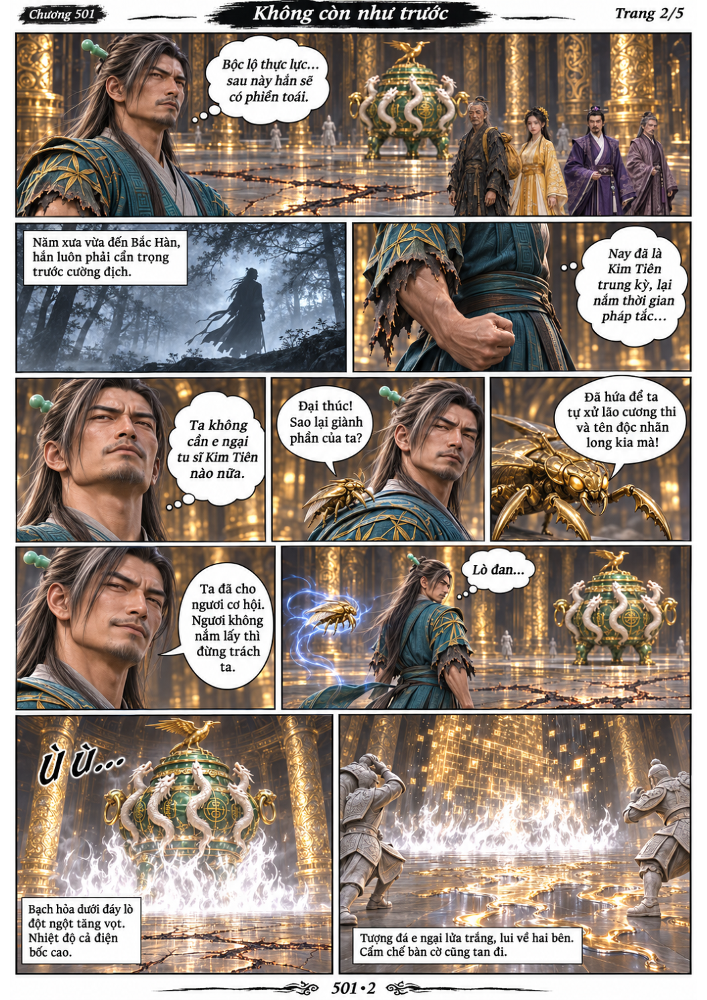
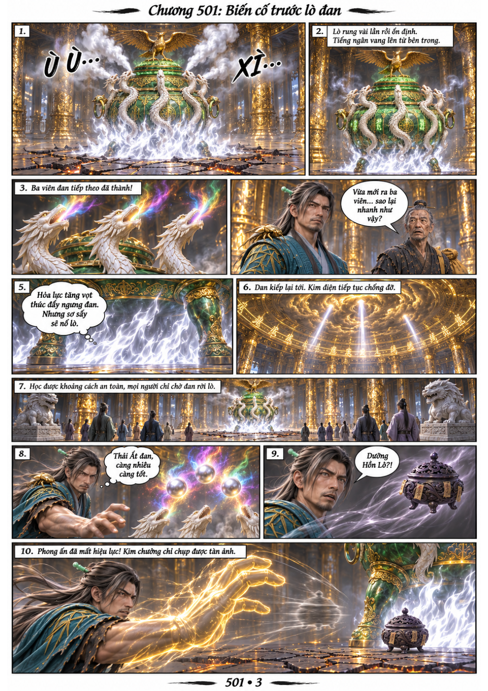
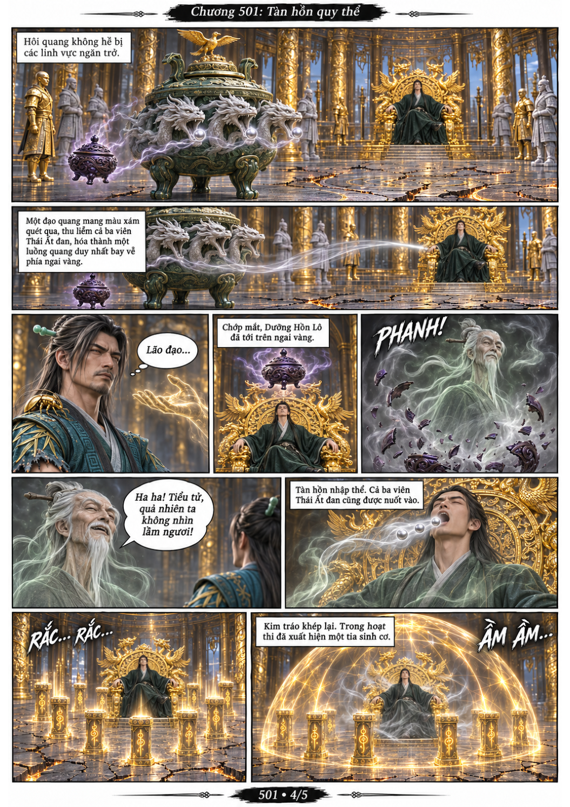
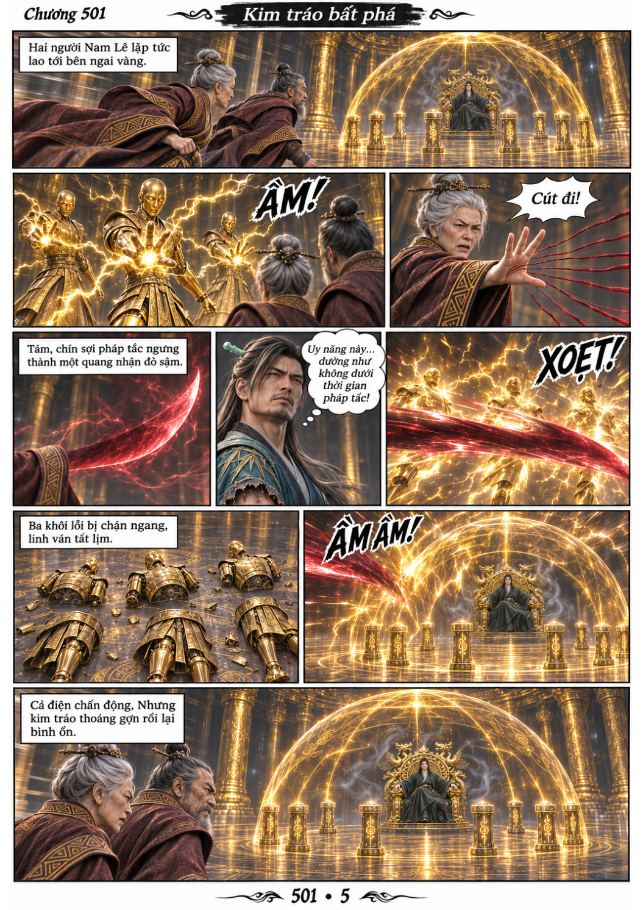

# Chương 501: Quy hồn

5 trang PNG riêng, tỉ lệ A4 dọc; chuyển thể từ văn bản người dùng đính kèm, có thoại, suy nghĩ và lời dẫn. Dùng model tham chiếu trong bộ nhớ dự án.

[PDF A4](chuong-501.pdf) · [Văn bản nguồn](SOURCE.txt)

Hàn Lập hạ Phong Thiên Đô và Tề Thiên Tiêu khi thời gian đình trệ. Đan lô bất ngờ tăng hỏa lực; tàn hồn thoát Dưỡng Hồn Lô, đoạt ba viên Thái Ất đan và nhập vào hoạt thi dưới màn bảo vệ chín trụ.

