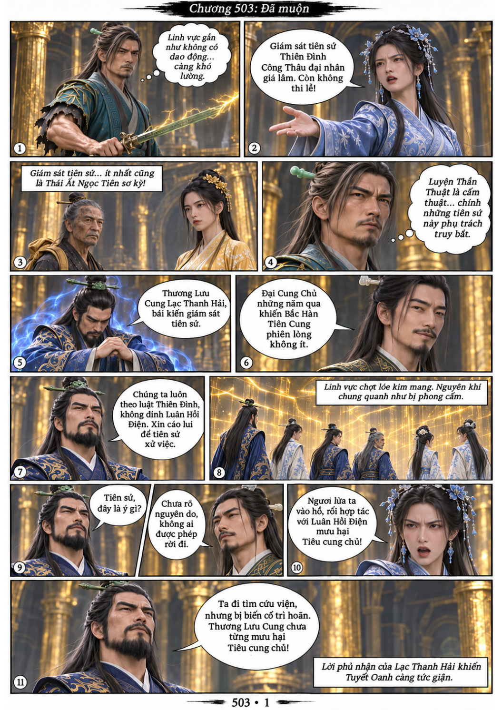
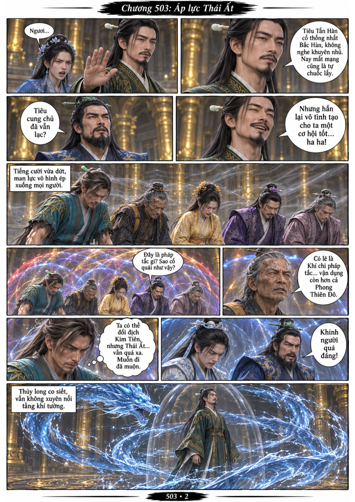
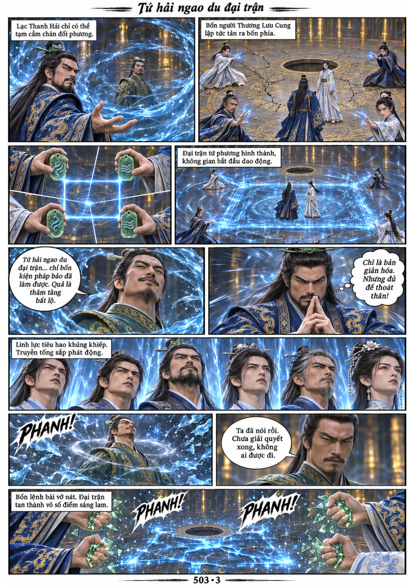
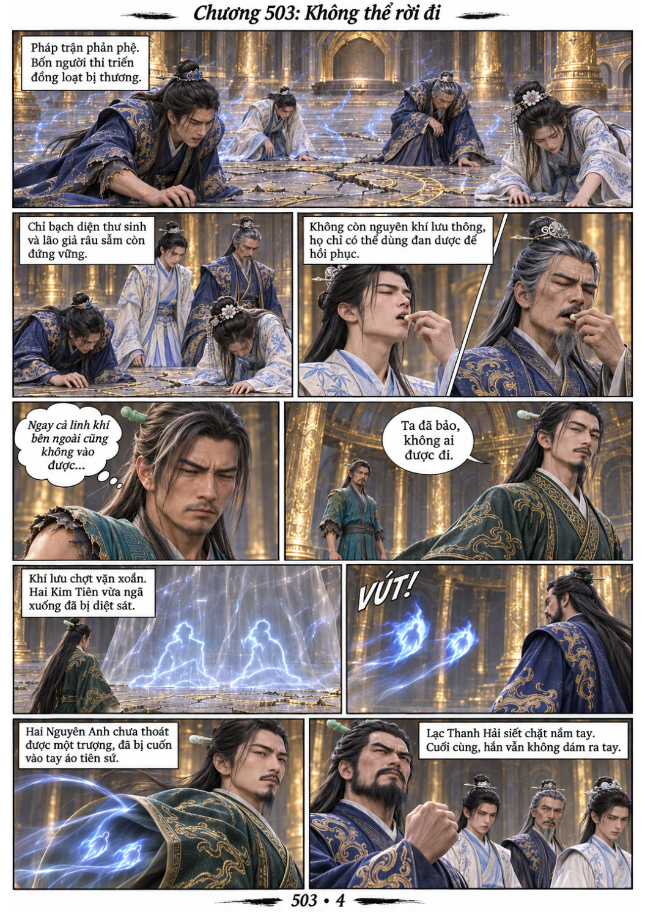

# Chương 503: Đã muộn

4 trang PNG riêng, tỉ lệ A4 dọc; chuyển thể từ văn bản người dùng đính kèm, có thoại, suy nghĩ và lời dẫn. Dùng model tham chiếu trong bộ nhớ dự án.

[PDF A4](chuong-503.pdf) · [Văn bản nguồn](SOURCE.txt)

Công Thâu Cửu phong cấm nguyên khí và không cho ai rời điện. Lạc Thanh Hải thử dùng thủy pháp cầm chân tiên sứ để lập trận truyền tống, nhưng kế hoạch bị phá và hai Kim Tiên bị diệt sát.

