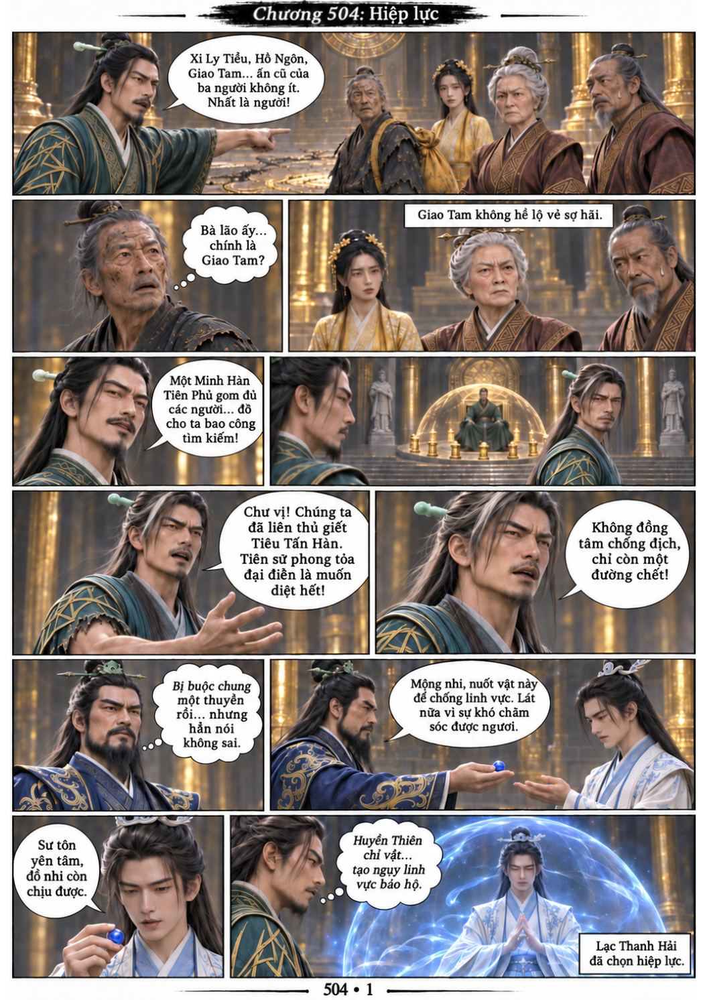
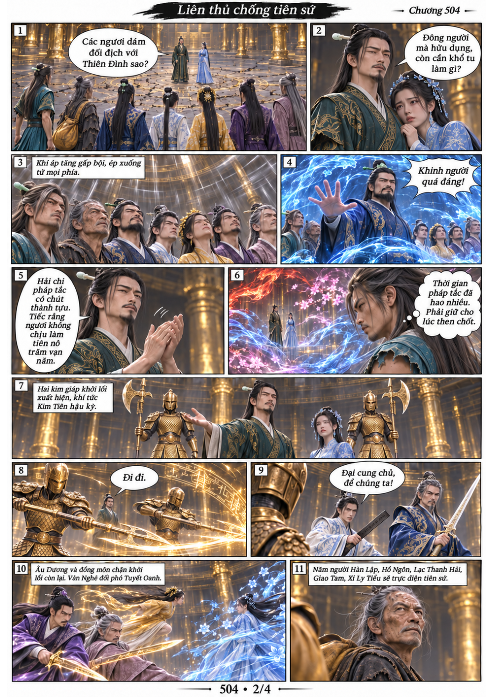
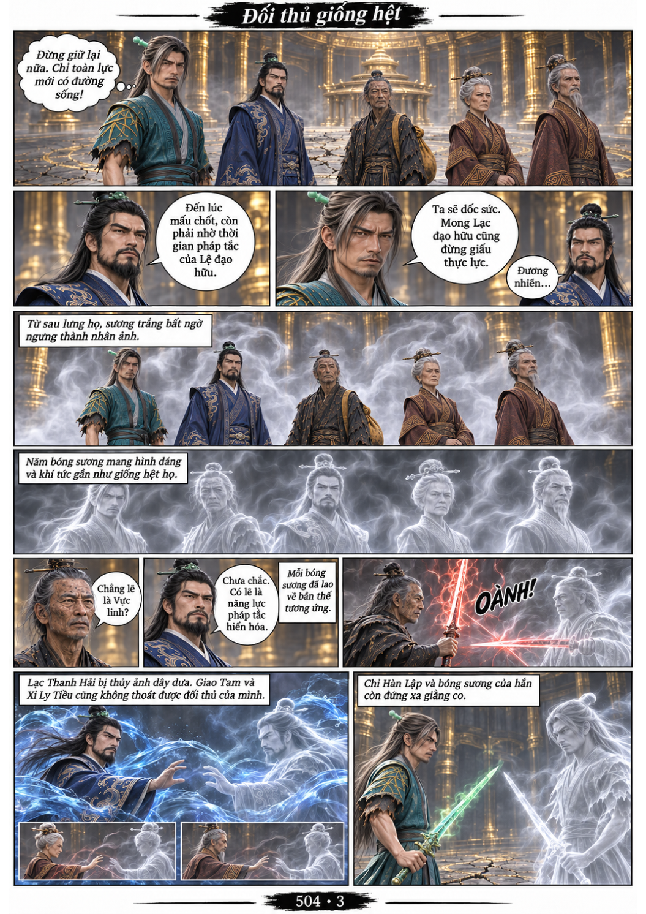
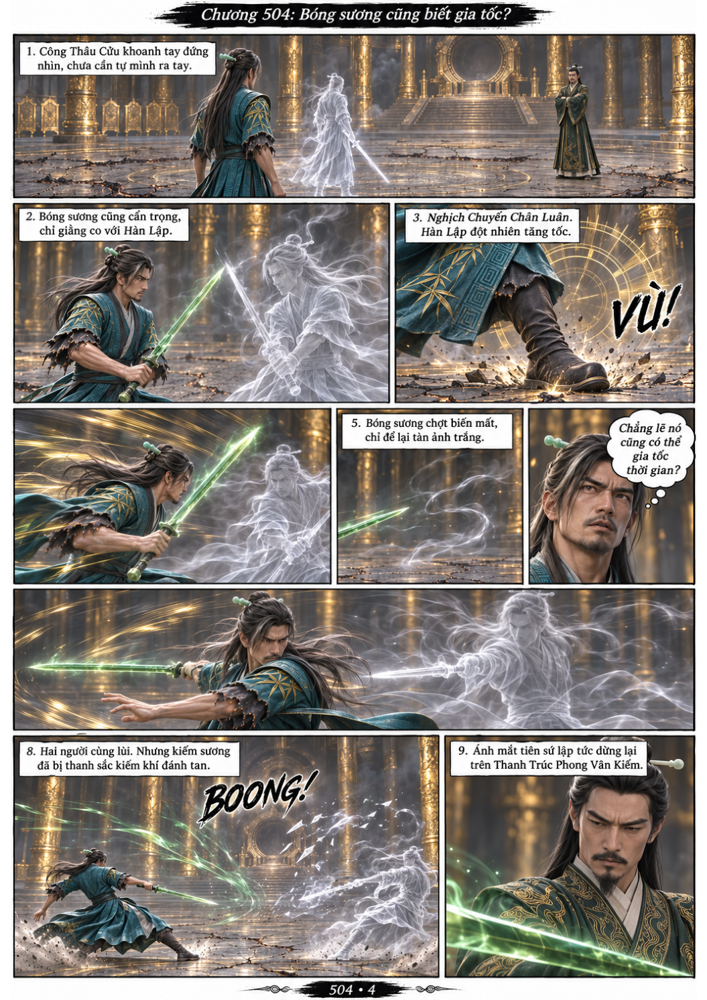

# Chương 504: Hiệp lực

4 trang PNG riêng, tỉ lệ A4 dọc; chuyển thể từ văn bản người dùng đính kèm, có thoại, suy nghĩ và lời dẫn. Dùng model tham chiếu trong bộ nhớ dự án.

[PDF A4](chuong-504.pdf) · [Văn bản nguồn](SOURCE.txt)

Hàn Lập kêu gọi các phe hiệp lực trước Công Thâu Cửu. Tiên sứ thả hai khôi lỗi kim giáp và tạo năm bóng sương mô phỏng đối thủ. Hàn Lập giao kiếm với bóng sương của mình, khiến Công Thâu Cửu chú ý đến pháp bảo của hắn.

