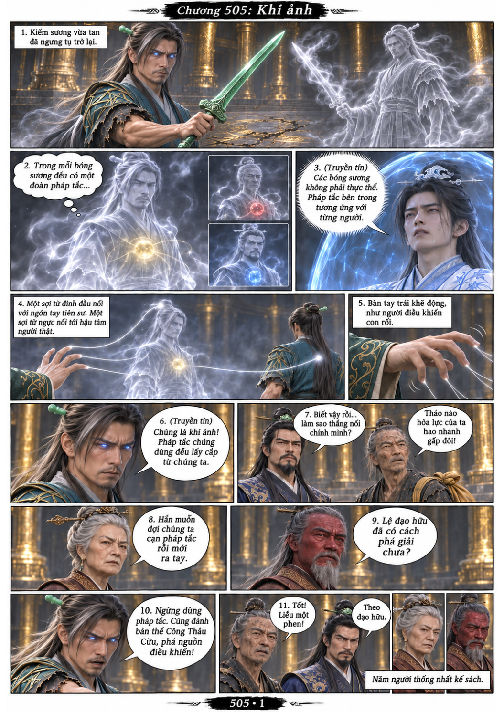
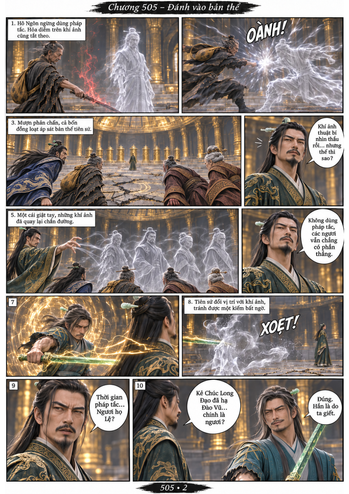
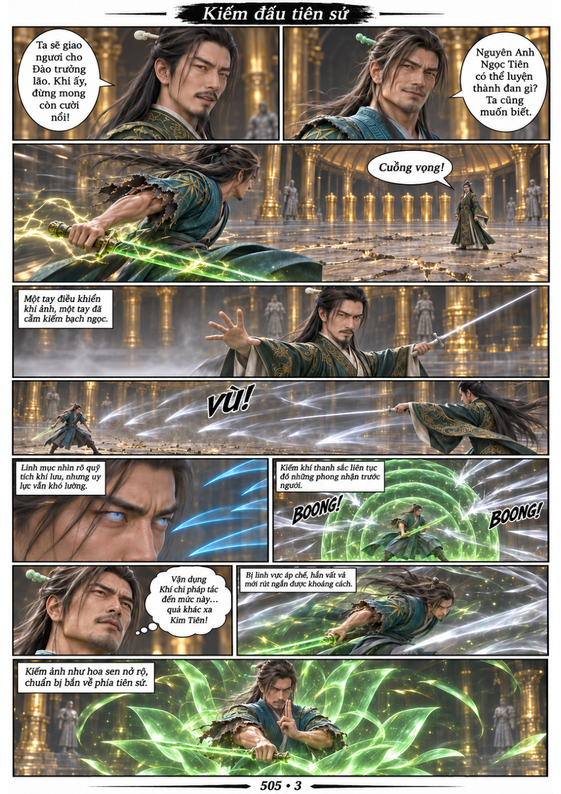
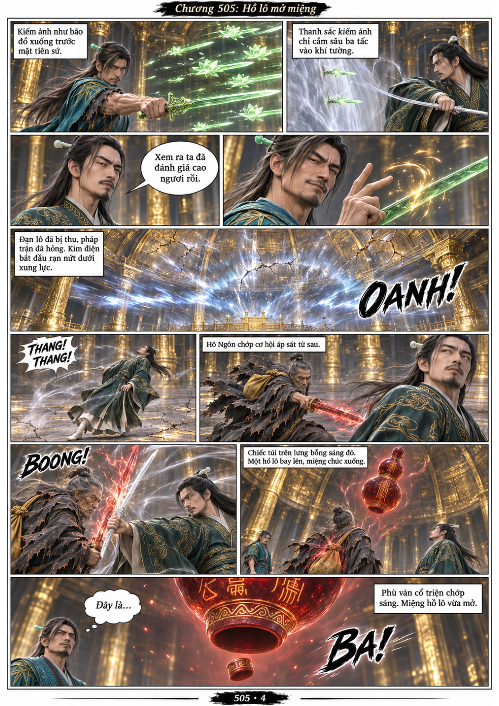

# Chương 505: Khí ảnh

4 trang PNG riêng, tỉ lệ A4 dọc; chuyển thể từ văn bản người dùng đính kèm, có thoại, suy nghĩ và lời dẫn. Dùng model tham chiếu trong bộ nhớ dự án.

[PDF A4](chuong-505.pdf) · [Văn bản nguồn](SOURCE.txt)

Nam Kha Mộng nhìn ra dây liên kết của khí ảnh, giúp Hàn Lập nhận ra chúng đang đánh cắp pháp tắc. Cả nhóm đổi cách đánh; Hàn Lập tấn công bản thể tiên sứ, phối hợp với Hô Ngôn để mở miệng hồ lô đỏ.

