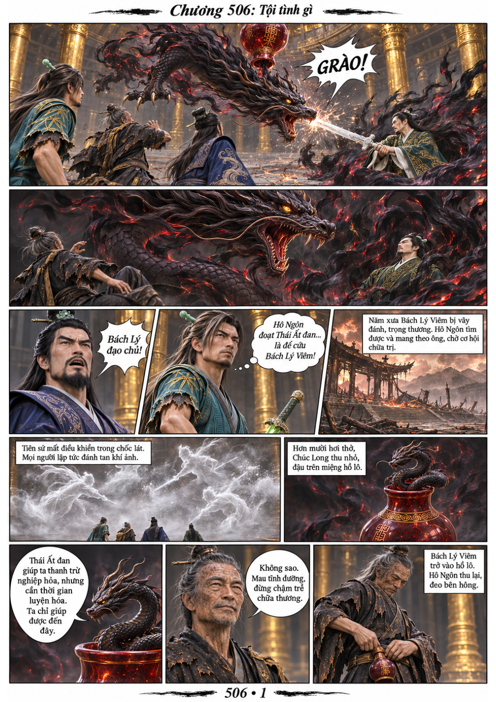
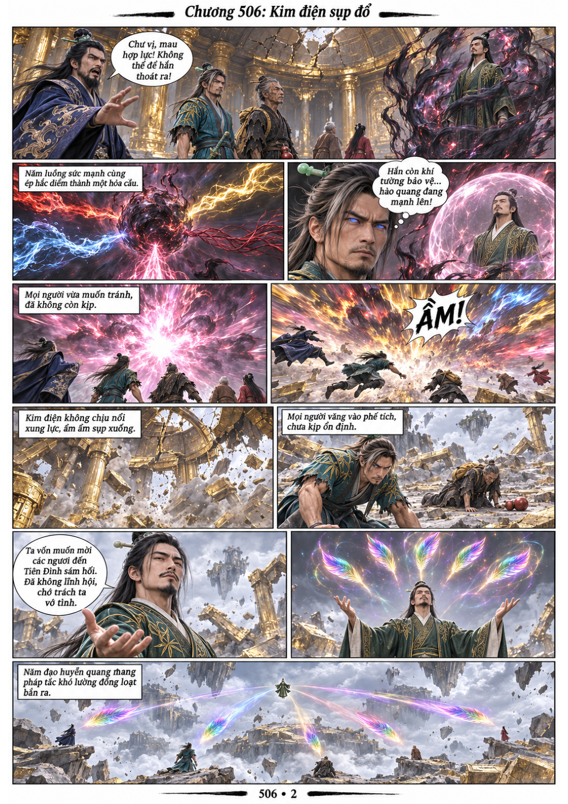
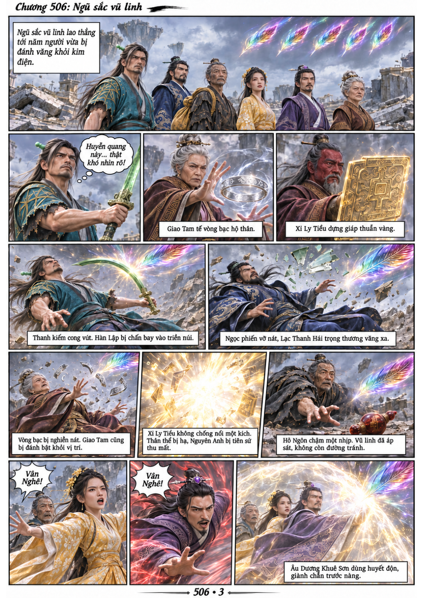
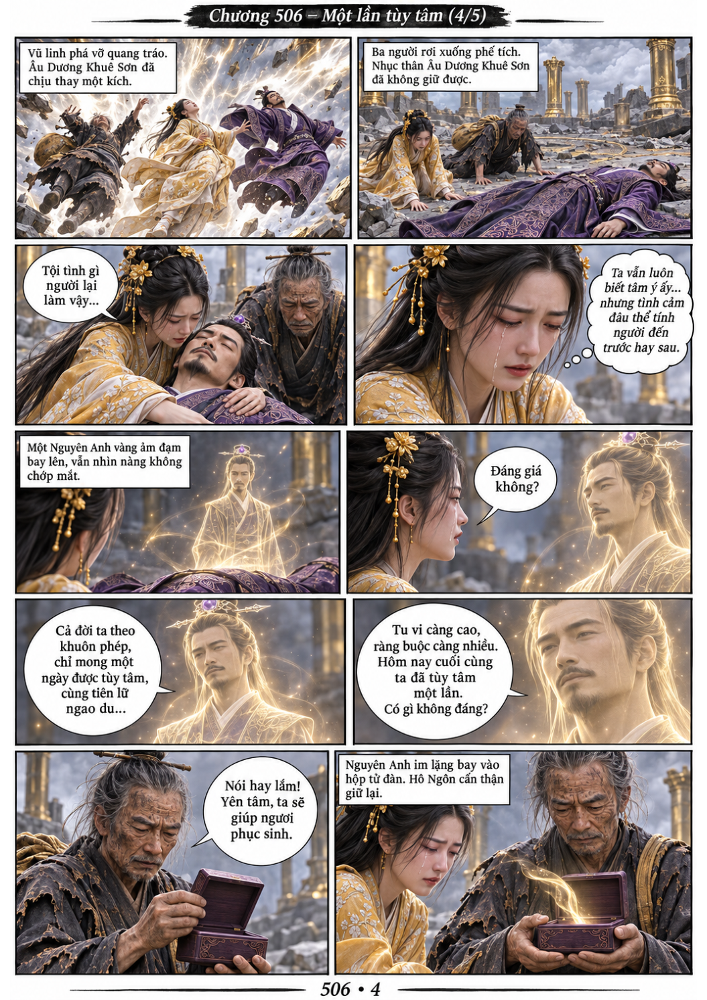
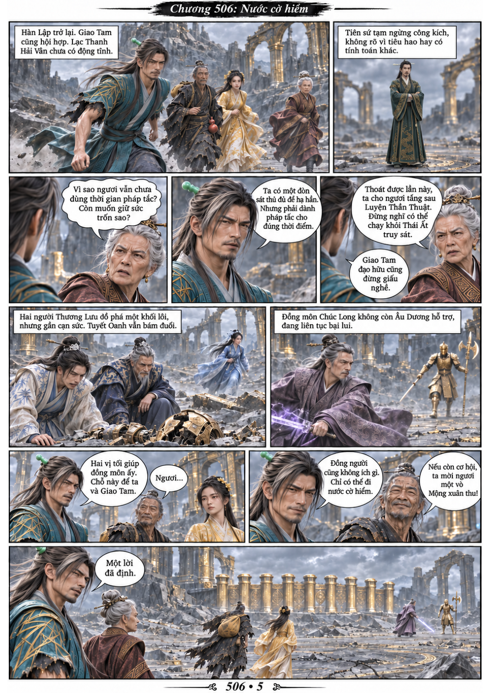

# Chương 506: Tội tình gì

5 trang PNG riêng, tỉ lệ A4 dọc; chuyển thể từ văn bản người dùng đính kèm, có thoại, suy nghĩ và lời dẫn. Dùng model tham chiếu trong bộ nhớ dự án.

[PDF A4](chuong-506.pdf) · [Văn bản nguồn](SOURCE.txt)

Bách Lý Viêm từ hồ lô hiện thân trợ giúp, nhưng Công Thâu Cửu vẫn phá vòng vây và đánh sập kim điện. Xi Ly Tiều bị hạ; Âu Dương Khuê Sơn hy sinh thân thể để che chở Vân Nghê. Hàn Lập cùng Giao Tam quyết định đối phó tiên sứ bằng một nước cờ hiểm.

