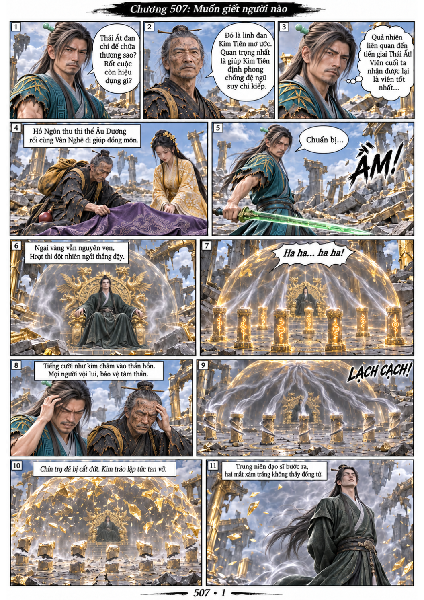
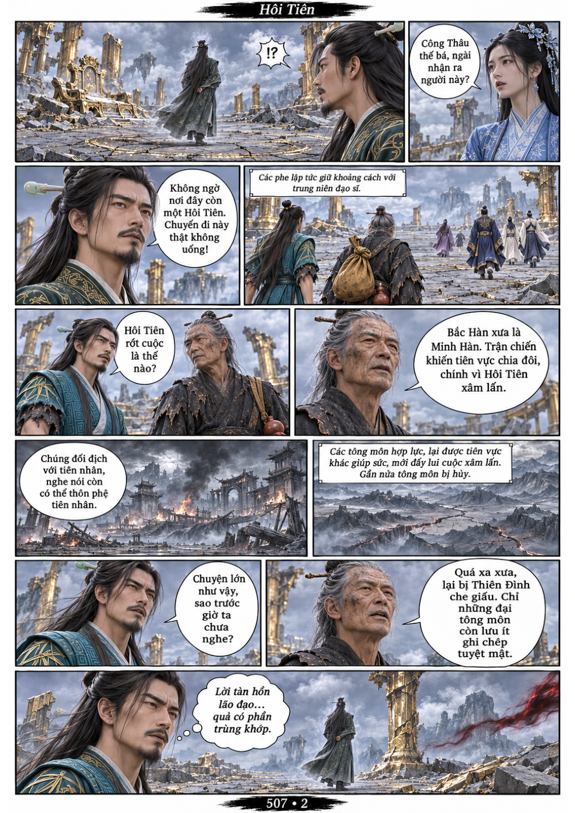
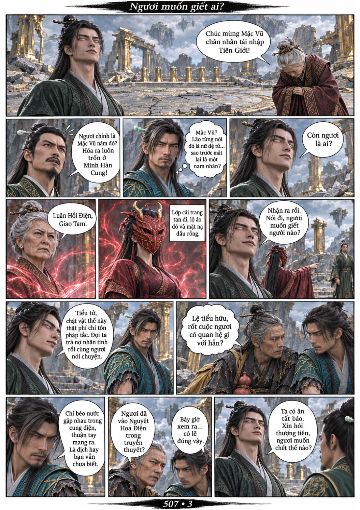
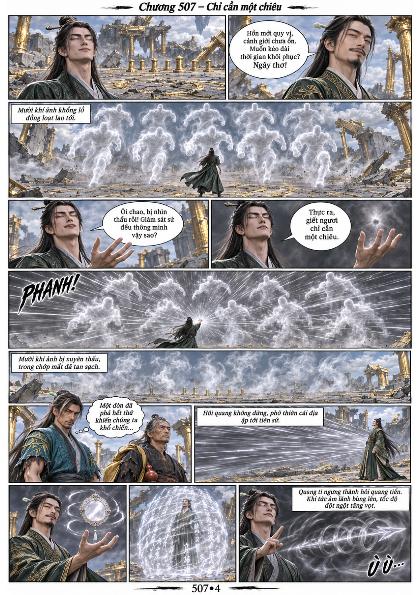

# Chương 507: Muốn giết người nào

4 trang PNG riêng, tỉ lệ A4 dọc; chuyển thể từ văn bản người dùng đính kèm, có thoại, suy nghĩ và lời dẫn. Dùng model tham chiếu trong bộ nhớ dự án.

[PDF A4](chuong-507.pdf) · [Văn bản nguồn](SOURCE.txt)

Người trên ngai thức dậy, được xác nhận là Hôi Tiên Mặc Vũ. Giao Tam giải trừ cải trang và nhờ Mặc Vũ đối phó Công Thâu Cửu. Hôi quang của Mặc Vũ phá tan mười khí ảnh rồi hóa thành mũi tên lao tới tiên sứ.

