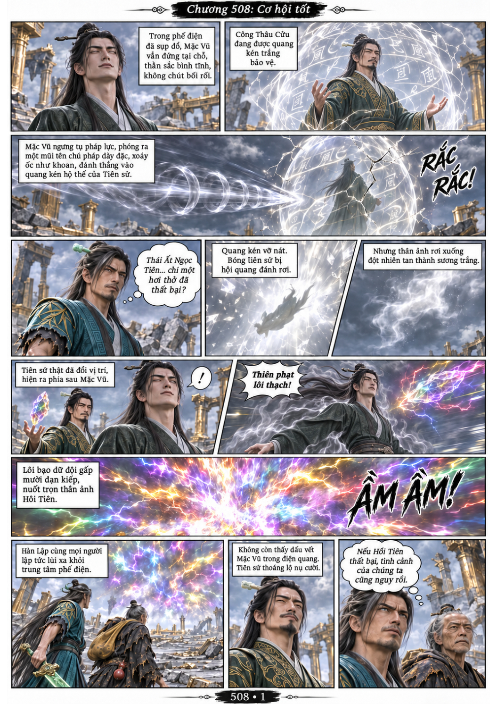
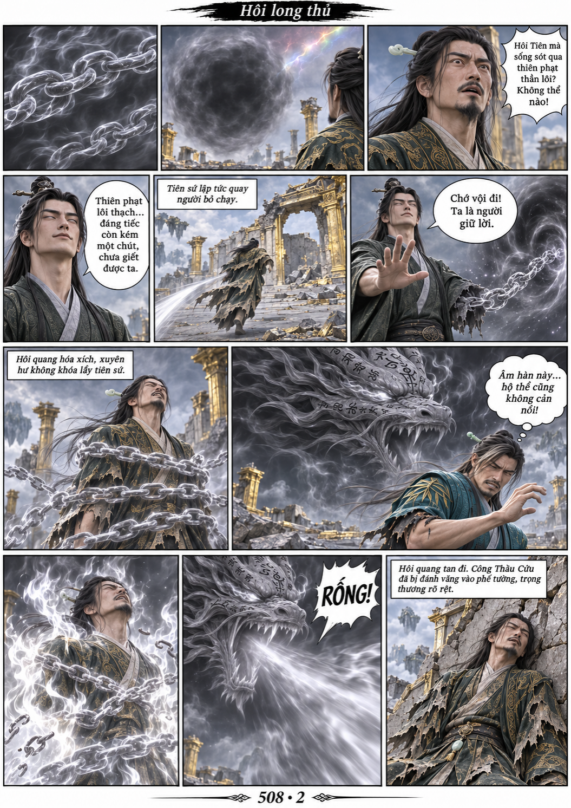
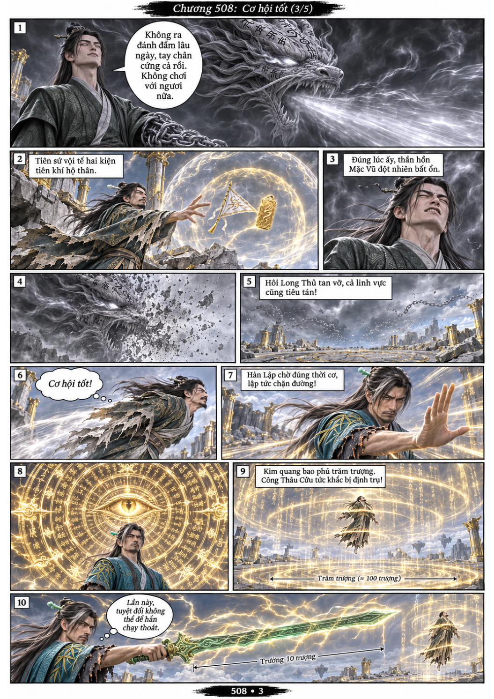
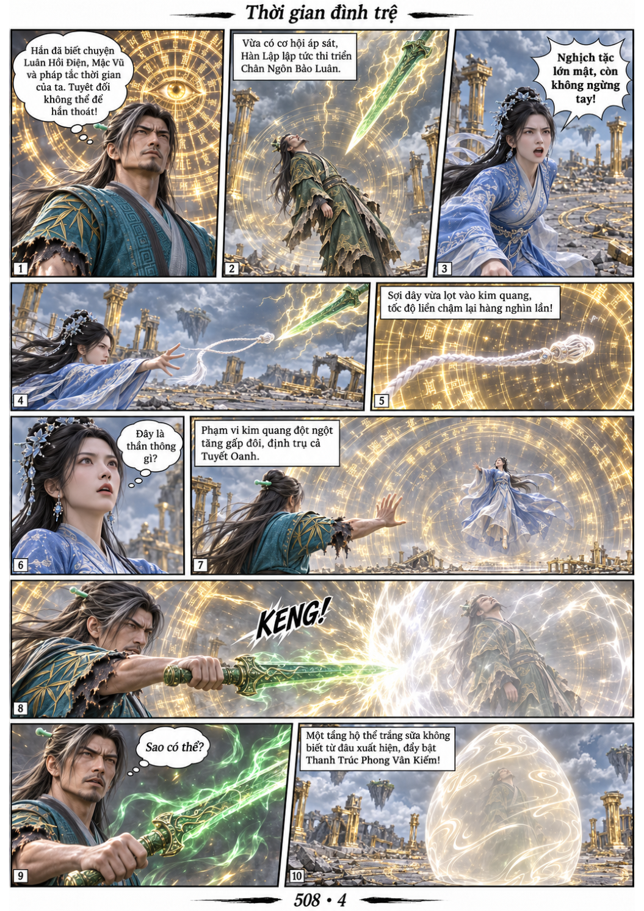
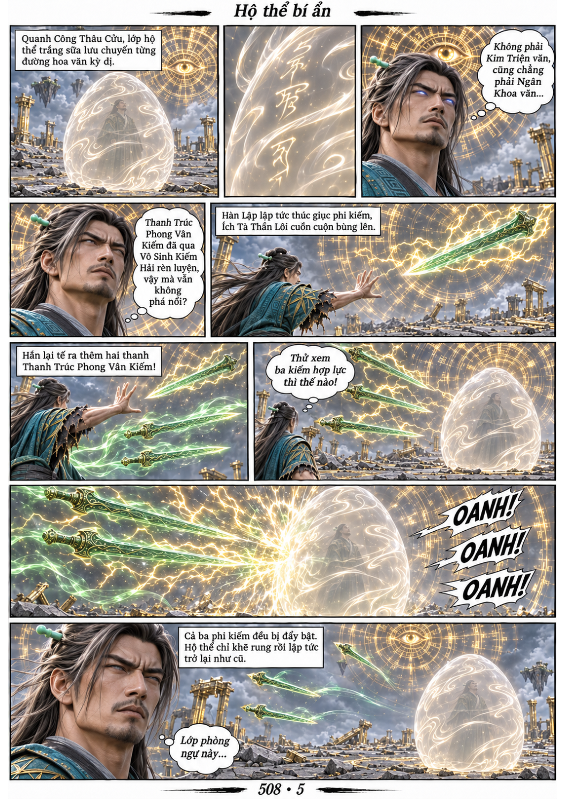

# Chương 508: Cơ hội tốt

5 trang PNG riêng, tỉ lệ A4 dọc; chuyển thể từ văn bản người dùng đính kèm, có thoại, suy nghĩ và lời dẫn. Dùng model tham chiếu trong bộ nhớ dự án.

[PDF A4](chuong-508.pdf) · [Văn bản nguồn](SOURCE.txt)

Mặc Vũ chống Thiên Phạt Lôi Thạch, dùng Hôi Long Thủ đánh trọng thương Công Thâu Cửu. Khi thần hồn Mặc Vũ bất ổn, Hàn Lập chặn tiên sứ, định trụ cả Tuyết Oanh. Lớp hộ thể trắng sữa bí ẩn vẫn cản được ba Thanh Trúc Phong Vân Kiếm.

