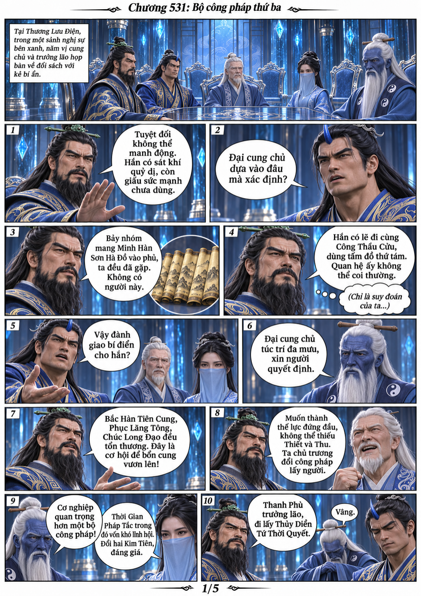
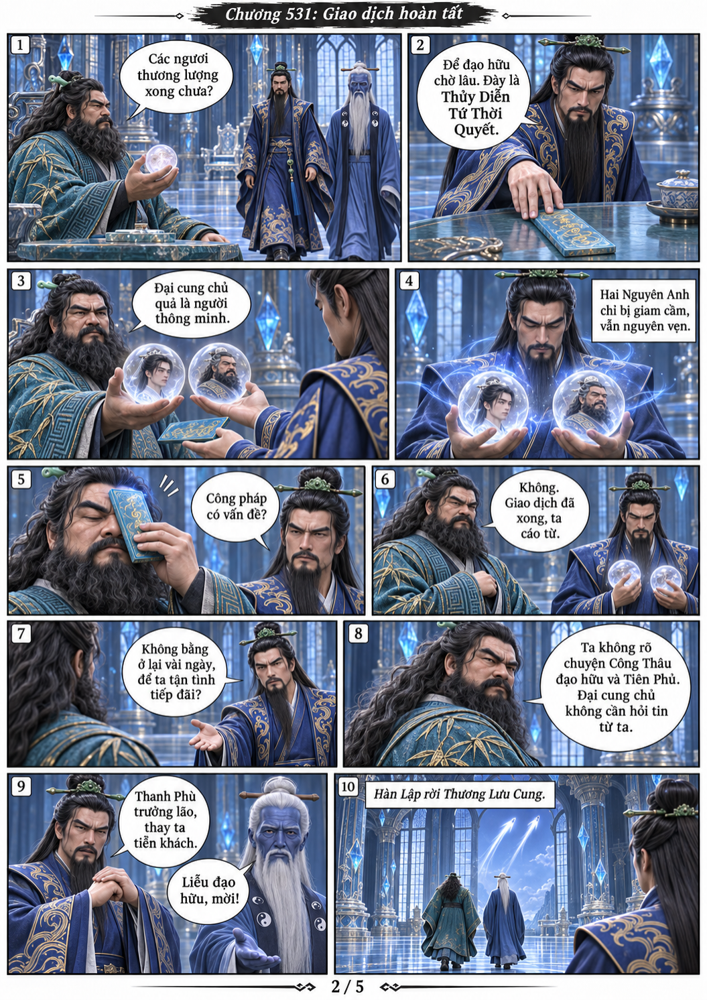
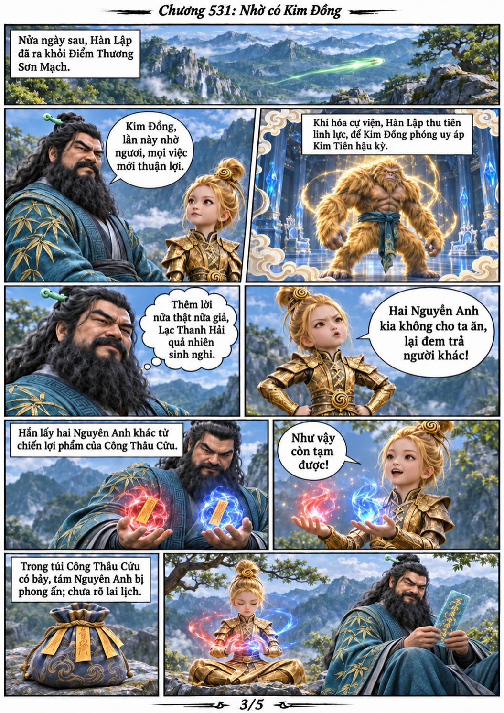
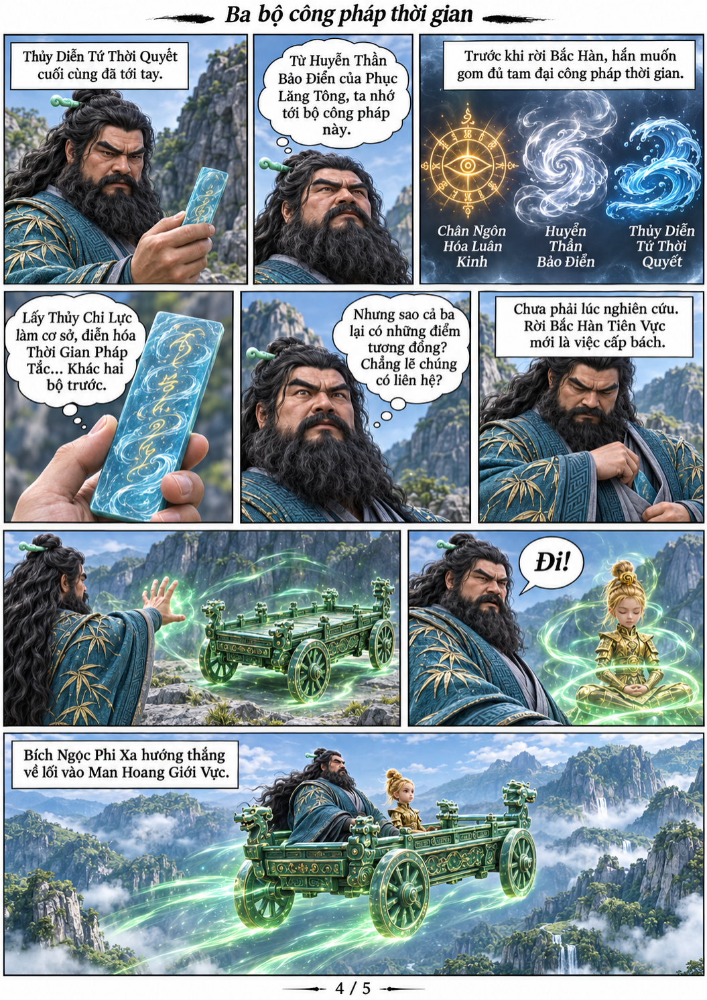
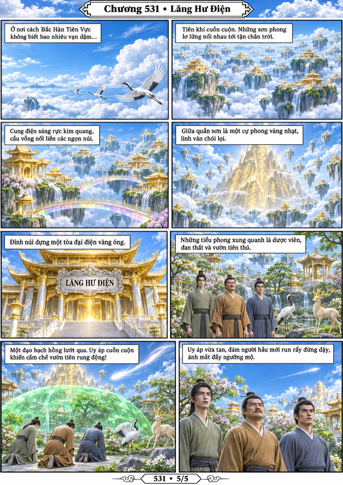

# Chương 531: Bộ công pháp thứ ba

5 trang PNG riêng, tỉ lệ A4 dọc; chuyển thể từ văn bản người dùng đính kèm, có thoại, suy nghĩ và lời dẫn. Dùng model tham chiếu trong bộ nhớ dự án.

[PDF A4](chuong-531.pdf) · [Văn bản nguồn](SOURCE.txt)

Lạc Thanh Hải chấp nhận đổi bí điển lấy hai Nguyên Anh. Hàn Lập rời cung, cảm ơn Kim Đồng, suy ngẫm quan hệ giữa ba bộ công pháp và lên đường tới Man Hoang. Cuối chương chuyển sang Lăng Hư Điện trên quần sơn lơ lửng.

