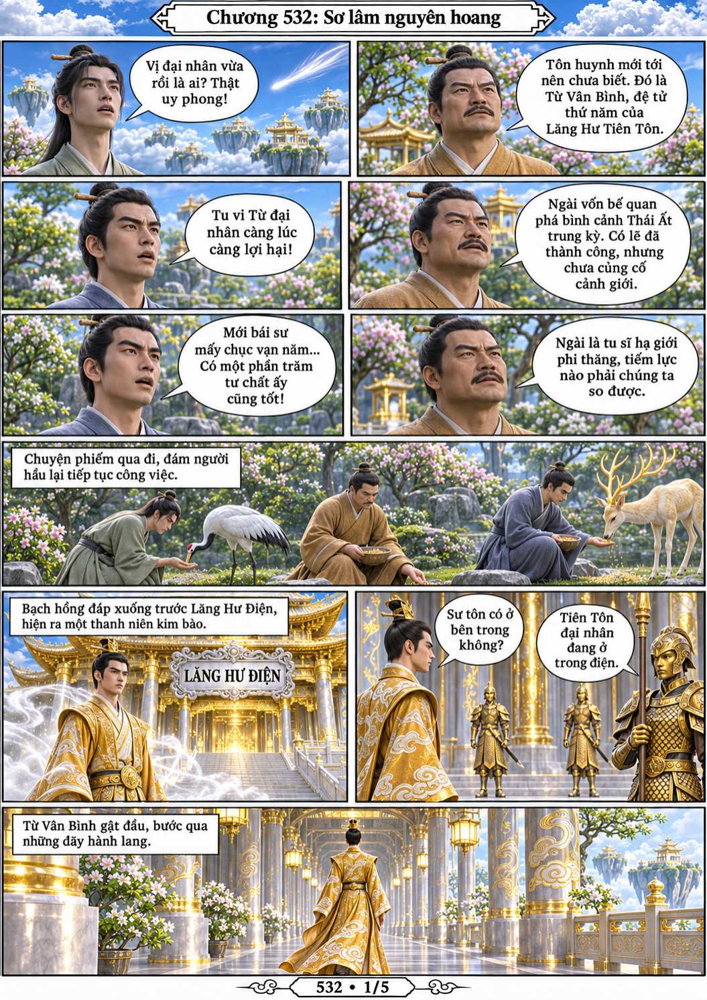
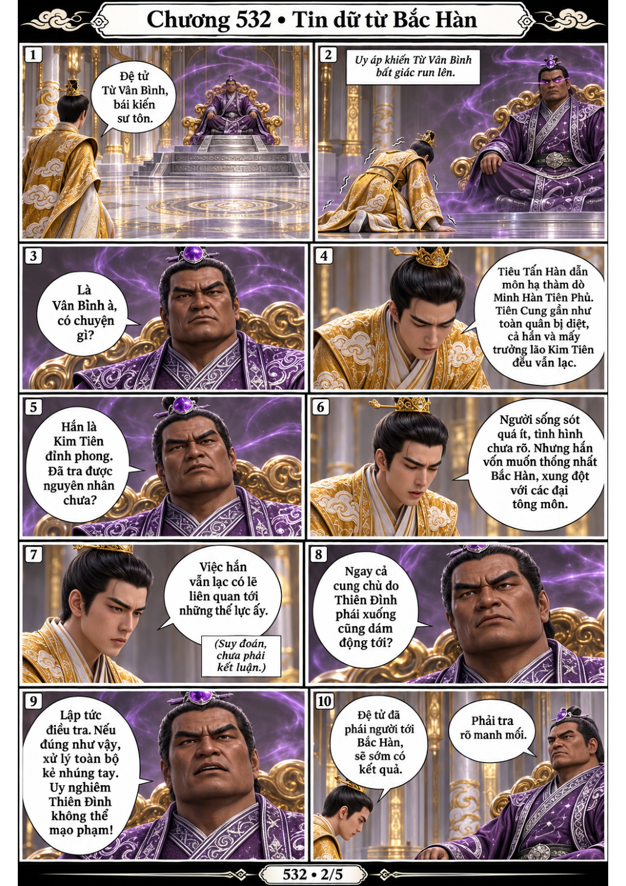
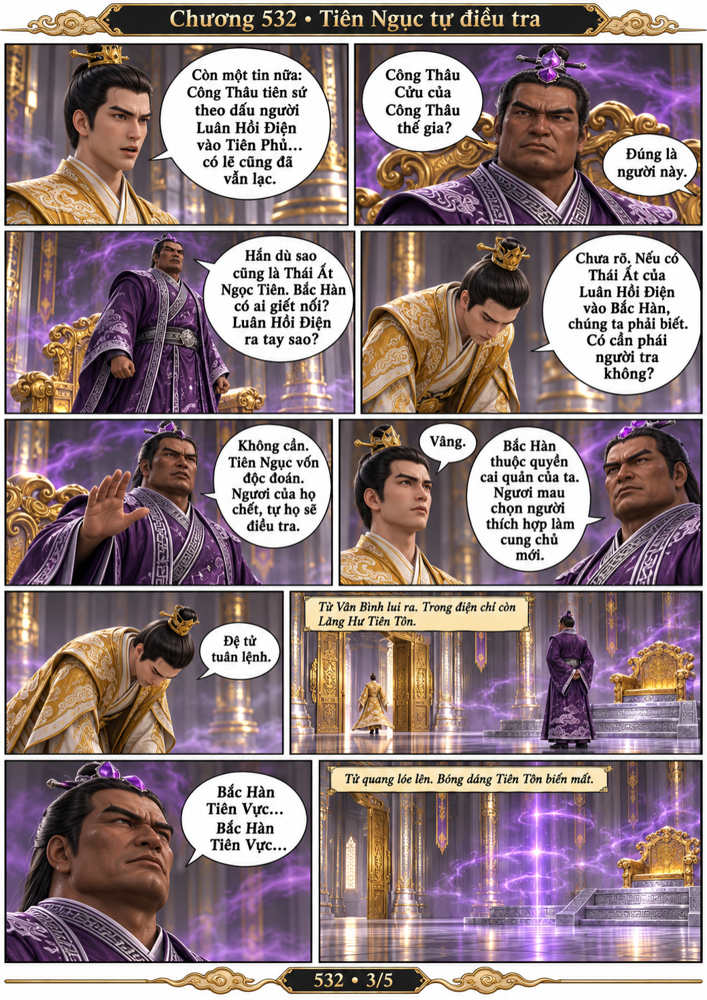
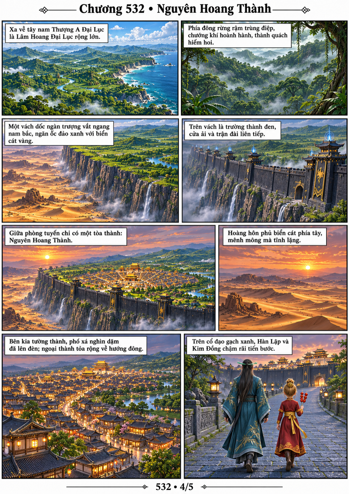
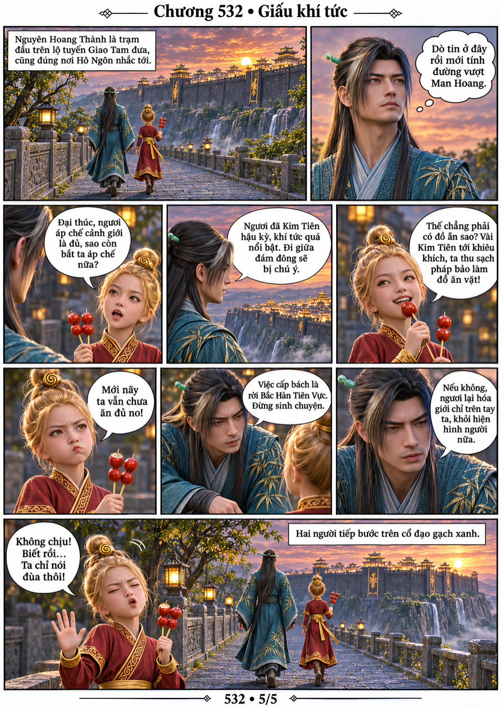

# Chương 532: Sơ lâm nguyên hoang

5 trang PNG riêng, tỉ lệ A4 dọc; chuyển thể từ văn bản người dùng đính kèm, có thoại, suy nghĩ và lời dẫn. Dùng model tham chiếu trong bộ nhớ dự án.

[PDF A4](chuong-532.pdf) · [Văn bản nguồn](SOURCE.txt)

Từ Vân Bình báo tin tử nạn tại Minh Hàn Tiên Phủ; Lăng Hư Tiên Tôn lệnh điều tra Bắc Hàn, để Tiên Ngục tự xử lý chuyện Công Thâu Cửu. Chuyển cảnh tới Nguyên Hoang Thành, Hàn Lập dặn Kim Đồng giấu khí tức để sớm vượt Man Hoang.

