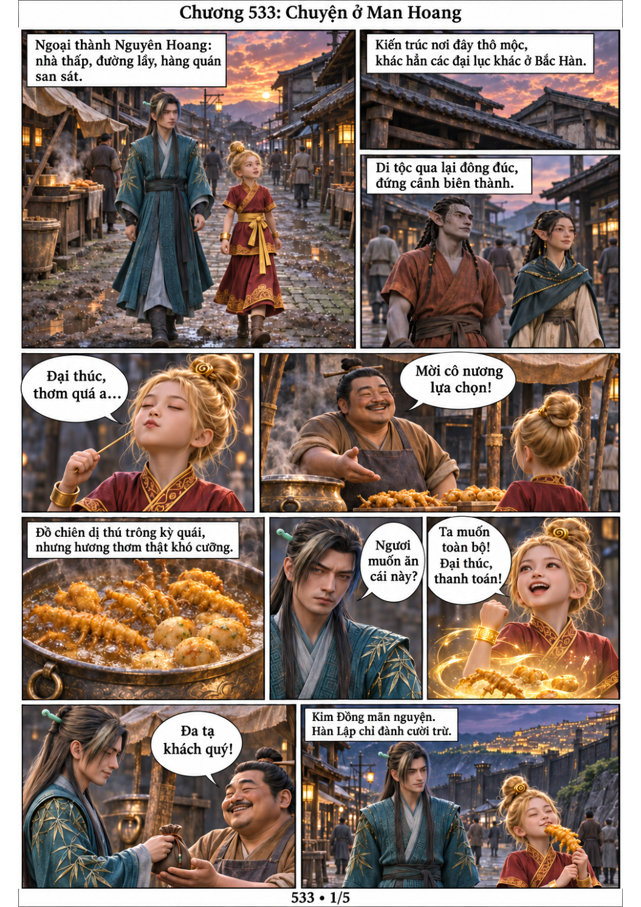
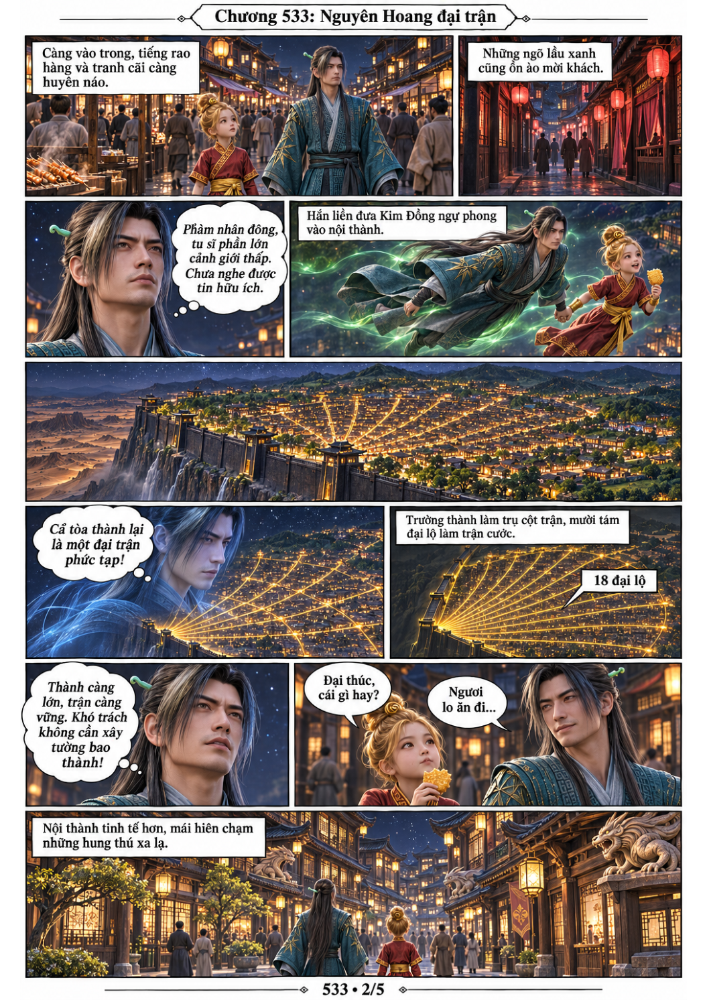
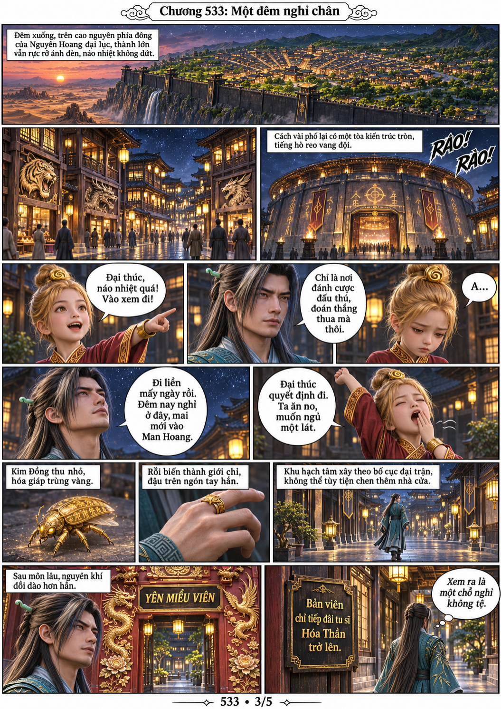
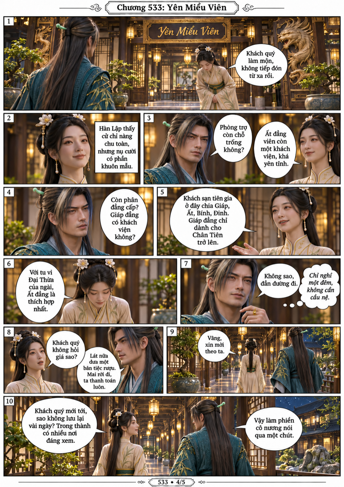
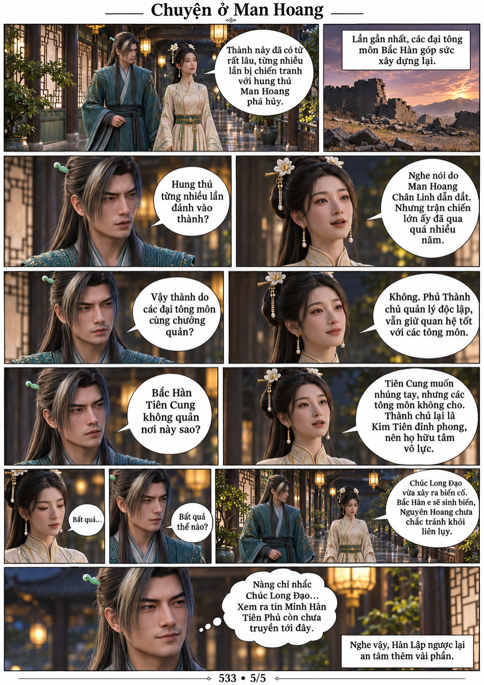

# Chương 533: Chuyện ở Man Hoang

5 trang PNG riêng, tỉ lệ A4 dọc; chuyển thể từ văn bản người dùng đính kèm, có thoại, suy nghĩ và lời dẫn. Dùng model tham chiếu trong bộ nhớ dự án.

[PDF A4](chuong-533.pdf) · [Văn bản nguồn](SOURCE.txt)

Kim Đồng mua đồ chiên ở ngoại thành. Hàn Lập nhìn ra đại trận dùng trường thành và mười tám đại lộ, tới Yên Miểu Viên nghỉ chân khi Kim Đồng hóa nhẫn. Qua nữ tu đón khách, hắn biết lịch sử thú triều, vai trò Phủ Thành chủ và tin Tiên Phủ chưa truyền tới đây.

