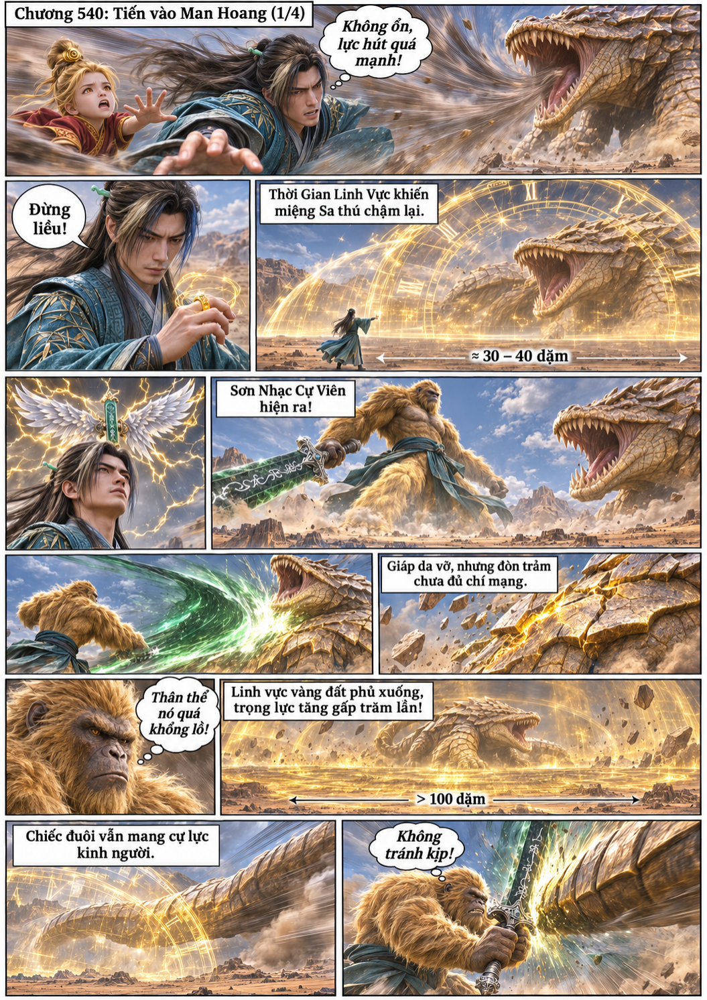
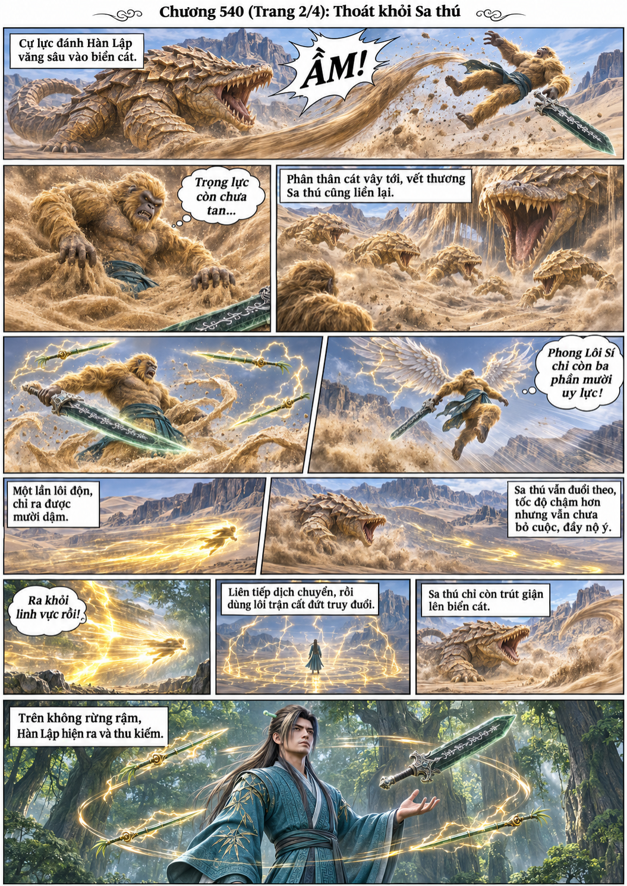
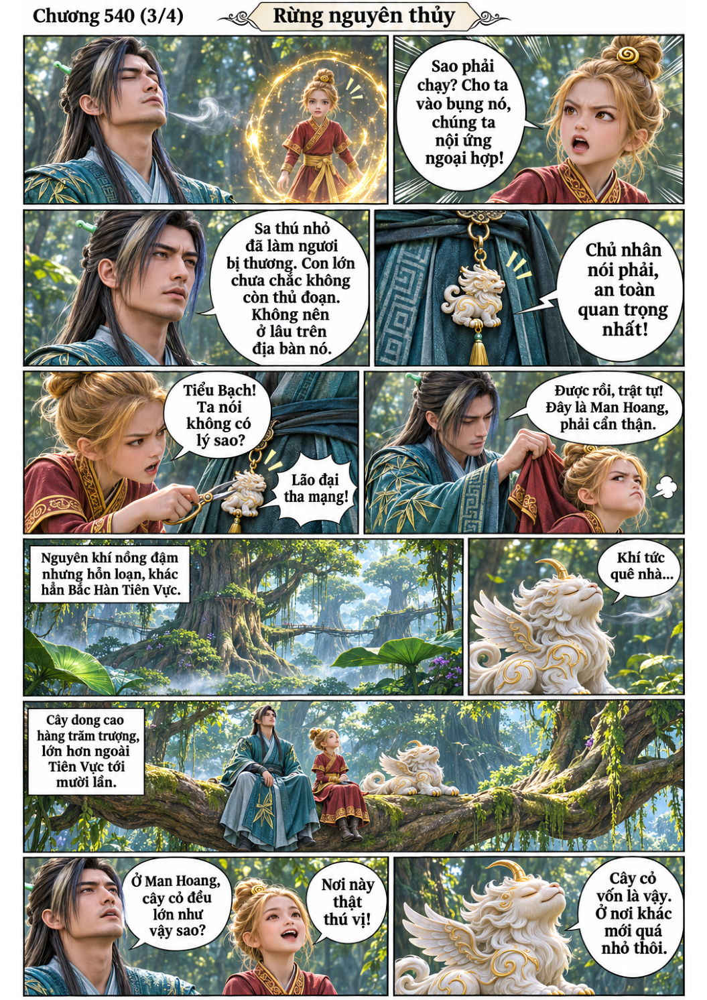
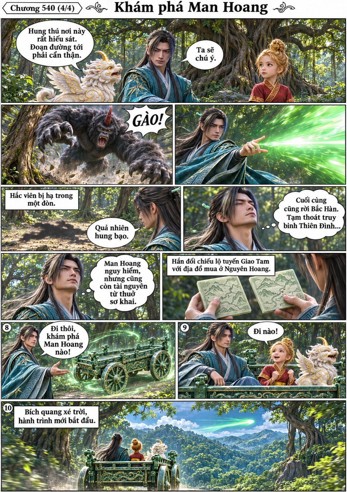

# Chương 540: Tiến vào Man Hoang

4 trang PNG riêng, tỉ lệ A4 dọc; chuyển thể từ văn bản người dùng đính kèm, có thoại, suy nghĩ và lời dẫn. Dùng model tham chiếu trong bộ nhớ dự án.

[PDF A4](chuong-540.pdf) · [Văn bản nguồn](SOURCE.txt)

Hàn Lập đối đầu Sa thú, dùng linh vực thời gian, cự viên và lôi độn để thoát thân. Sang rừng nguyên thủy, hắn cảnh báo Kim Đồng, gặp cây cối khổng lồ, hạ hắc viên rồi cùng Tiểu Bạch lên đường.

