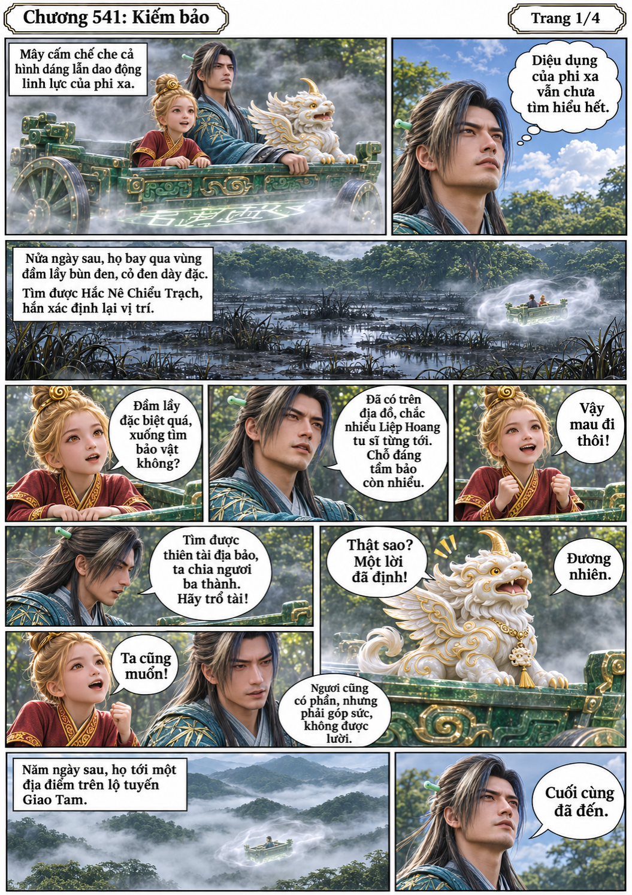
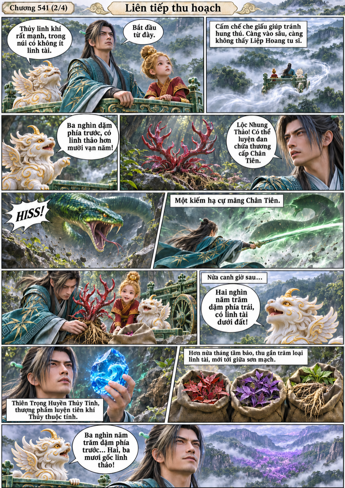
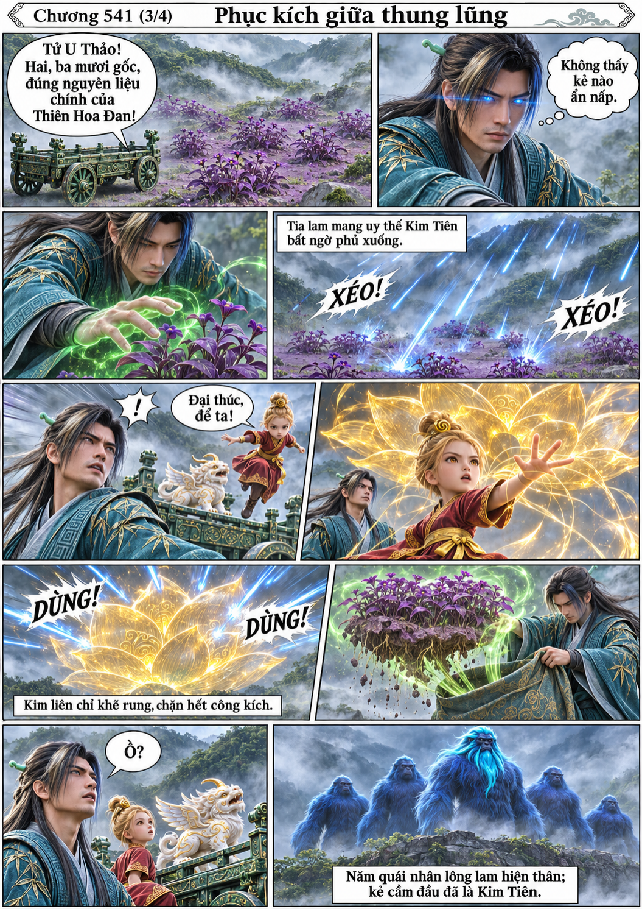
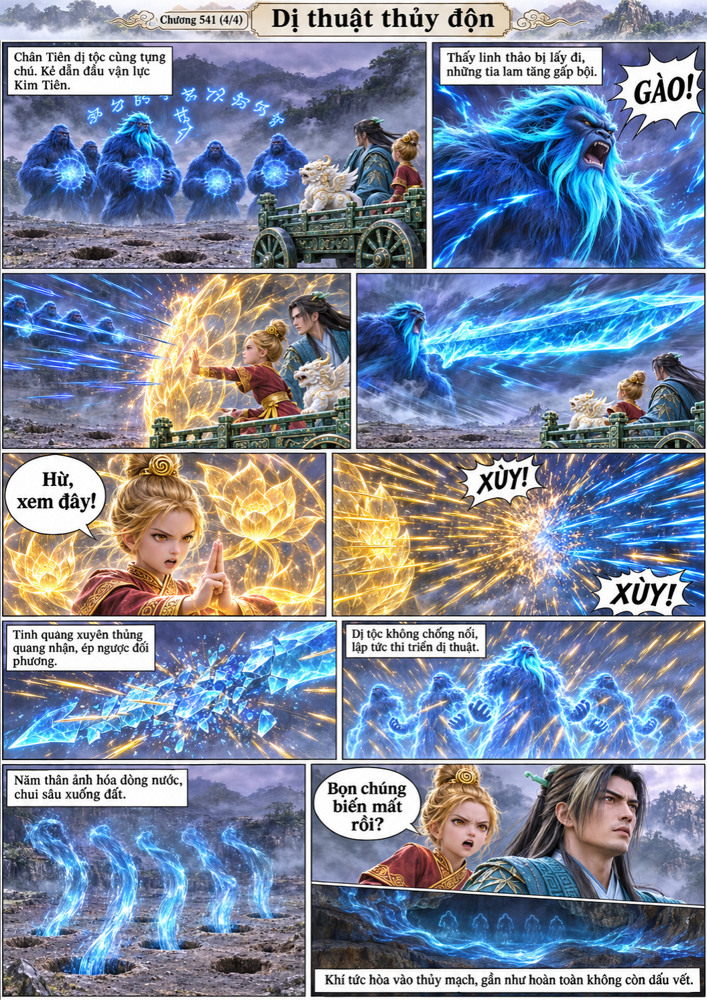

# Chương 541: Kiếm bảo

4 trang PNG riêng, tỉ lệ A4 dọc; chuyển thể từ văn bản người dùng đính kèm, có thoại, suy nghĩ và lời dẫn. Dùng model tham chiếu trong bộ nhớ dự án.

[PDF A4](chuong-541.pdf) · [Văn bản nguồn](SOURCE.txt)

Phi xa ẩn nặc đưa ba người qua Hắc Nê Chiểu Trạch đến vụ hải. Tiểu Bạch dò bảo, Hàn thu linh thảo và thủy tinh. Khi lấy Tử U Thảo, họ bị dị tộc lông lam phục kích; Kim Đồng phản kích khiến cả nhóm hóa nước bỏ trốn.

