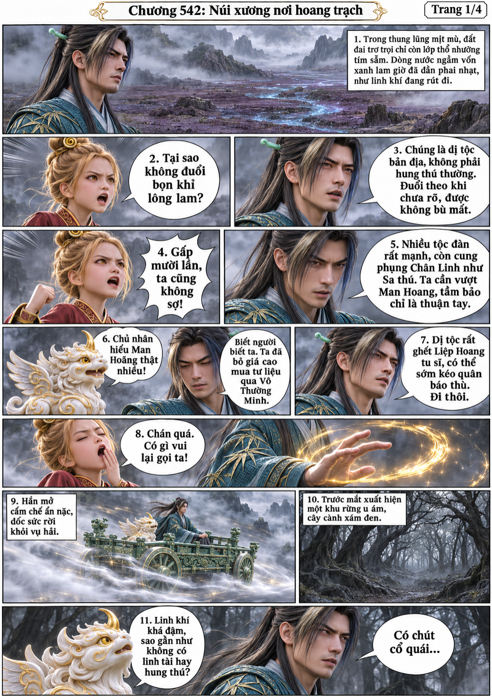
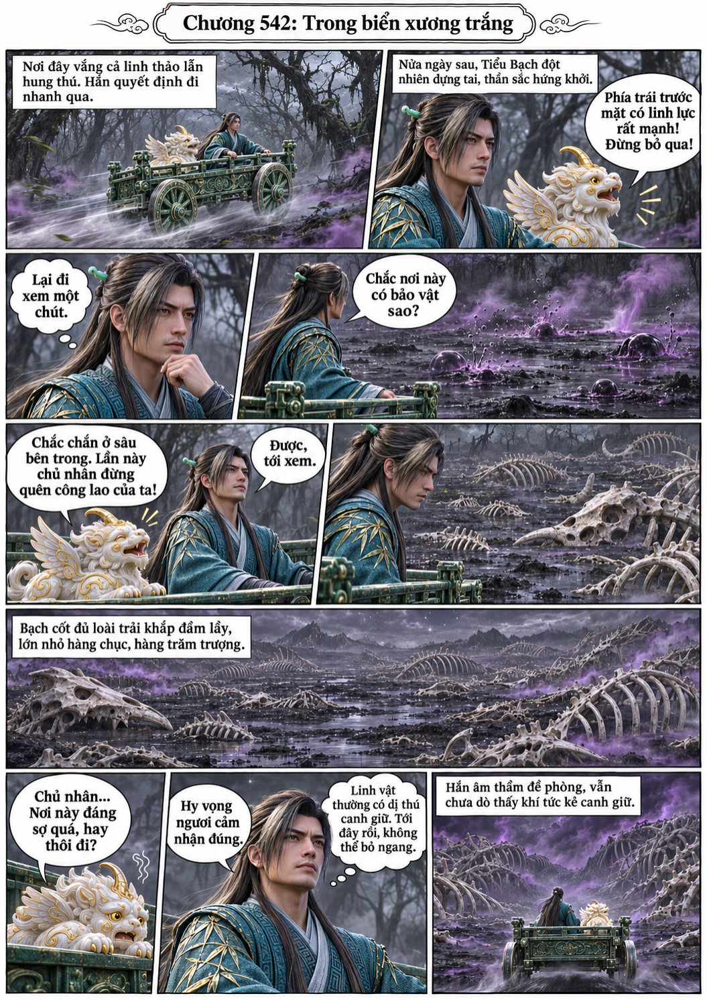
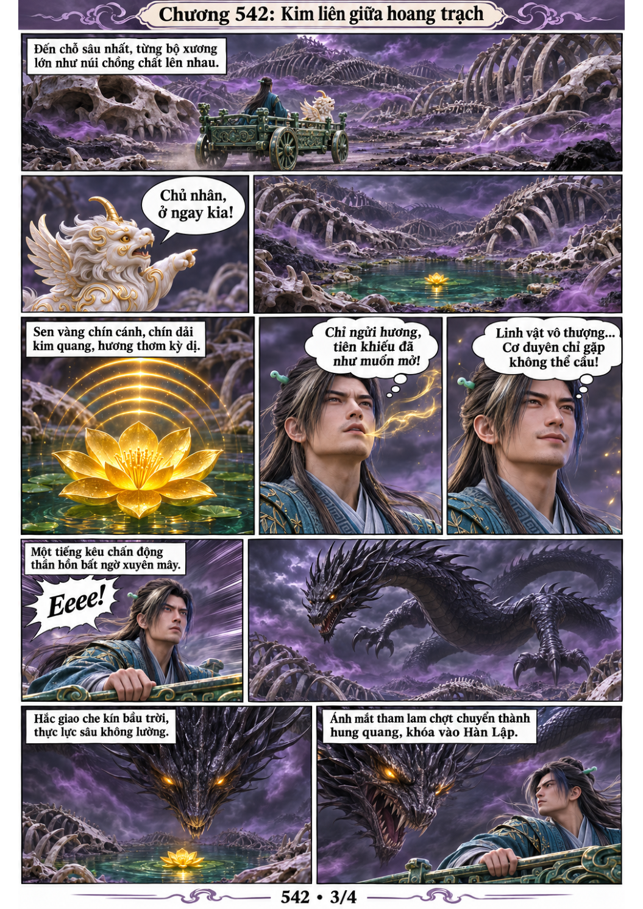
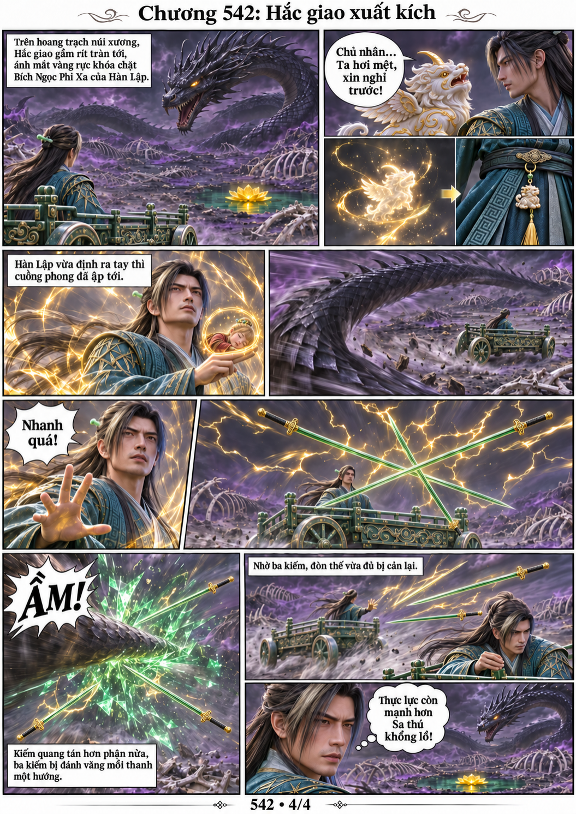

# Chương 542: Núi xương nơi hoang trạch

4 trang PNG riêng, tỉ lệ A4 dọc; chuyển thể từ văn bản người dùng đính kèm, có thoại, suy nghĩ và lời dẫn. Dùng model tham chiếu trong bộ nhớ dự án.

[PDF A4](chuong-542.pdf) · [Văn bản nguồn](SOURCE.txt)

Hàn Lập tránh đuổi theo dị tộc, vào rừng âm u rồi theo cảm ứng Tiểu Bạch tới hoang trạch núi xương. Một hoa sen chín cánh vàng lộ ra, nhưng hắc giao xuất hiện; ba kiếm vừa đủ cản đòn đuôi để phi xa lùi lại.

