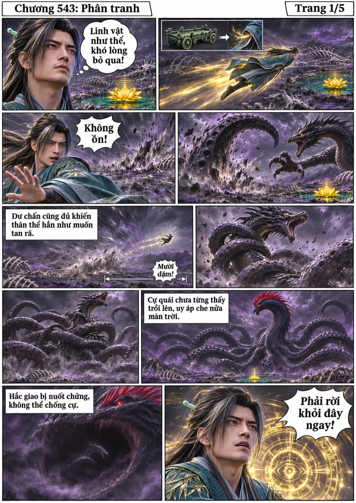
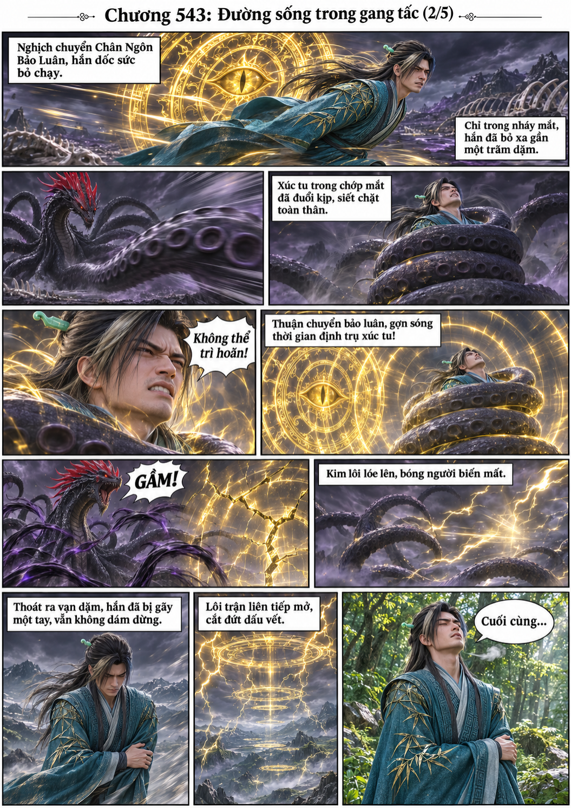
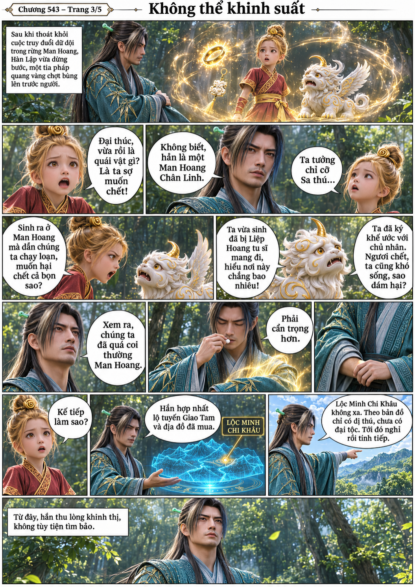
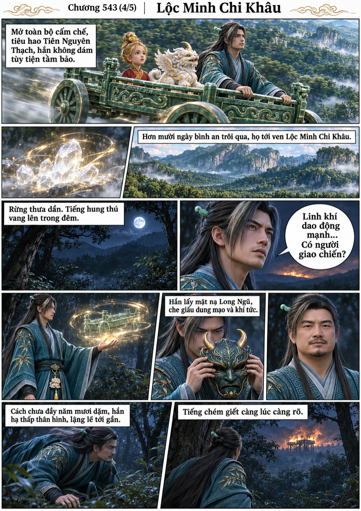
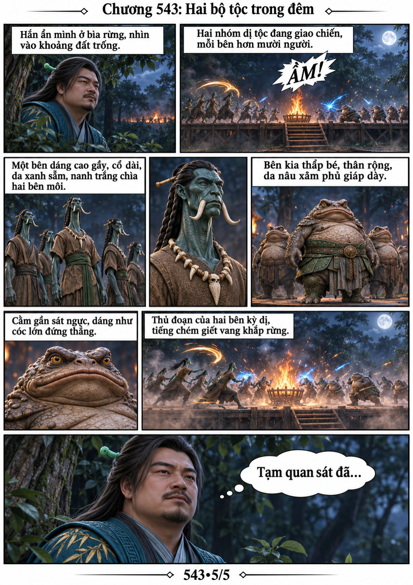

# Chương 543: Phân tranh

5 trang PNG riêng, tỉ lệ A4 dọc; chuyển thể từ văn bản người dùng đính kèm, có thoại, suy nghĩ và lời dẫn. Dùng model tham chiếu trong bộ nhớ dự án.

[PDF A4](chuong-543.pdf) · [Văn bản nguồn](SOURCE.txt)

Cự quái xúc tu nuốt hắc giao và suýt bắt Hàn Lập. Thoát thân, hồi phục rồi đổi lộ tuyến, hắn tới Lộc Minh Chi Khâu, dùng mặt nạ Long Ngũ và quan sát hai bộ tộc giao chiến.

