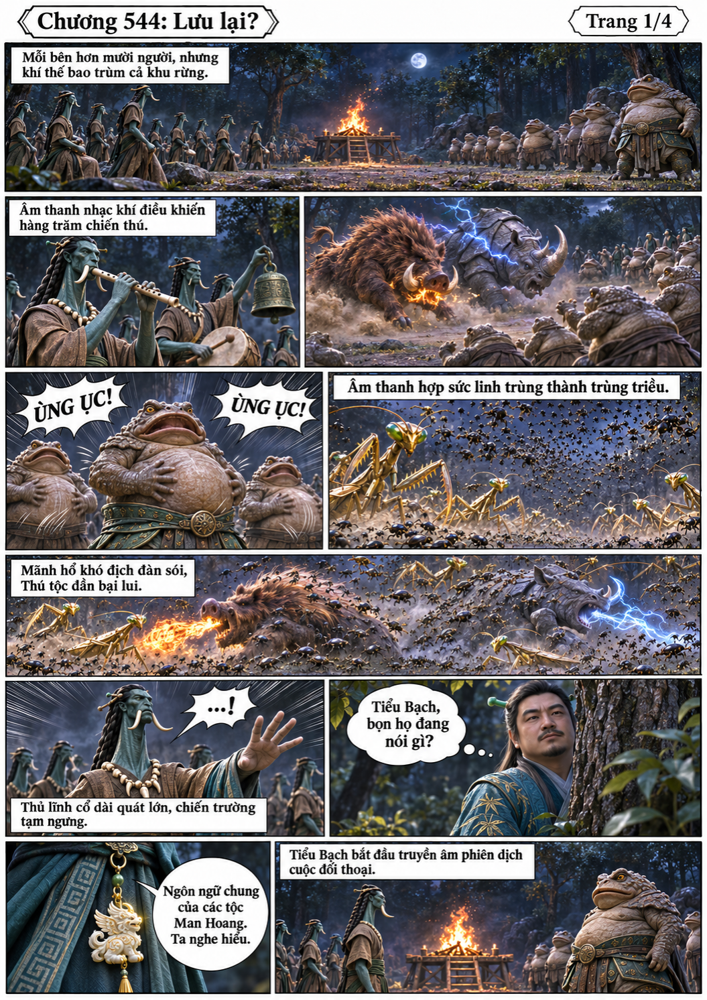
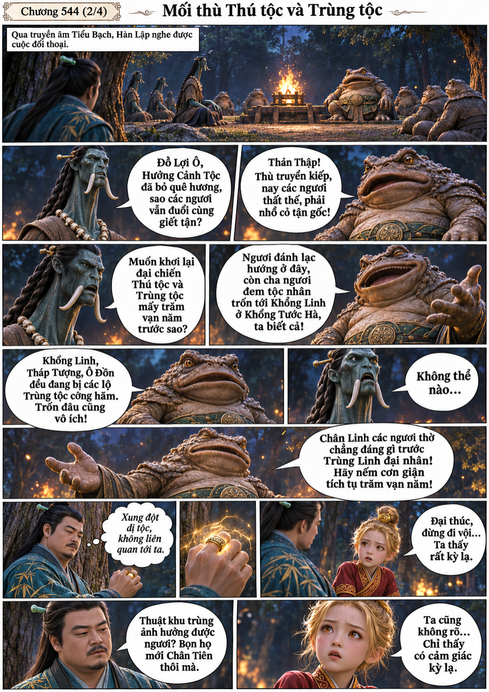
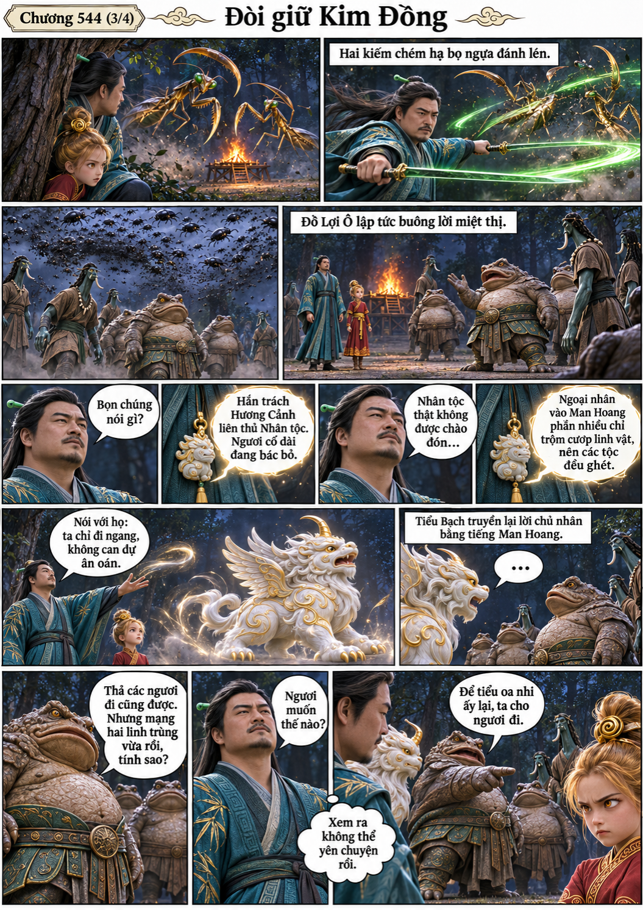
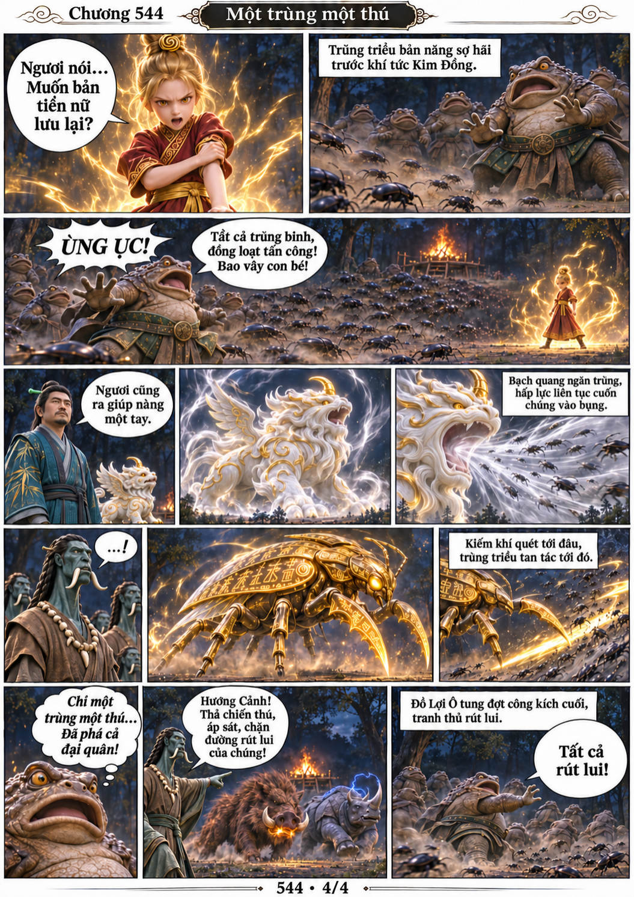

# Chương 544: Lưu lại?

4 trang PNG riêng, tỉ lệ A4 dọc; chuyển thể từ văn bản người dùng đính kèm, có thoại, suy nghĩ và lời dẫn. Dùng model tham chiếu trong bộ nhớ dự án.

[PDF A4](chuong-544.pdf) · [Văn bản nguồn](SOURCE.txt)

Tiểu Bạch phiên dịch mối thù Thú tộc–Trùng tộc. Kim Đồng thấy cảm giác kỳ lạ, hai bọ ngựa đánh lén khiến nhóm lộ diện. Đồ Lợi Ô đòi giữ nàng; Kim Đồng và Tiểu Bạch phá trùng triều, Hôi Thiềm bắt đầu rút lui.

