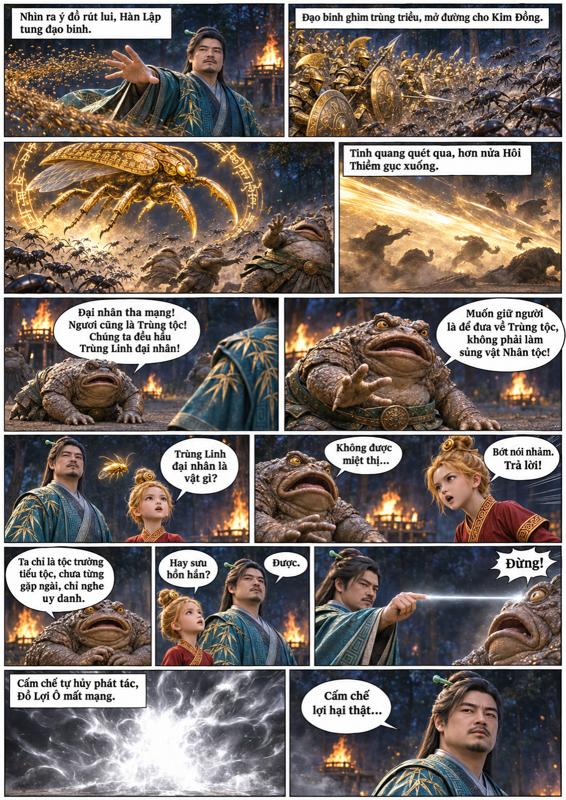
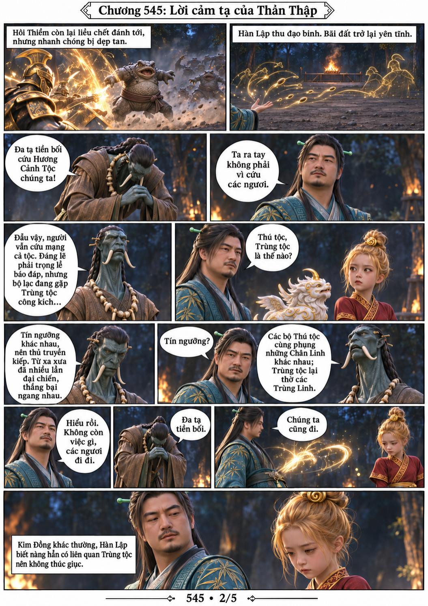
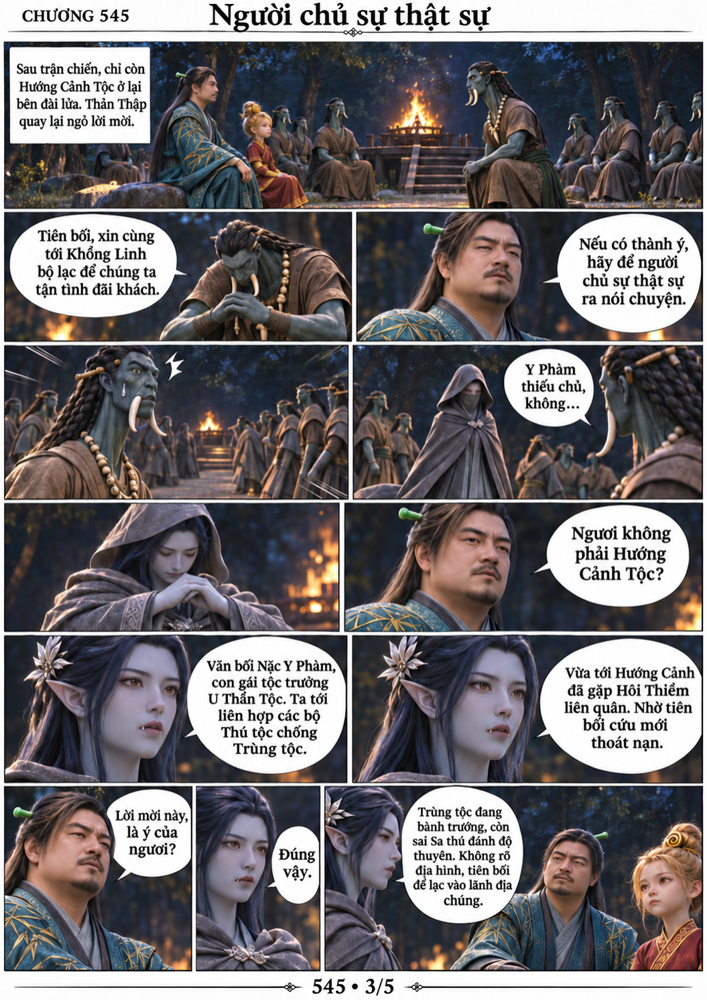
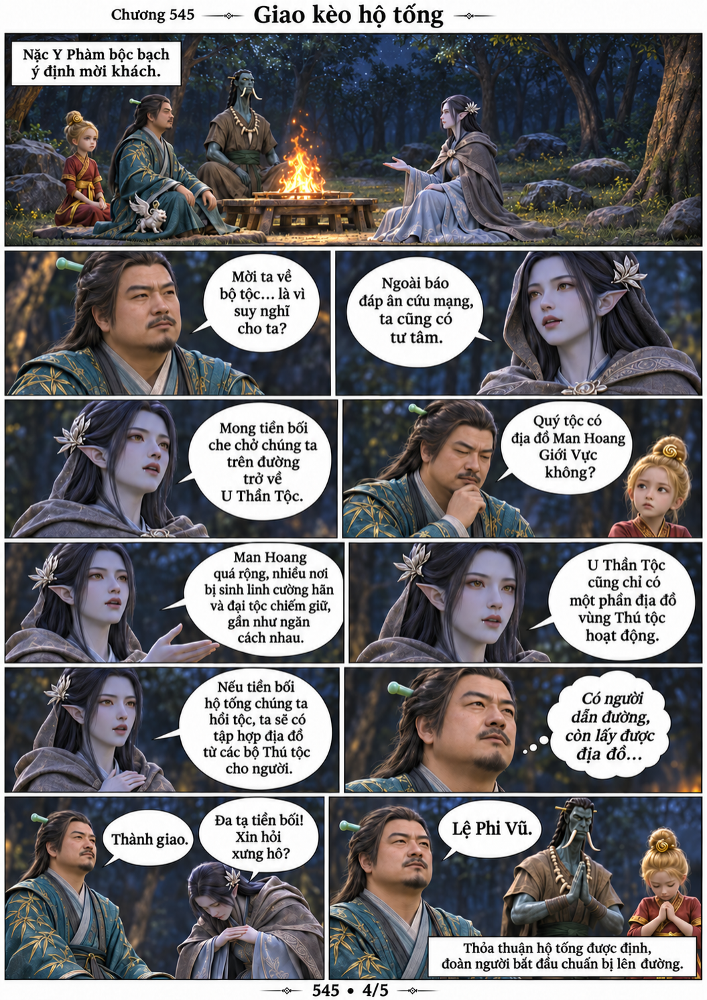
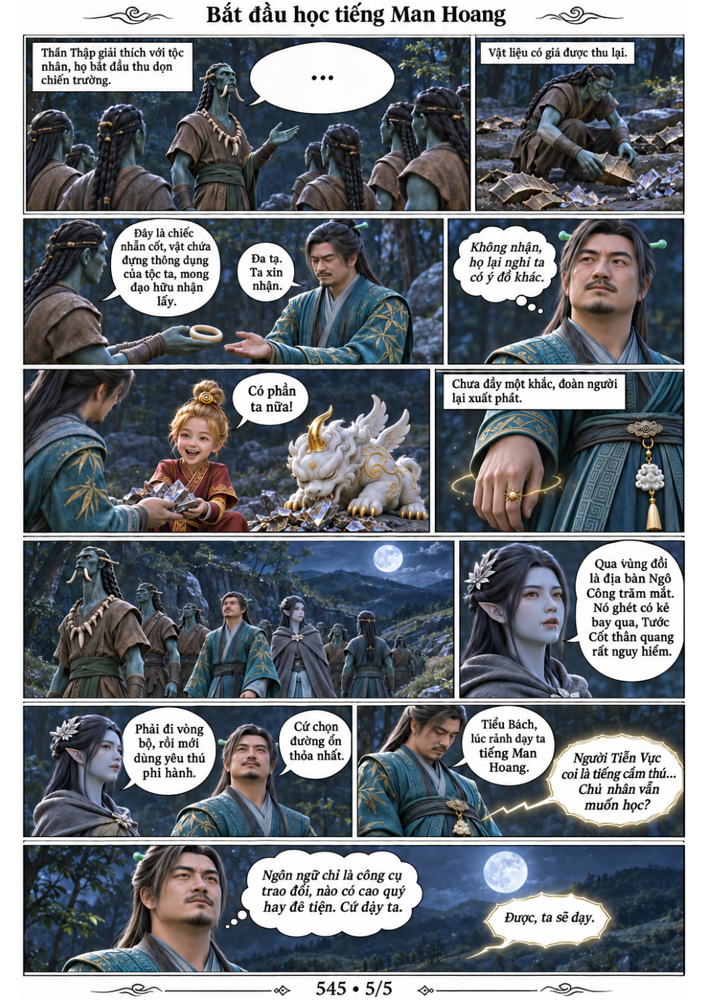

# Chương 545: Khách quý

5 trang PNG riêng, tỉ lệ A4 dọc; chuyển thể từ văn bản người dùng đính kèm, có thoại, suy nghĩ và lời dẫn. Dùng model tham chiếu trong bộ nhớ dự án.

[PDF A4](chuong-545.pdf) · [Văn bản nguồn](SOURCE.txt)

Đạo binh chặn Hôi Thiềm, Đồ Lợi Ô chết vì cấm chế khi bị sưu hồn. Sau lời cảm tạ và giải thích tín ngưỡng, Nặc Y Phàm lộ diện, thỏa thuận đổi địa đồ lấy hộ tống. Hàn xưng Lệ Phi Vũ và học tiếng Man Hoang khi lên đường.

