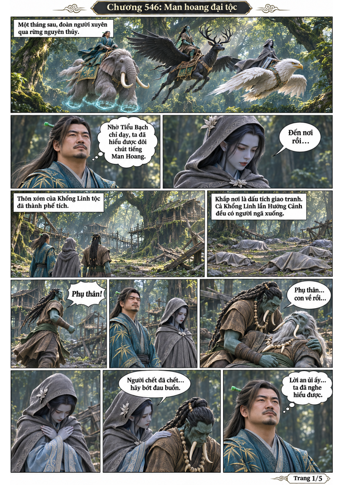
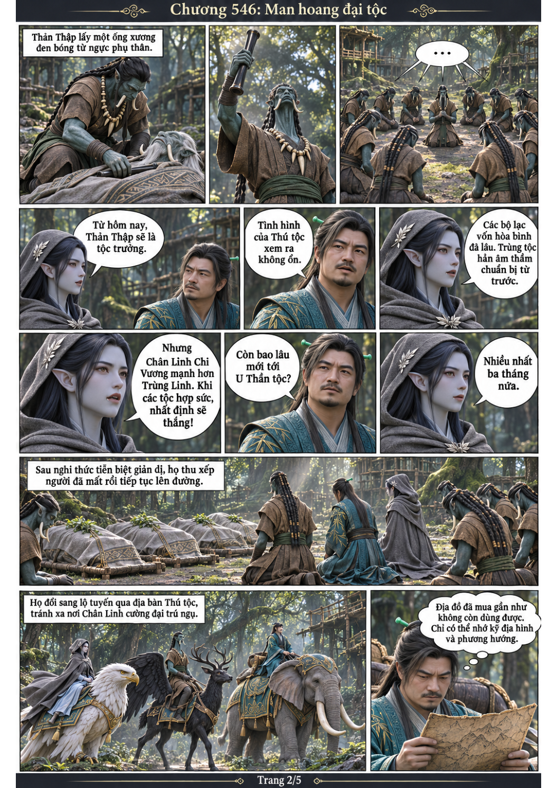
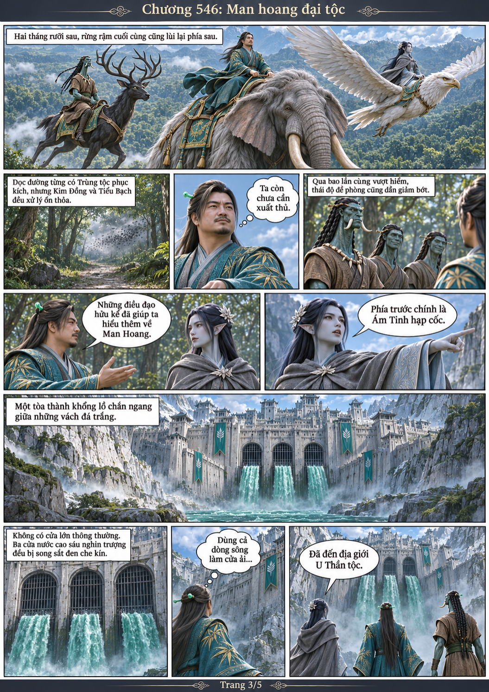
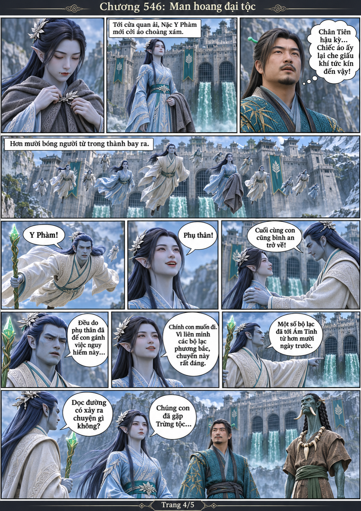
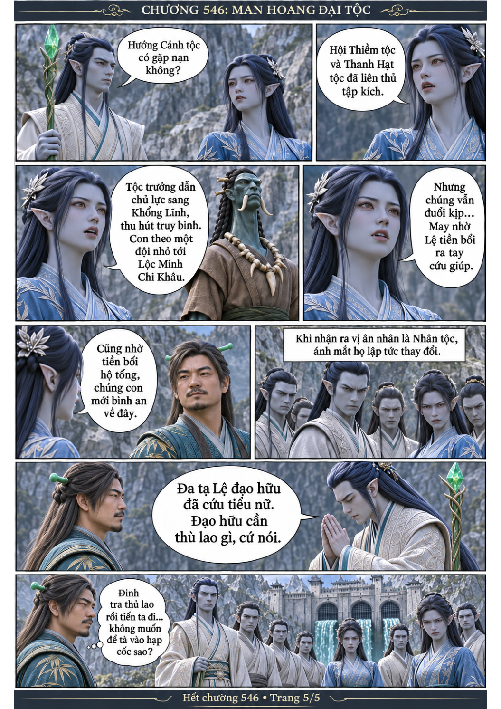

# Chương 546: Man hoang đại tộc

5 trang PNG riêng, tỉ lệ A4 dọc; chuyển thể từ văn bản người dùng đính kèm, có thoại, suy nghĩ và lời dẫn. Dùng model tham chiếu trong bộ nhớ dự án.

[PDF A4](chuong-546.pdf) · [Văn bản nguồn](SOURCE.txt)

Đoàn người tới phế thôn Khổng Linh, Thản Thập nhận di vật của phụ thân và kế nhiệm tộc trưởng. Sau hành trình dài, họ tới Ám Tinh; Nặc Y Phàm đoàn tụ với phụ thân, nhưng U Thần tộc dè chừng vị khách Nhân tộc.

