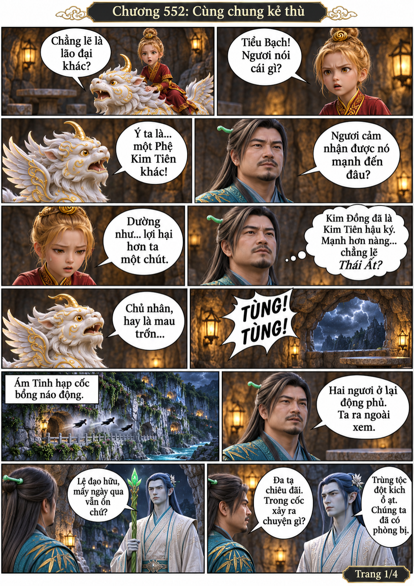
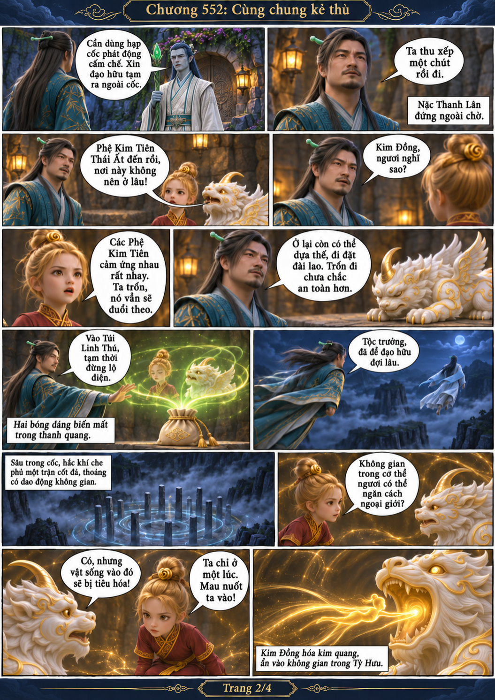
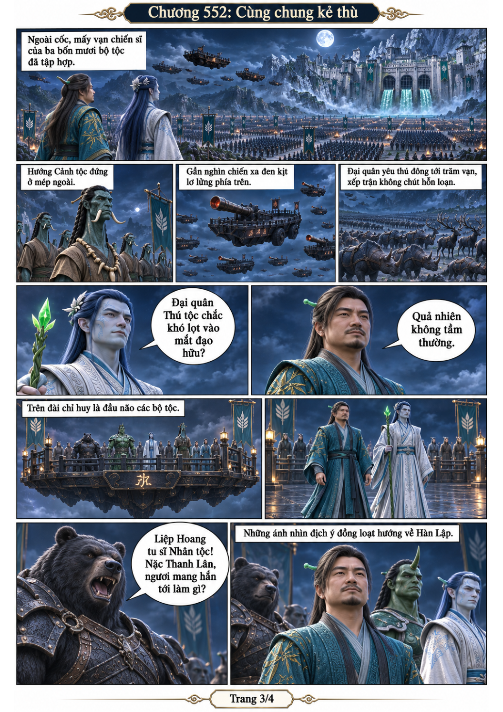
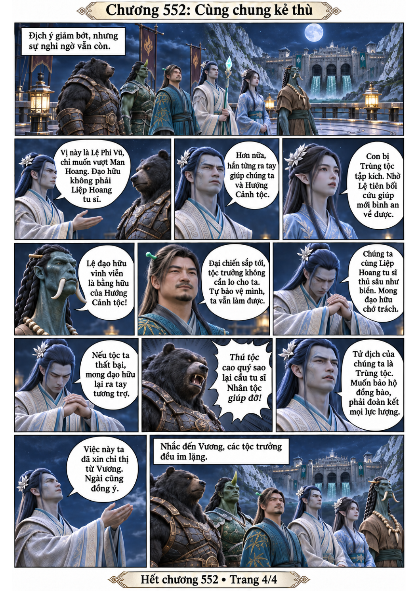

# Chương 552: Cùng chung kẻ thù

4 trang PNG riêng, tỉ lệ A4 dọc; chuyển thể từ văn bản người dùng đính kèm, có thoại, suy nghĩ và lời dẫn. Dùng model tham chiếu trong bộ nhớ dự án.

[PDF A4](chuong-552.pdf) · [Văn bản nguồn](SOURCE.txt)

Cảm ứng về một Phệ Kim Tiên mạnh hơn khiến nhóm Hàn Lập phải chọn ở lại. Kim Đồng giấu trong không gian cơ thể Tiểu Bạch, cả hai vào Túi Linh Thú. Hàn theo Nặc Thanh Lân ra đài chỉ huy; giữa sự dè chừng của các tộc, Nặc Thanh Lân kêu gọi cùng chống Trùng tộc.

