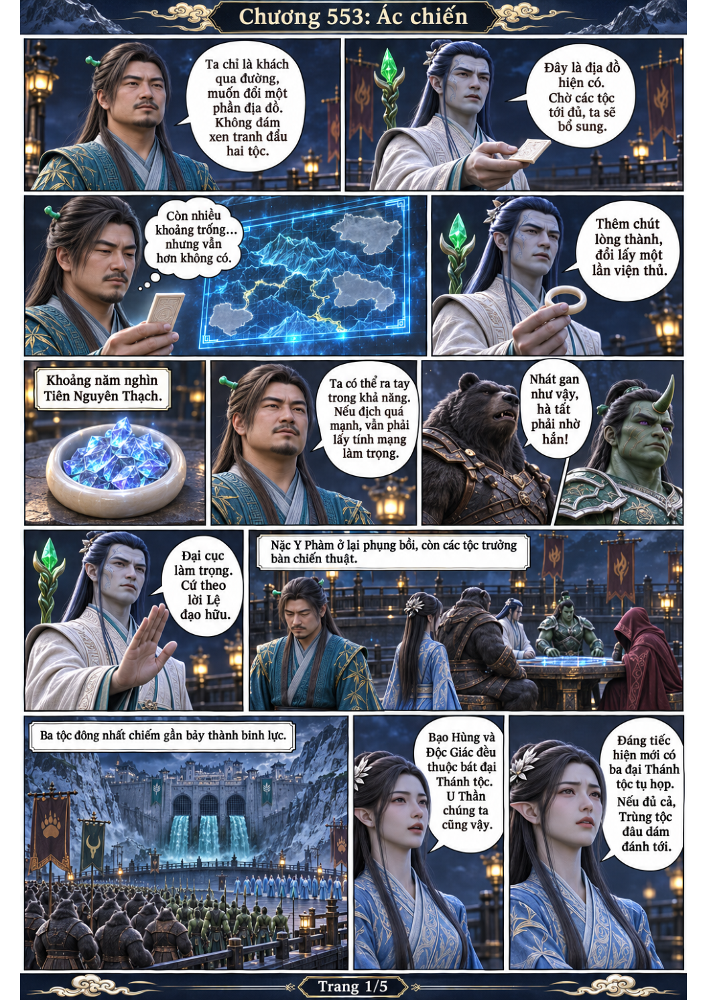
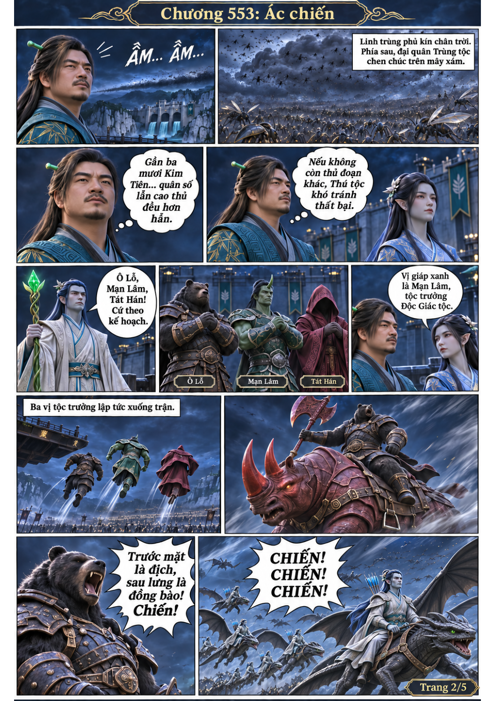
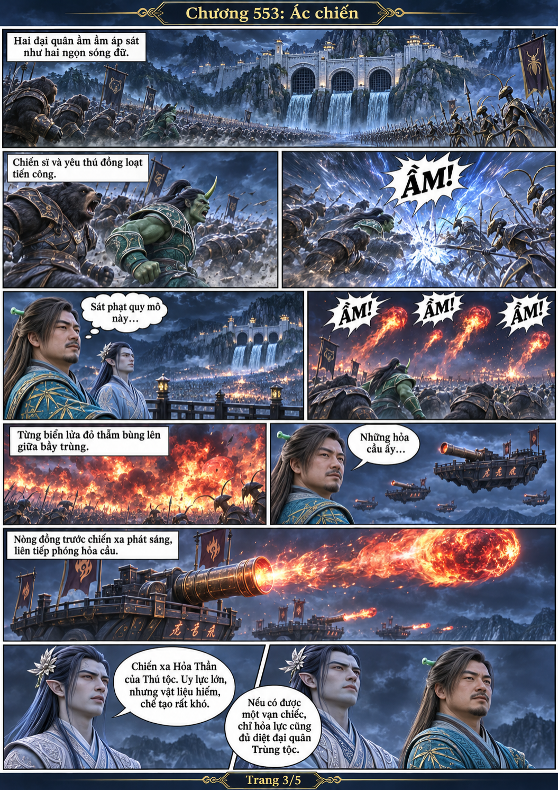
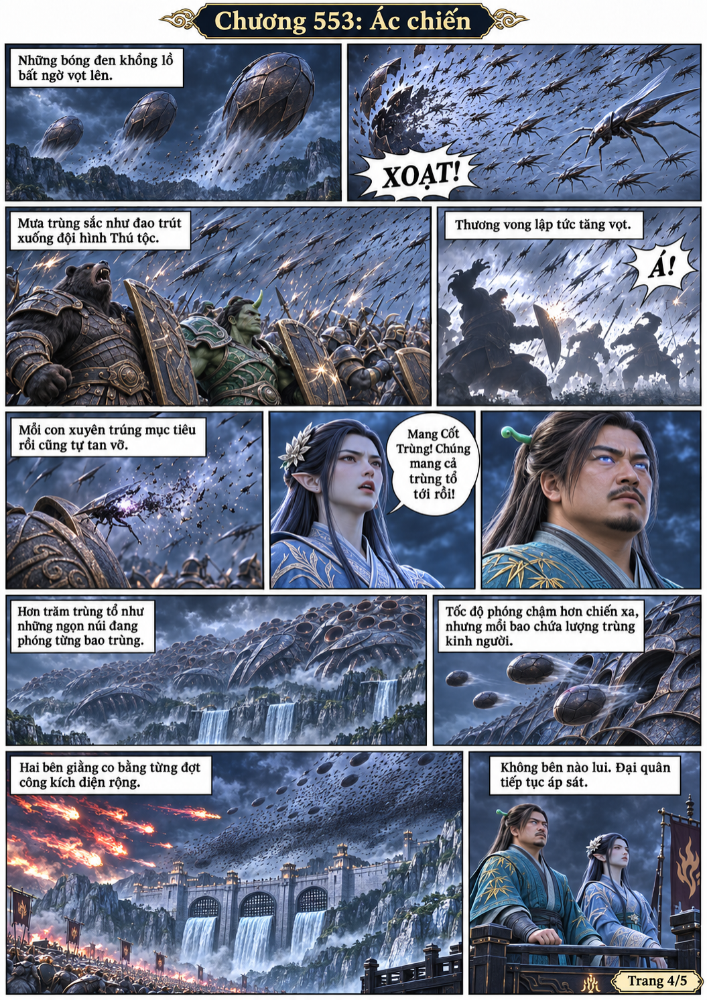
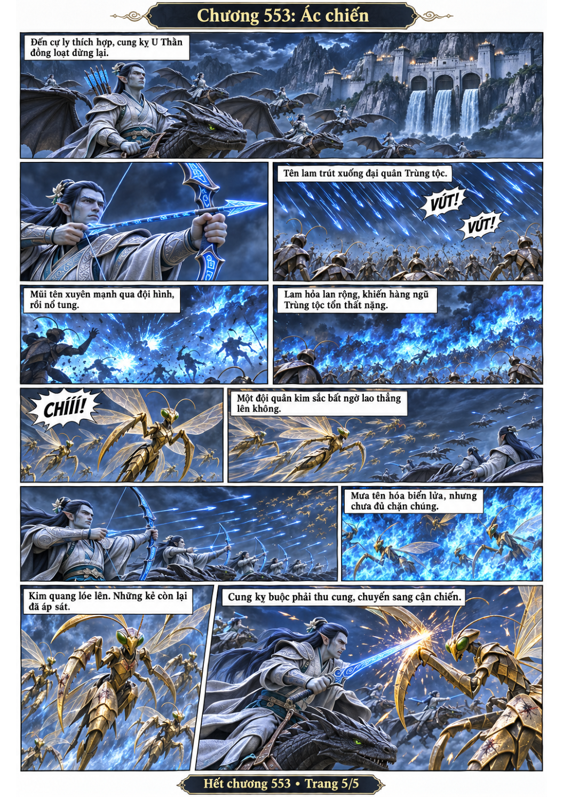

# Chương 553: Ác chiến

5 trang PNG riêng, tỉ lệ A4 dọc; chuyển thể từ văn bản người dùng đính kèm, có thoại, suy nghĩ và lời dẫn. Dùng model tham chiếu trong bộ nhớ dự án.

[PDF A4](chuong-553.pdf) · [Văn bản nguồn](SOURCE.txt)

Nhận địa đồ thiếu phần và thù lao, Hàn Lập đồng ý viện thủ có giới hạn. Thú tộc xuất quân đối đầu lực lượng Trùng tộc vượt trội; chiến xa Hỏa Thần đấu trùng tổ Mang Cốt, rồi cung kỵ U Thần bị Kim Đường áp sát.

