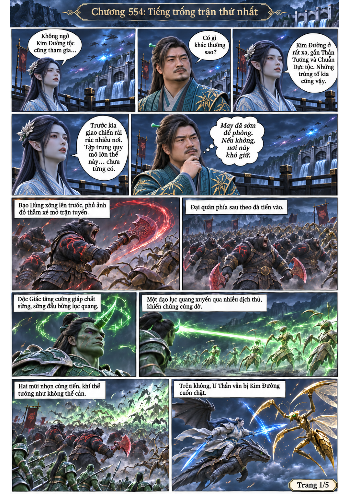
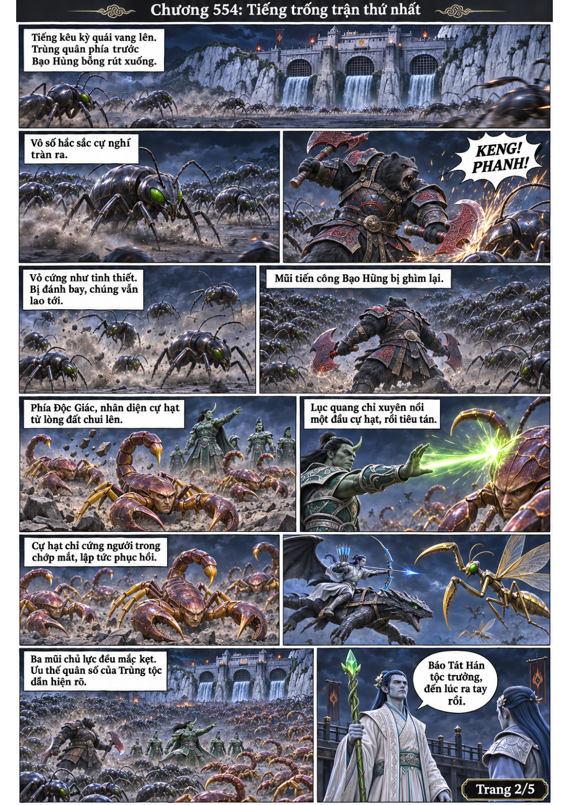
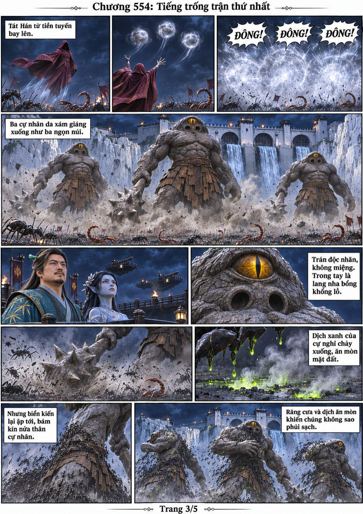
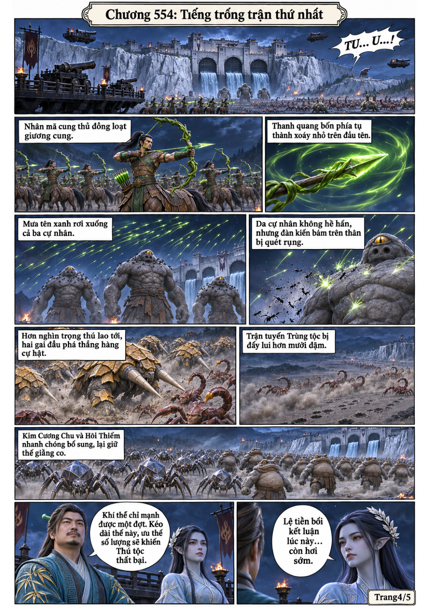
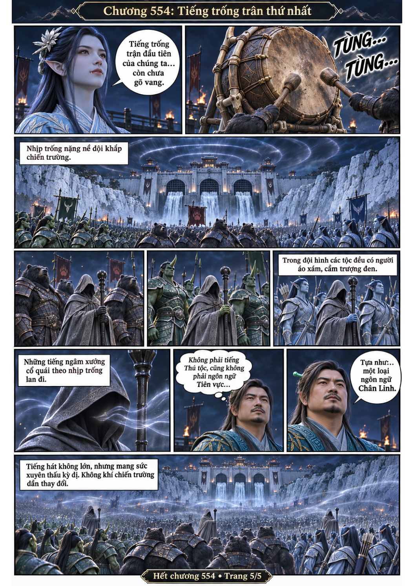

# Chương 554: Tiếng trống trận thứ nhất

5 trang PNG riêng, tỉ lệ A4 dọc; chuyển thể từ văn bản người dùng đính kèm, có thoại, suy nghĩ và lời dẫn. Dùng model tham chiếu trong bộ nhớ dự án.

[PDF A4](chuong-554.pdf) · [Văn bản nguồn](SOURCE.txt)

Bạo Hùng và Độc Giác bị cự nghĩ, nhân diện cự hạt cản bước. Tát Hán tung ba cự nhân độc nhãn; cung thủ nhân mã và trọng thú tiếp ứng. Khi hai bên tiếp tục giằng co, tiếng trống cùng lời ngâm của các tế ti bắt đầu thay đổi chiến trường.

