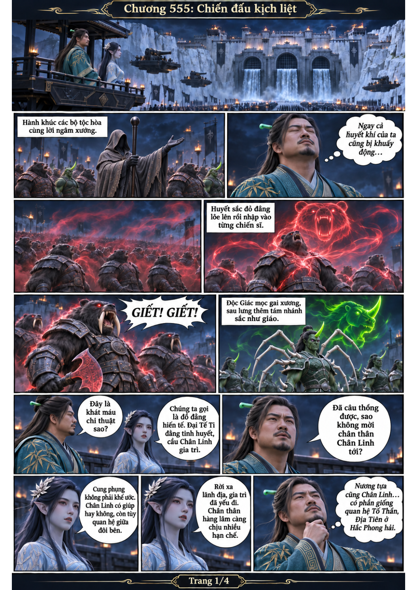
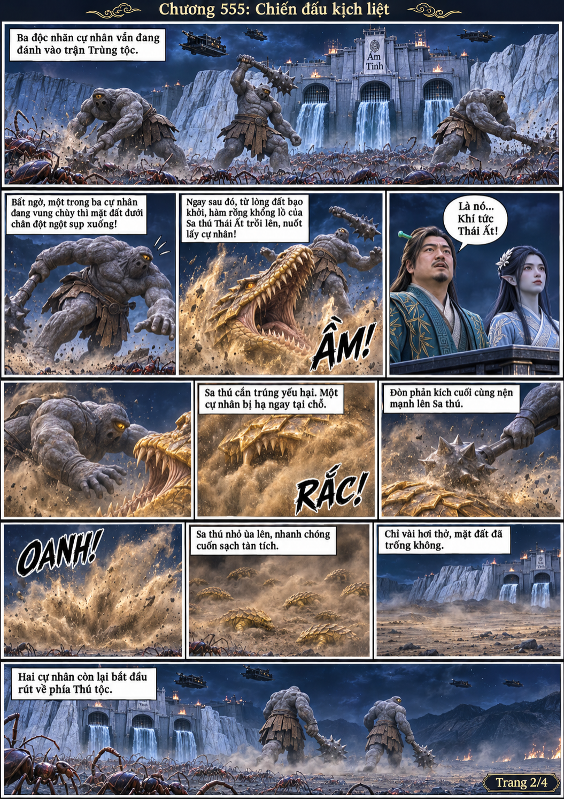
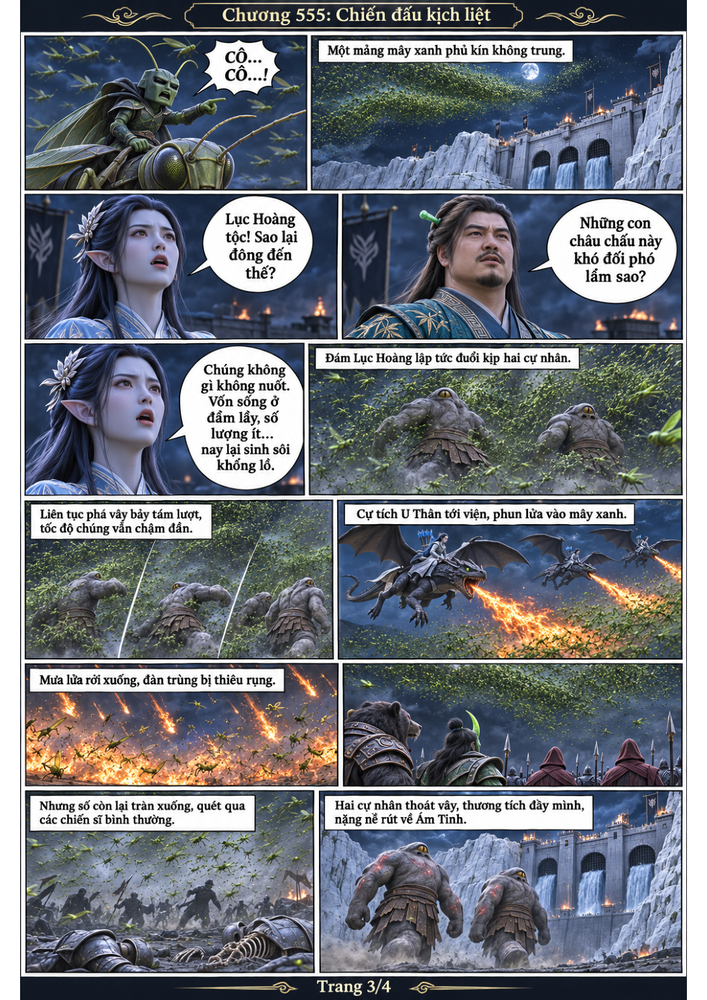
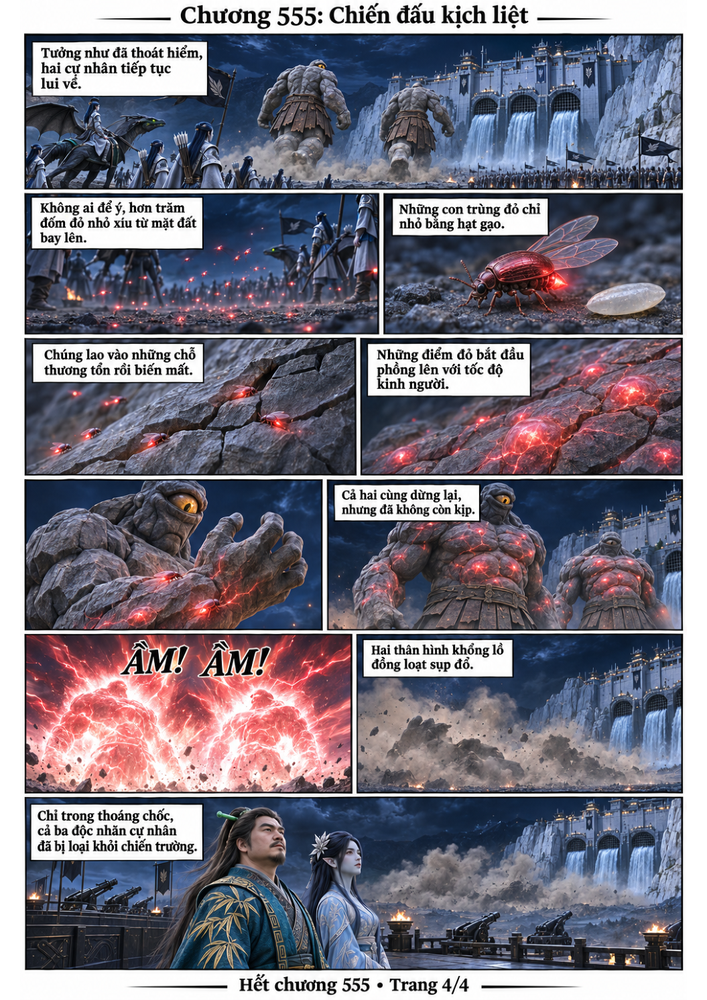

# Chương 555: Chiến đấu kịch liệt

4 trang PNG riêng, tỉ lệ A4 dọc; chuyển thể từ văn bản người dùng đính kèm, có thoại, suy nghĩ và lời dẫn. Dùng model tham chiếu trong bộ nhớ dự án.

[PDF A4](chuong-555.pdf) · [Văn bản nguồn](SOURCE.txt)

Nghi thức đồ đằng gia trì các chiến sĩ, nhưng Sa thú Thái Ất bất ngờ hạ một cự nhân. Hai con còn lại thoát đàn Lục Hoàng nhờ cự tích tiếp viện, rồi trúng đàn trùng đỏ ký sinh và đồng loạt sụp đổ.

