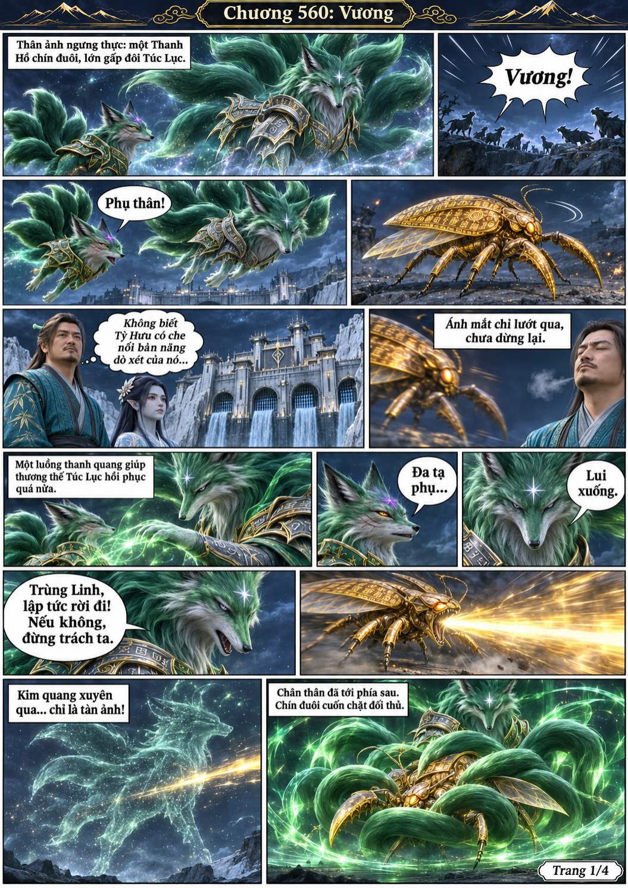
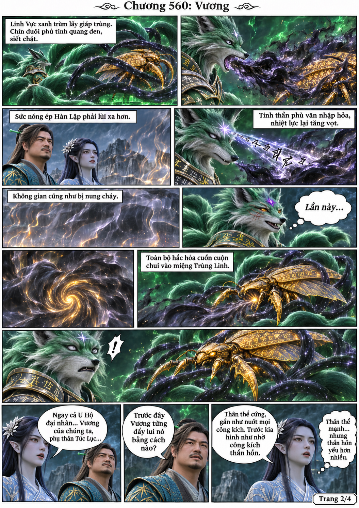
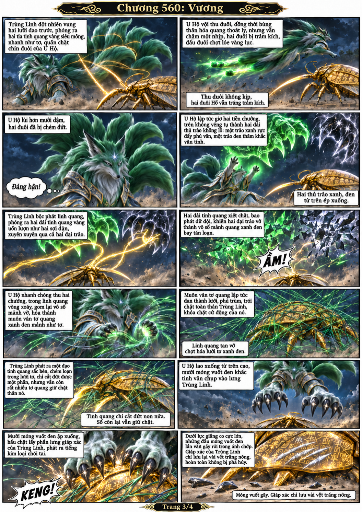
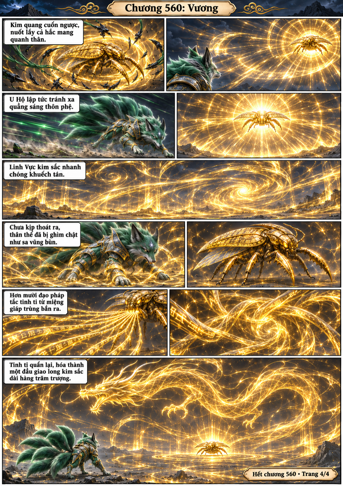

# Chương 560: Vương

4 trang PNG riêng, tỉ lệ A4 dọc; chuyển thể từ văn bản người dùng đính kèm, có thoại, suy nghĩ và lời dẫn. Dùng model tham chiếu trong bộ nhớ dự án.

[PDF A4](chuong-560.pdf) · [Văn bản nguồn](SOURCE.txt)

U Hộ xuất hiện, chữa thương cho Túc Lục và giao chiến với Trùng Linh. Hắc hỏa bị nuốt, hai đuôi bị chém, móng vuốt cũng không xuyên được giáp. Trùng Linh phá trói, dựng linh vực kim sắc rồi ngưng giao long pháp tắc.

