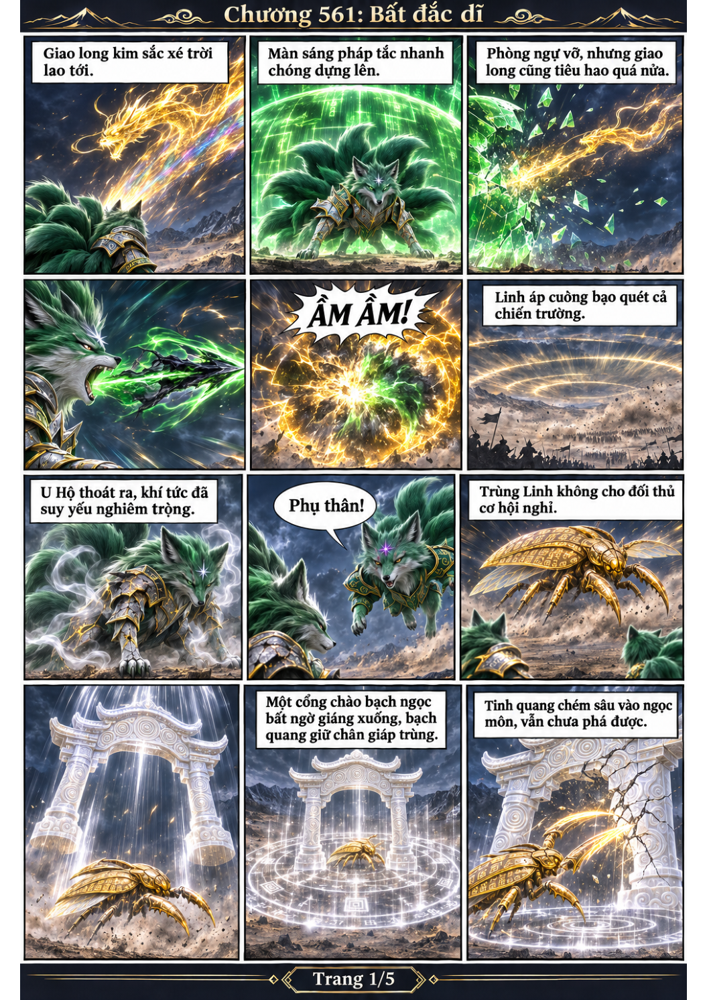
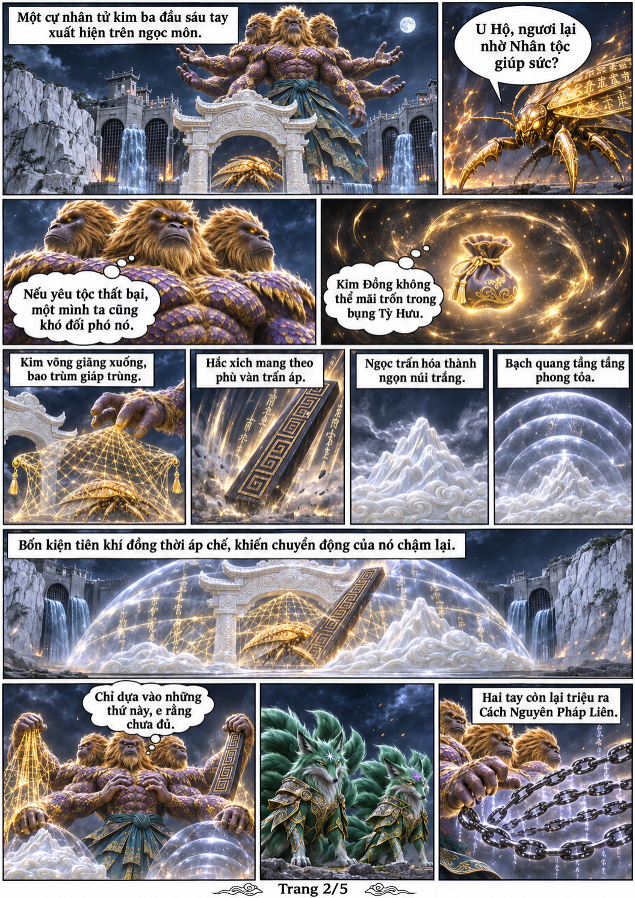
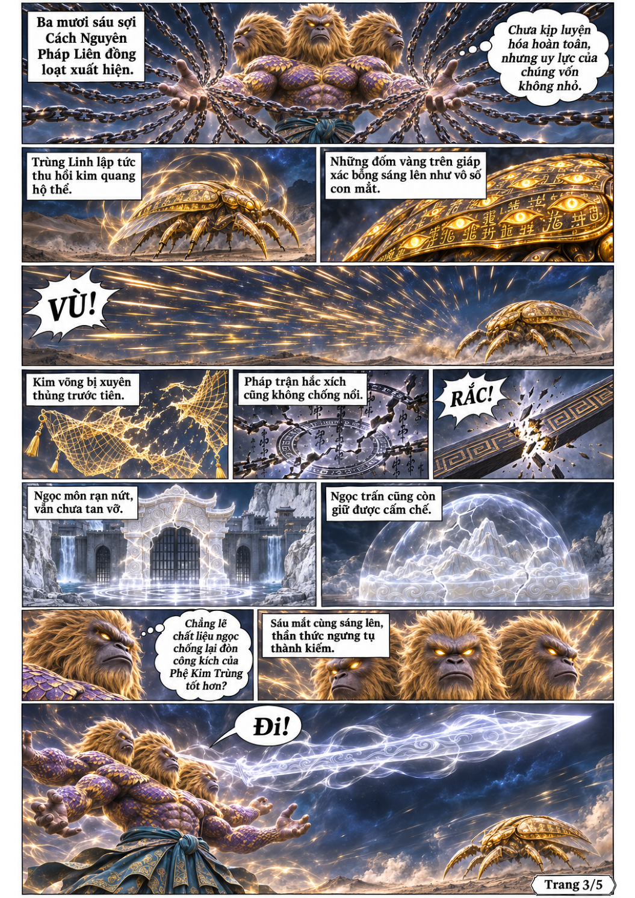
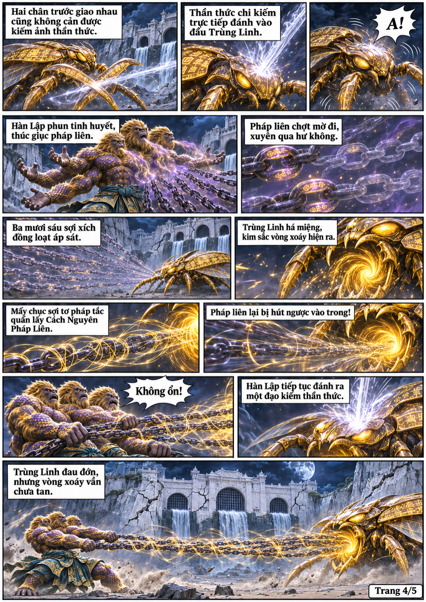
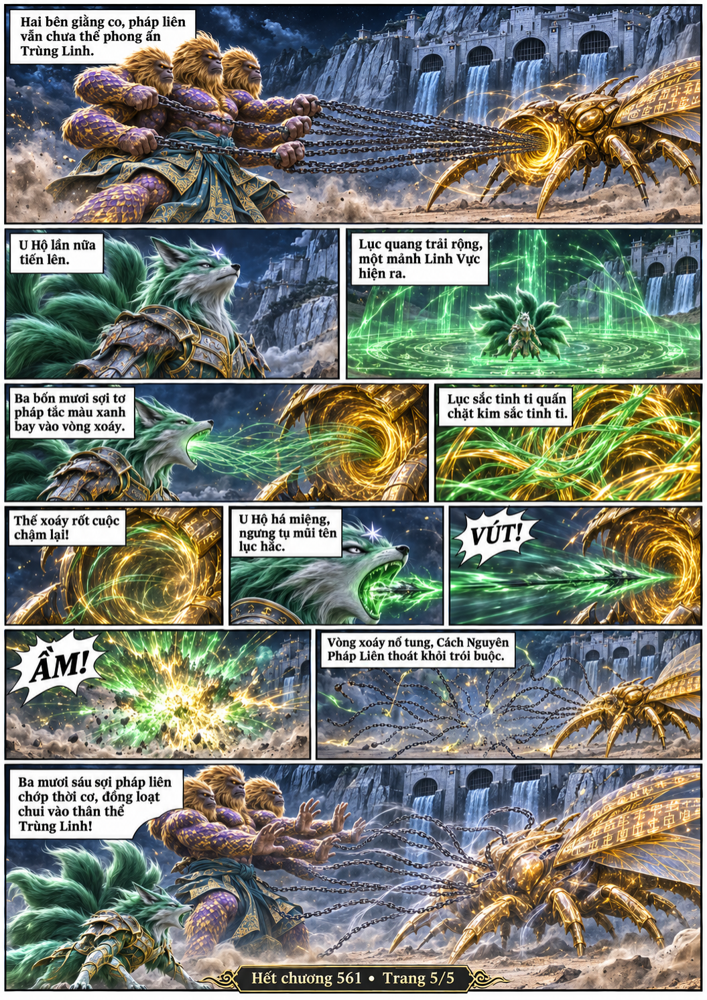

# Chương 561: Bất đắc dĩ

5 trang PNG riêng, tỉ lệ A4 dọc; chuyển thể từ văn bản người dùng đính kèm, có thoại, suy nghĩ và lời dẫn. Dùng model tham chiếu trong bộ nhớ dự án.

[PDF A4](chuong-561.pdf) · [Văn bản nguồn](SOURCE.txt)

Hàn Lập bất đắc dĩ trợ giúp U Hộ, dùng bốn tiên khí và kiếm thần thức để đưa Cách Nguyên Pháp Liên vào Trùng Linh.

