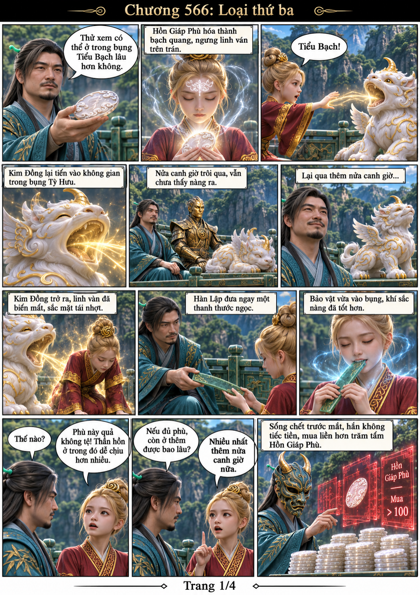
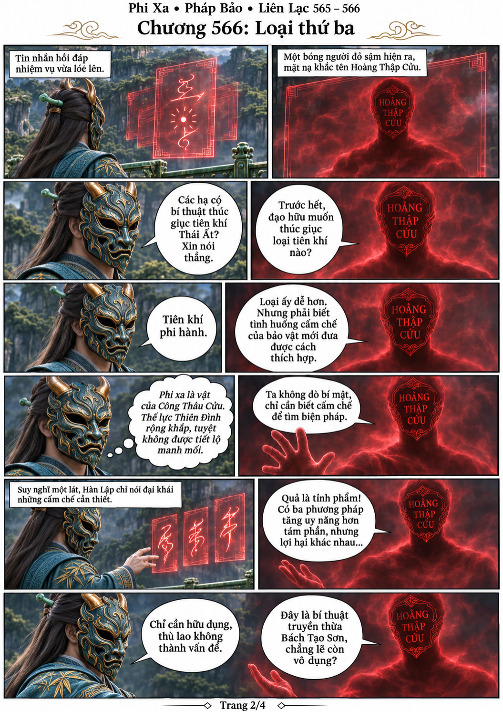
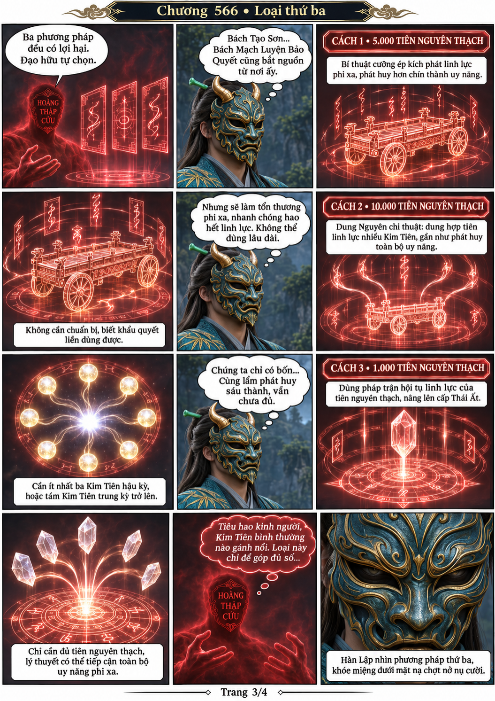
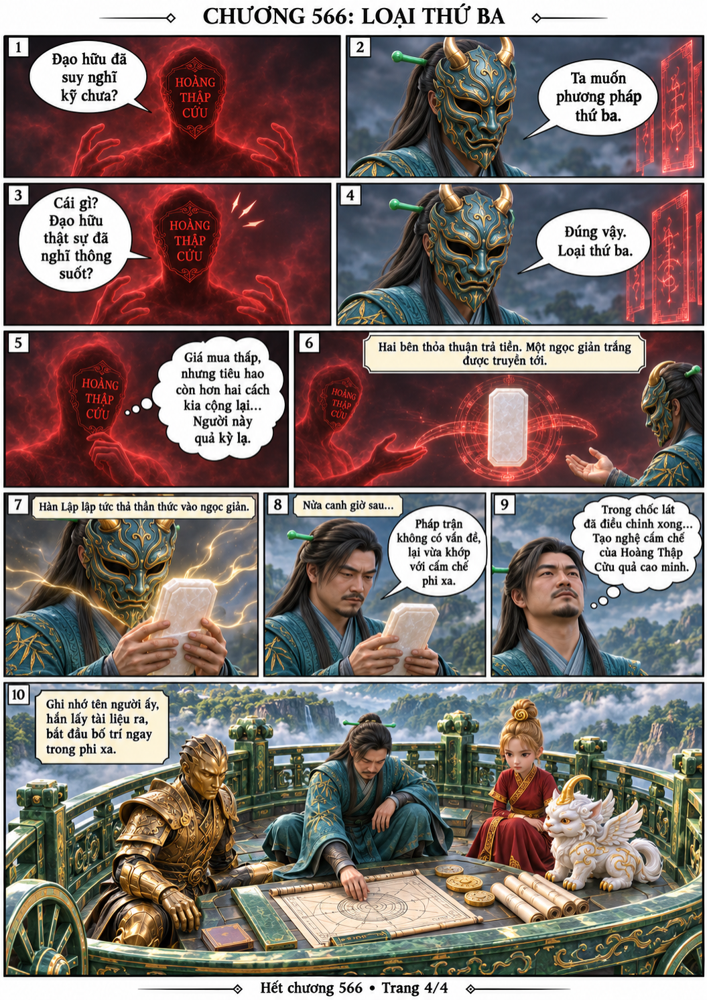

# Chương 566: Loại thứ ba

4 trang PNG riêng, tỉ lệ A4 dọc; chuyển thể từ văn bản người dùng đính kèm, có thoại, suy nghĩ và lời dẫn. Dùng model tham chiếu trong bộ nhớ dự án.

[PDF A4](chuong-566.pdf) · [Văn bản nguồn](SOURCE.txt)

Kim Đồng thử Hồn Giáp Phù; Hàn Lập mua hơn trăm tấm. Hoàng Thập Cửu đưa ba phương án tăng uy năng phi xa, Hàn Lập chọn pháp trận tiêu hao tiên nguyên thạch.

