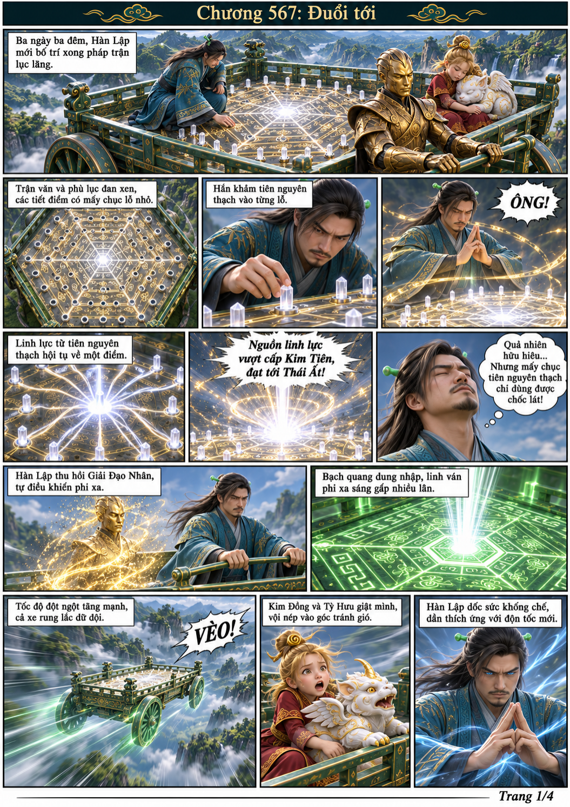
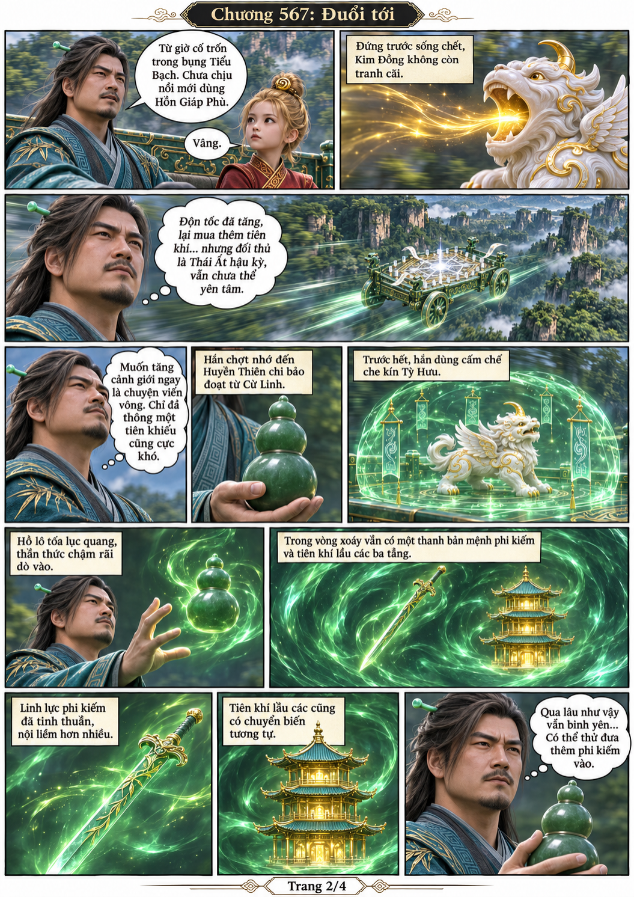
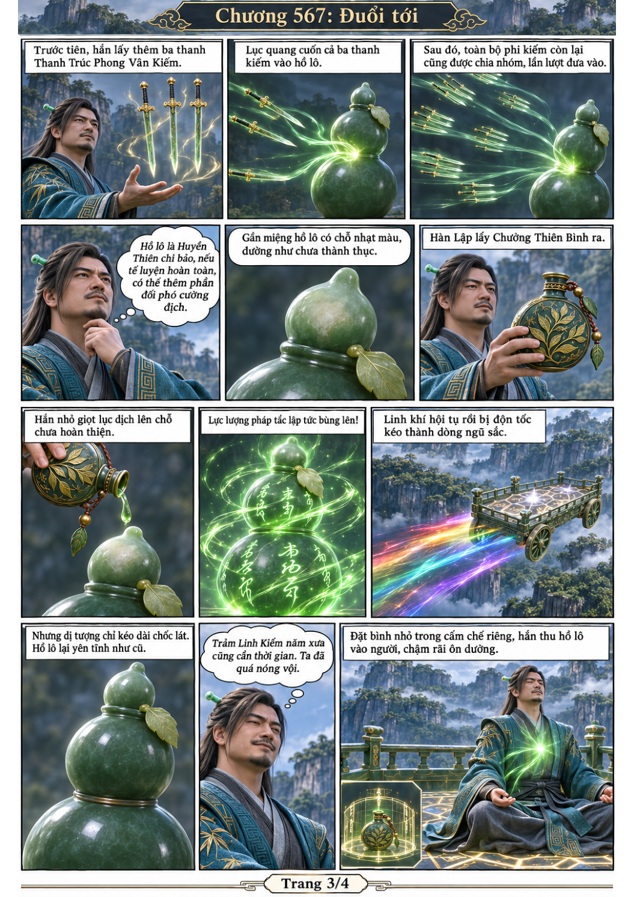
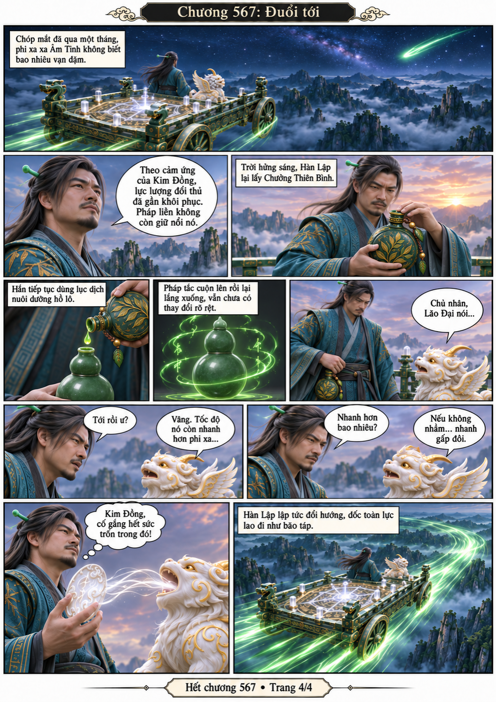

# Chương 567: Đuổi tới

4 trang PNG riêng, tỉ lệ A4 dọc; chuyển thể từ văn bản người dùng đính kèm, có thoại, suy nghĩ và lời dẫn. Dùng model tham chiếu trong bộ nhớ dự án.

[PDF A4](chuong-567.pdf) · [Văn bản nguồn](SOURCE.txt)

Pháp trận tăng mạnh tốc độ phi xa. Hàn Lập ôn dưỡng hồ lô bằng lục dịch; một tháng sau, Phệ Kim Tiên truy tới với tốc độ nhanh gấp đôi.

