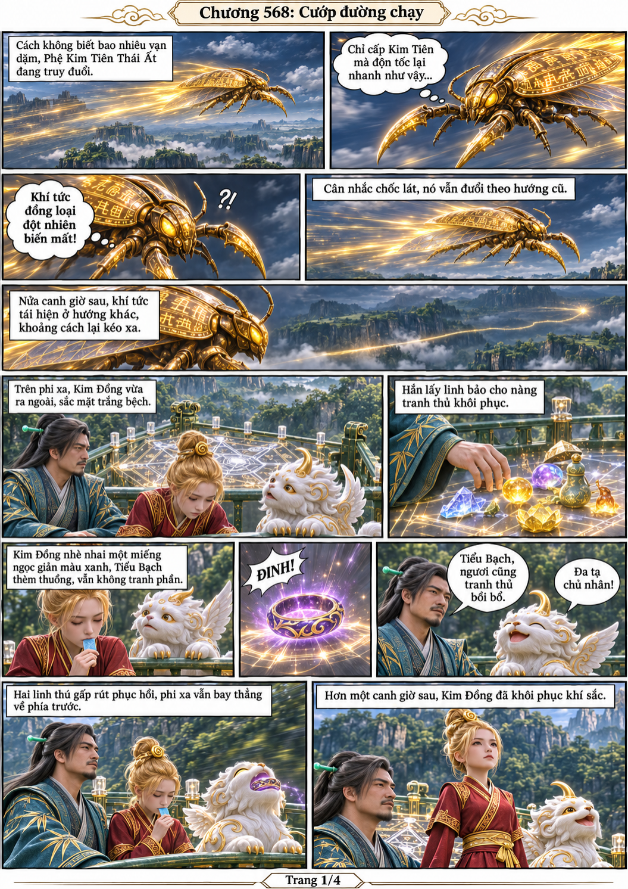
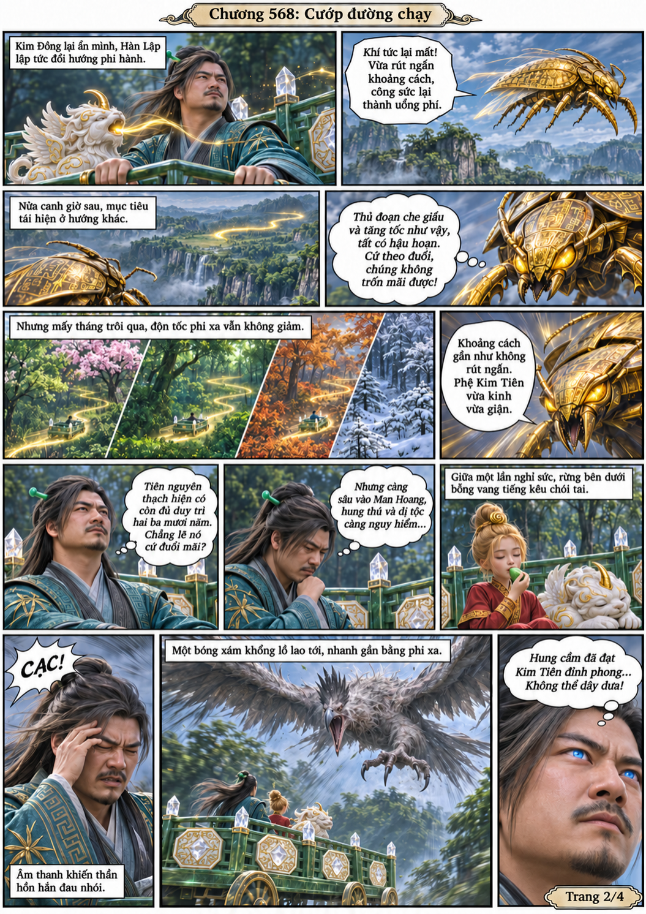
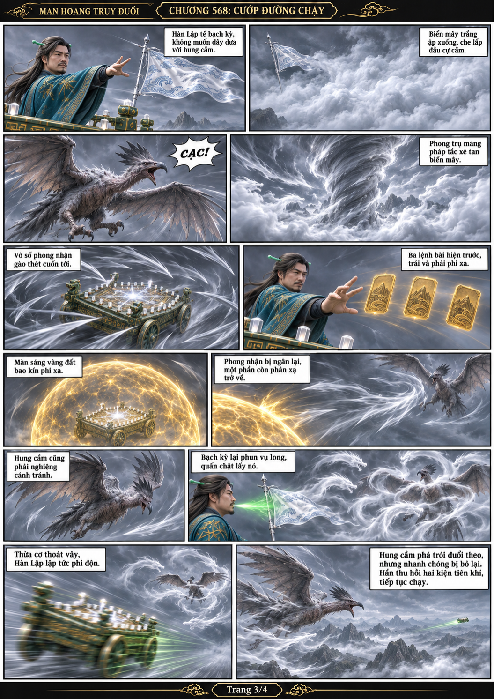
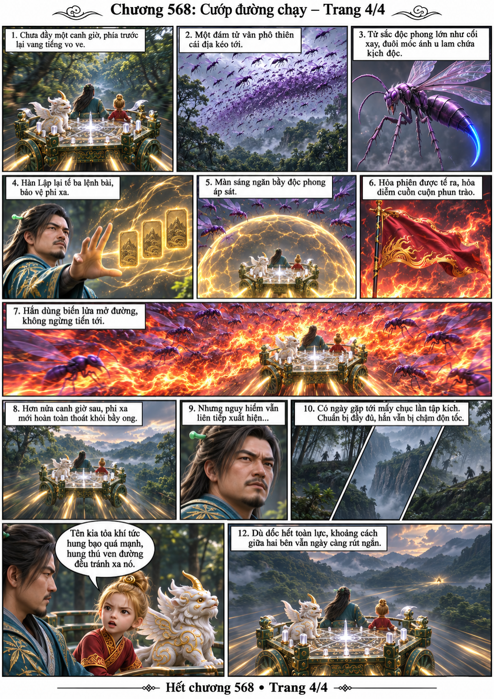

# Chương 568: Cướp đường chạy

4 trang PNG riêng, tỉ lệ A4 dọc; chuyển thể từ văn bản người dùng đính kèm, có thoại, suy nghĩ và lời dẫn. Dùng model tham chiếu trong bộ nhớ dự án.

[PDF A4](chuong-568.pdf) · [Văn bản nguồn](SOURCE.txt)

Hai bên truy đuổi nhiều tháng. Hàn Lập tận dụng che khí tức để đổi hướng nhưng hung cầm, độc phong và các cuộc tập kích liên tiếp làm chậm phi xa, khiến đối thủ ngày càng tới gần.

