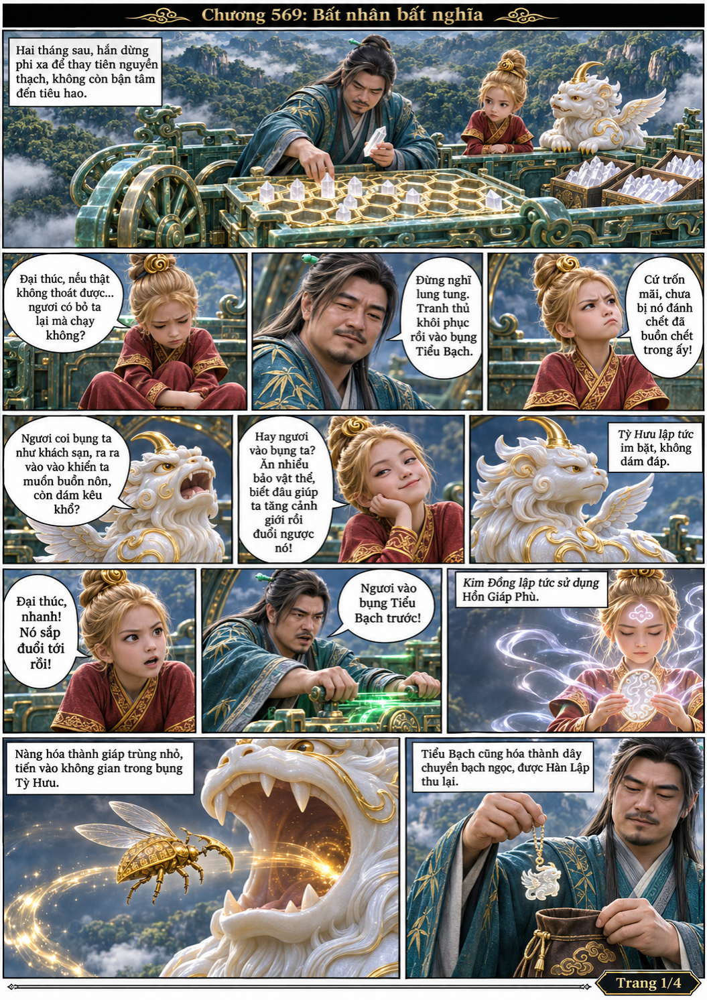
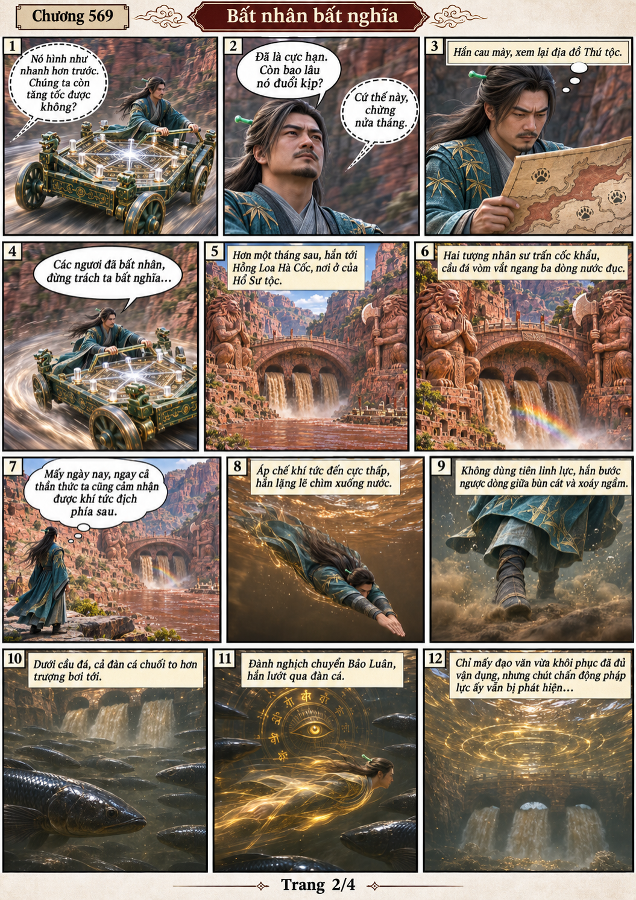
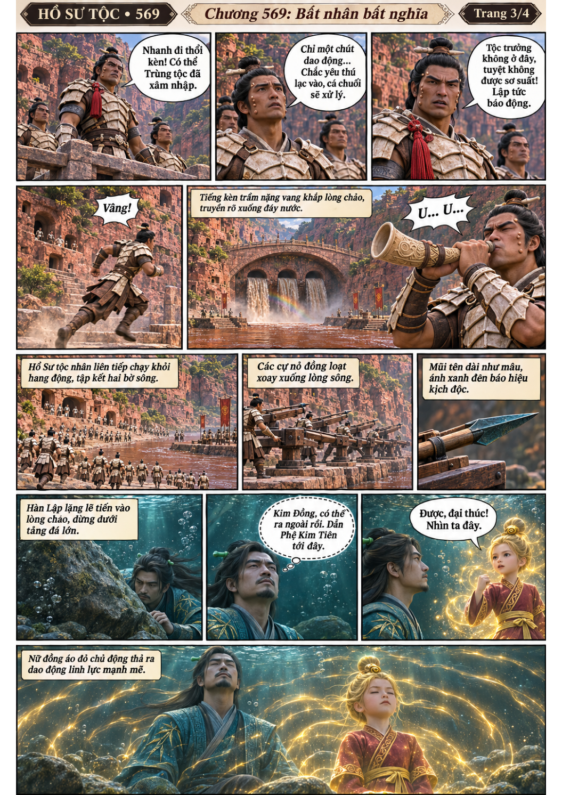
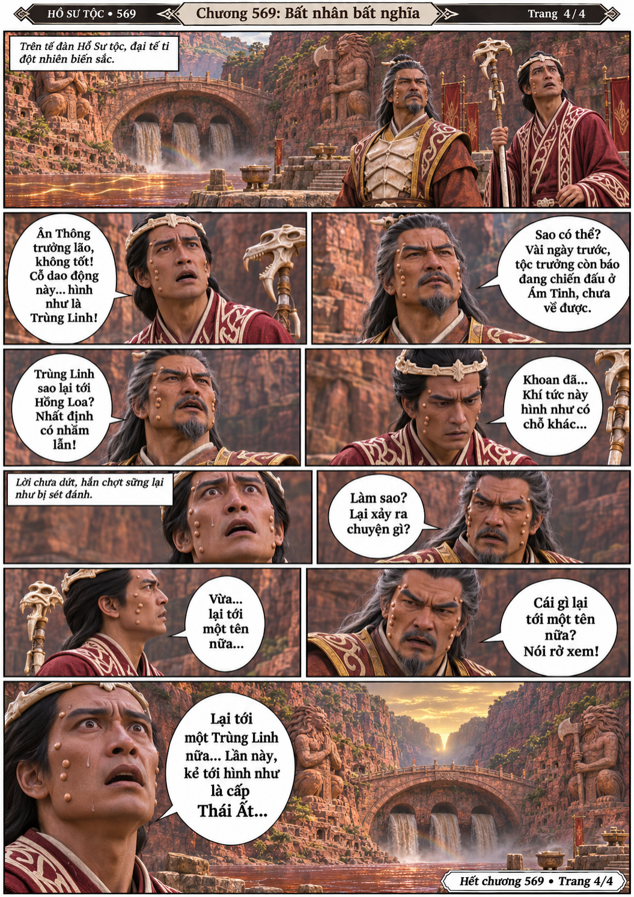

# Chương 569: Bất nhân bất nghĩa

4 trang PNG riêng, tỉ lệ A4 dọc; chuyển thể từ văn bản người dùng đính kèm, có thoại, suy nghĩ và lời dẫn. Dùng model tham chiếu trong bộ nhớ dự án.

[PDF A4](chuong-569.pdf) · [Văn bản nguồn](SOURCE.txt)

Bị truy sát ngày càng gần, Hàn Lập đổi hướng tới Hồng Loa Hà Cốc, lẻn dưới sông và để Kim Đồng hiện khí tức dẫn đối thủ tới Hổ Sư tộc.

