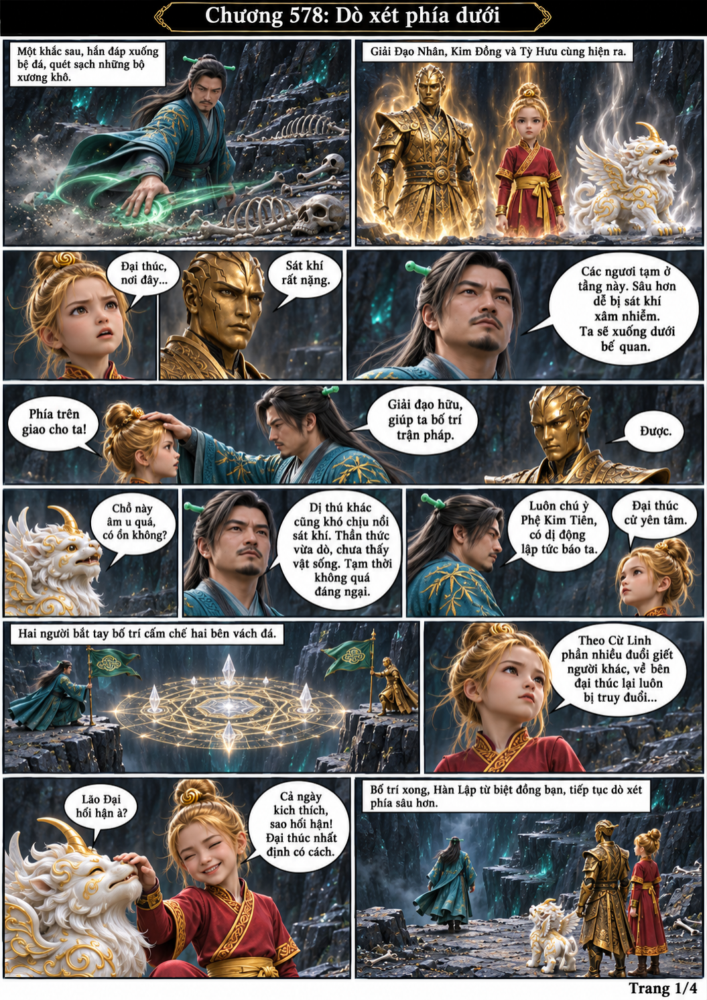
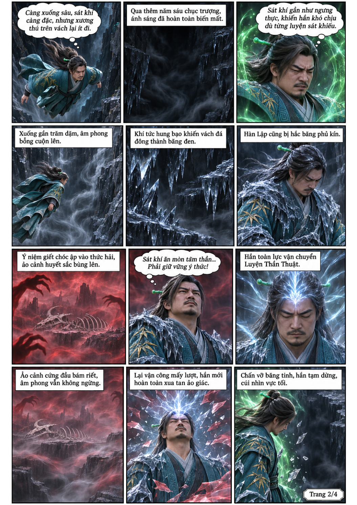
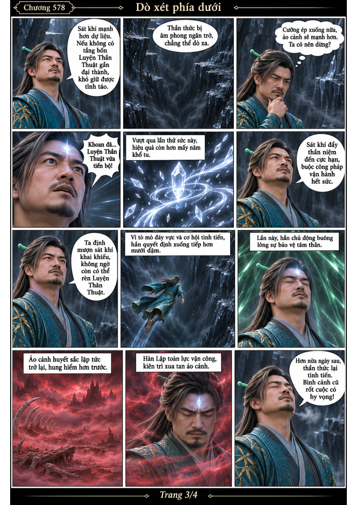
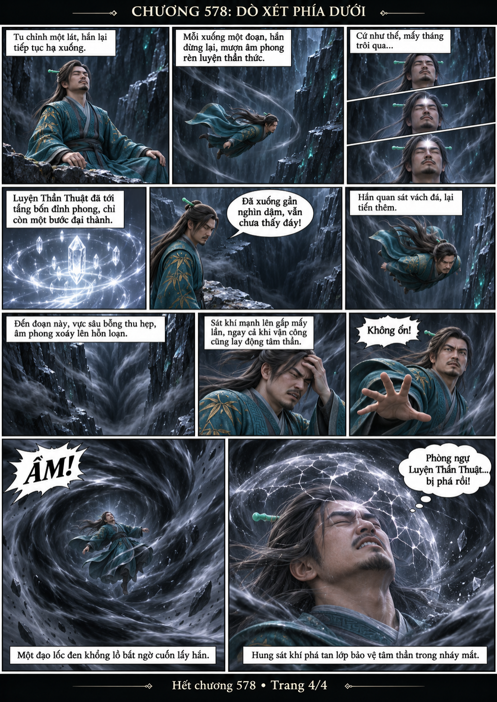

# Chương 578: Dò xét phía dưới

4 trang PNG riêng, tỉ lệ A4 dọc; chuyển thể từ văn bản người dùng đính kèm, có thoại, suy nghĩ và lời dẫn. Dùng model tham chiếu trong bộ nhớ dự án.

[PDF A4](chuong-578.pdf) · [Văn bản nguồn](SOURCE.txt)

Bố trí hộ pháp và tiếp tục thăm dò, Hàn Lập phát hiện sát khí giúp rèn Luyện Thần Thuật. Mấy tháng sau, một cơn lốc âm phong bất ngờ phá tan phòng vệ tâm thần.

