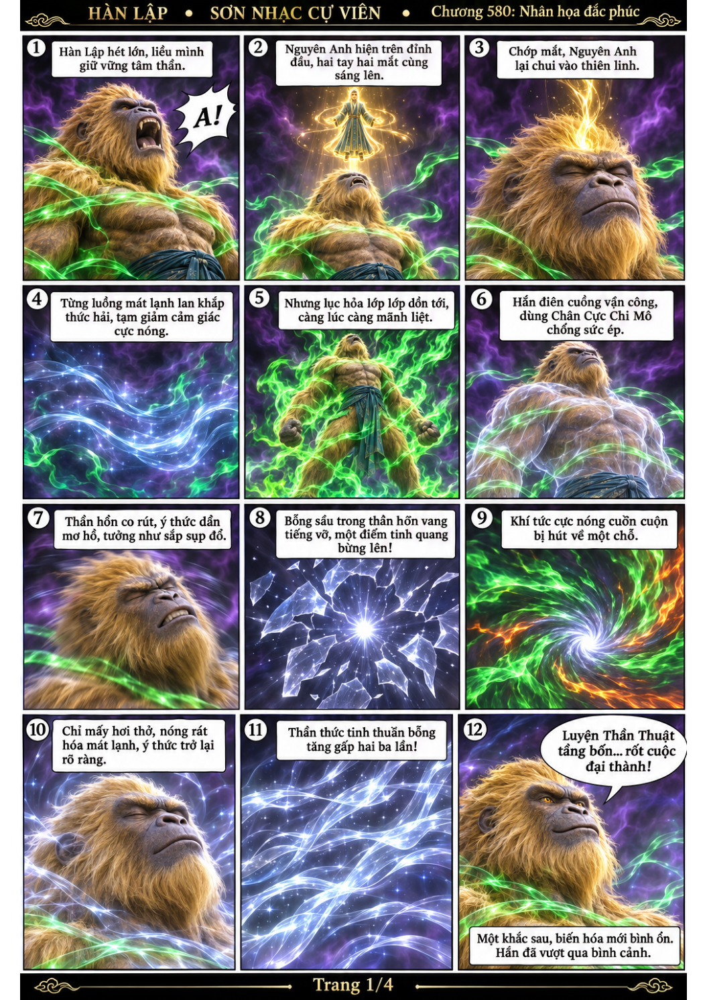
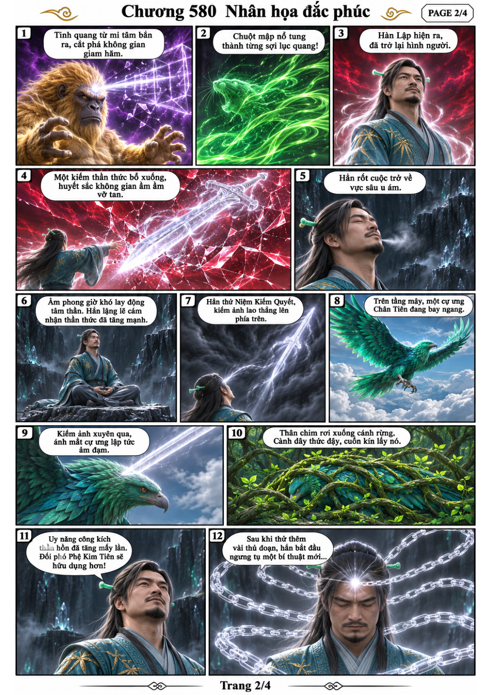
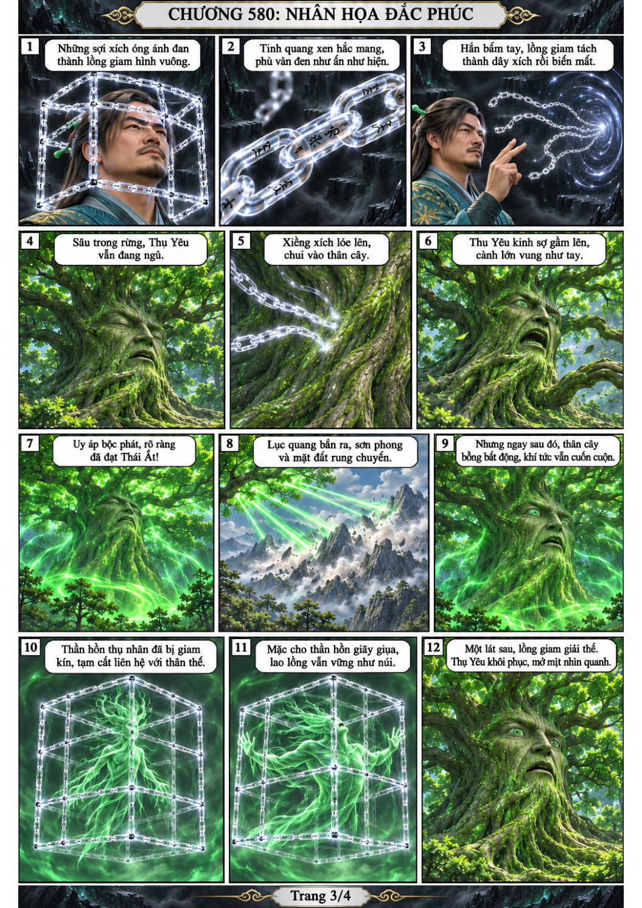
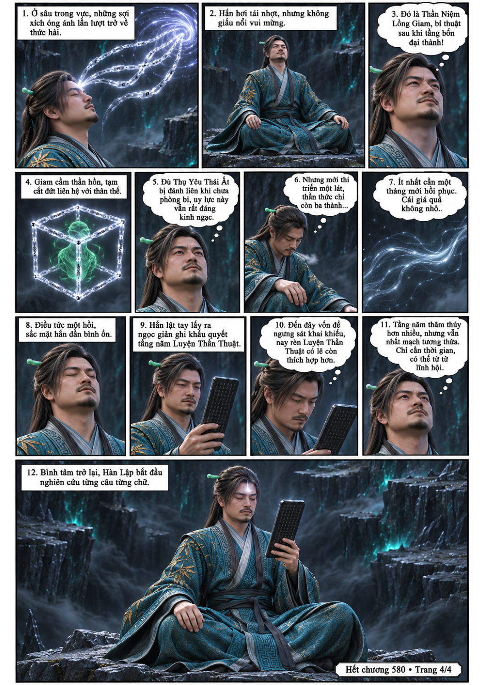

# Chương 580: Nhân họa đắc phúc

4 trang PNG riêng, tỉ lệ A4 dọc; chuyển thể từ văn bản người dùng đính kèm, có thoại, suy nghĩ và lời dẫn. Dùng model tham chiếu trong bộ nhớ dự án.

[PDF A4](chuong-580.pdf) · [Văn bản nguồn](SOURCE.txt)

Trong lục hỏa, Hàn Lập đột phá tầng bốn Luyện Thần Thuật, phá tan ảo cảnh và thử công kích thần hồn cùng Thần Niệm Lồng Giam, rồi nghiên cứu khẩu quyết tầng năm.

