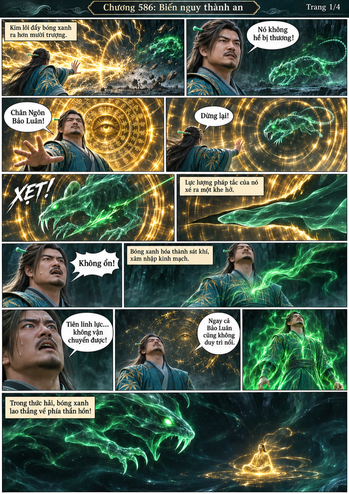
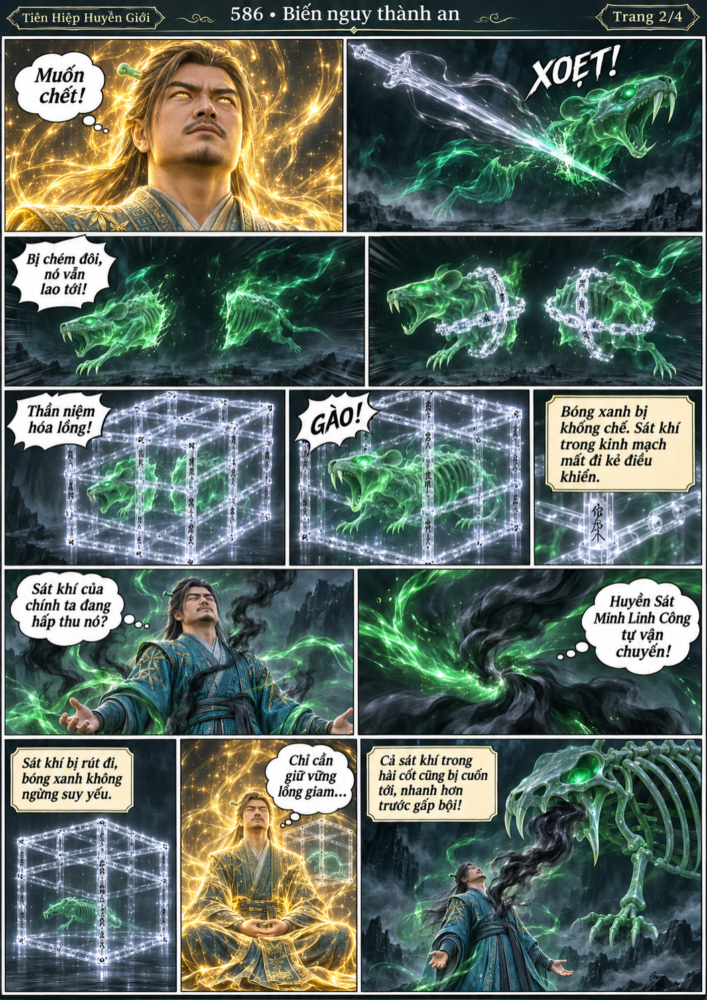
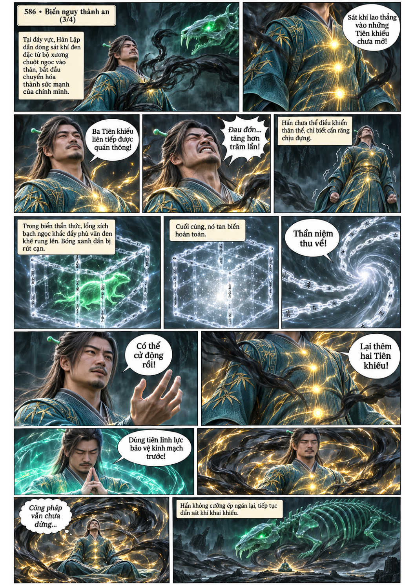
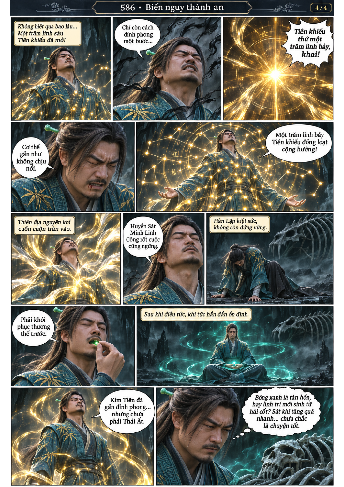

# Chương 586: Biến nguy thành an

4 trang PNG riêng, tỉ lệ A4 dọc; chuyển thể từ văn bản người dùng đính kèm, có thoại, suy nghĩ và lời dẫn. Dùng model tham chiếu trong bộ nhớ dự án.

[PDF A4](chuong-586.pdf) · [Văn bản nguồn](SOURCE.txt)

Bóng xanh xâm nhập thức hải, bị thần niệm giam lại. Huyền Sát Minh Linh Công tự vận chuyển, giúp Hàn Lập khai 107 Tiên khiếu nhưng để lại lo ngại về sát khí.

