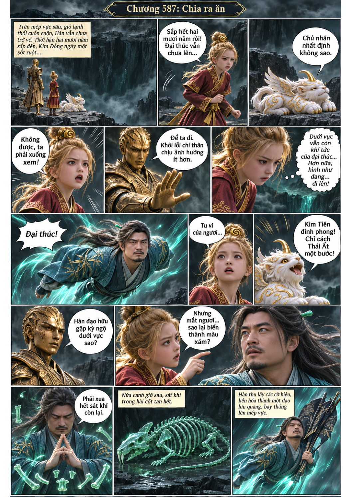
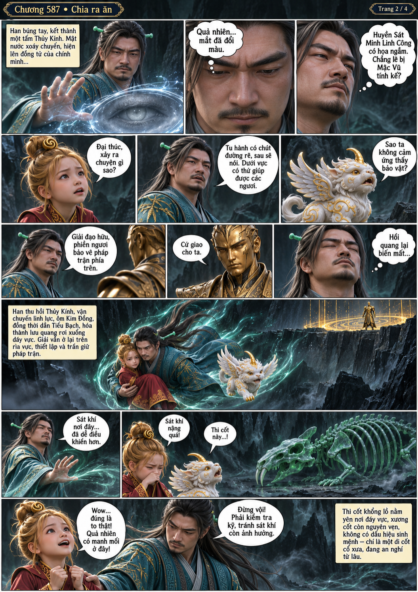
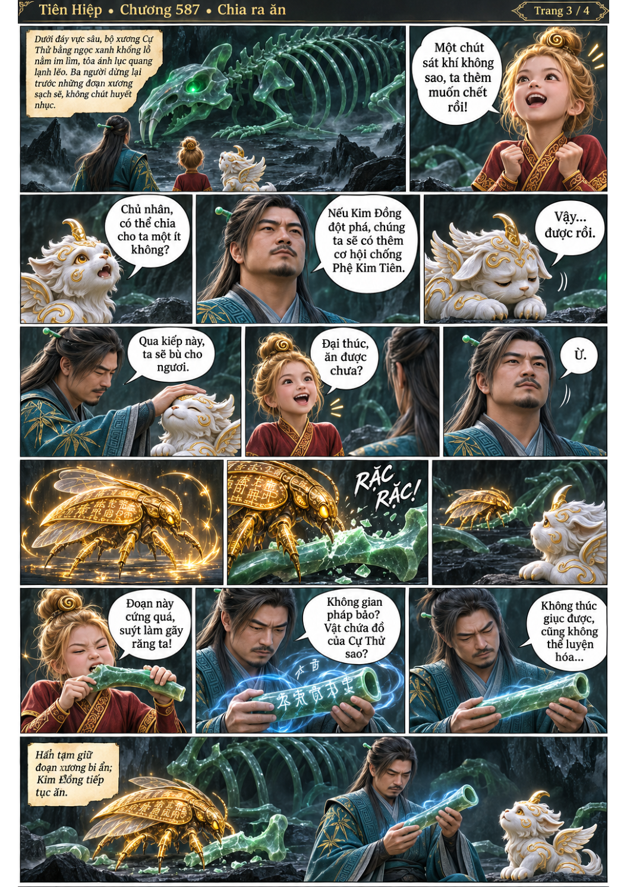
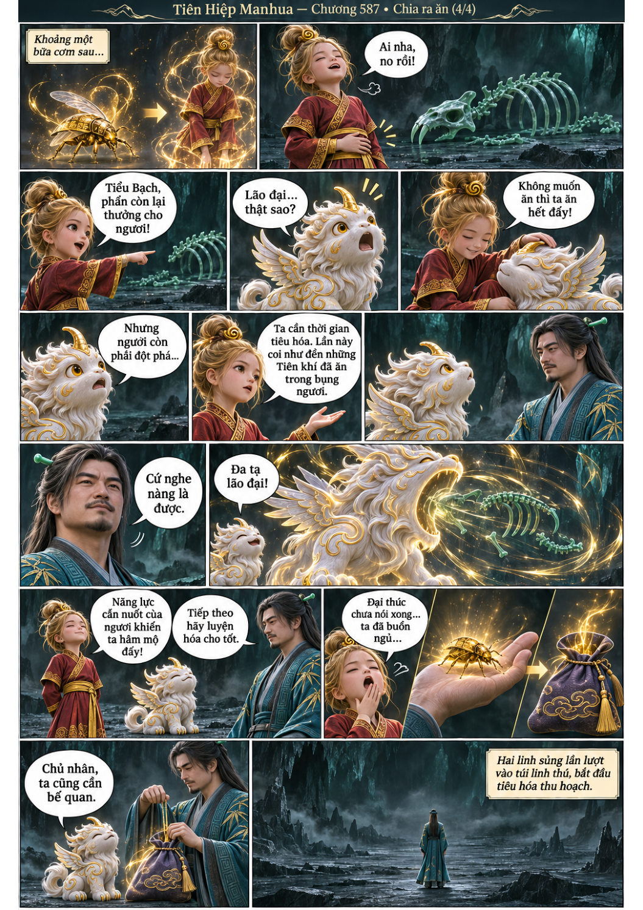

# Chương 587: Chia ra ăn

4 trang PNG riêng, tỉ lệ A4 dọc; chuyển thể từ văn bản người dùng đính kèm, có thoại, suy nghĩ và lời dẫn. Dùng model tham chiếu trong bộ nhớ dự án.

[PDF A4](chuong-587.pdf) · [Văn bản nguồn](SOURCE.txt)

Mắt Hàn Lập xuất hiện hôi quang bất thường. Kim Đồng và Tiểu Bạch chia nhau hài cốt Cự Thử; một đoạn xương chứa dao động không gian được giữ lại.

