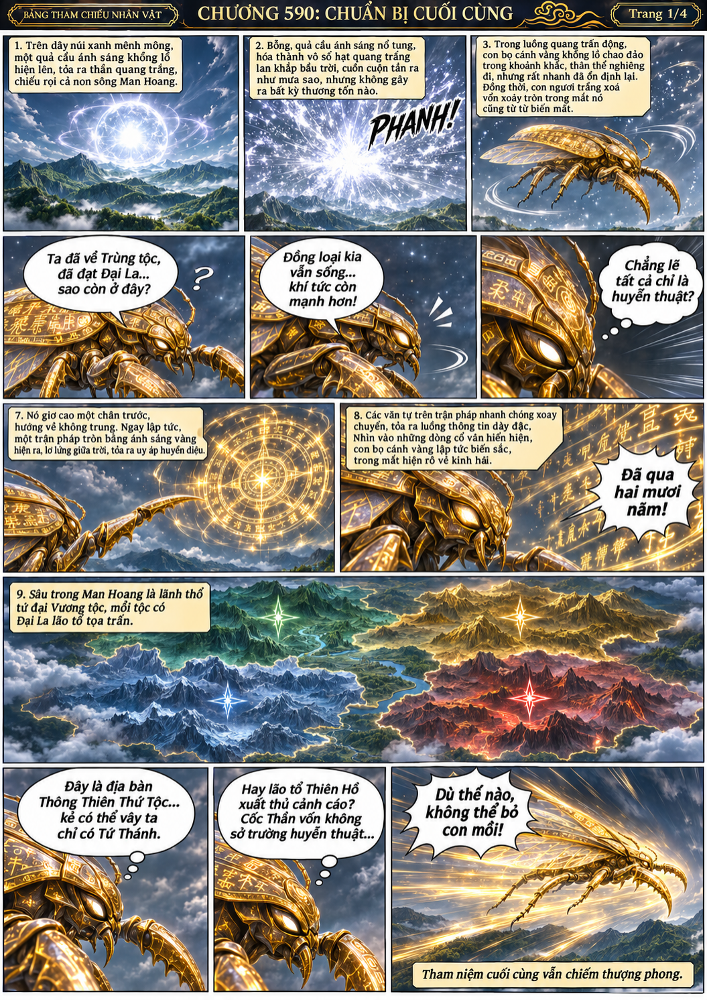
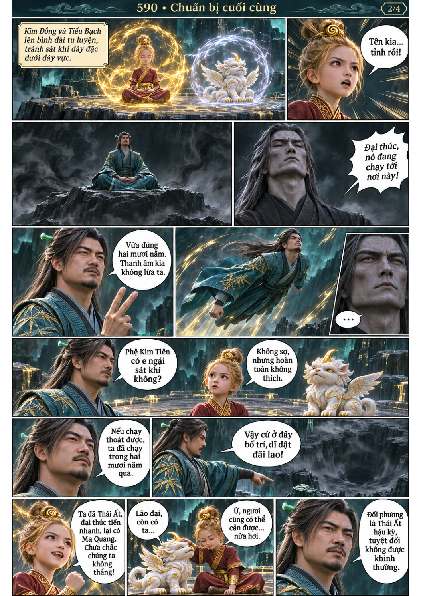
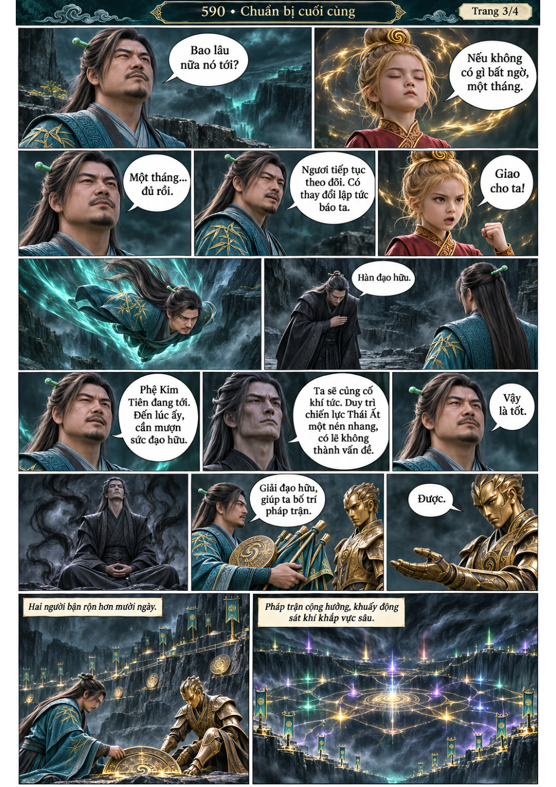
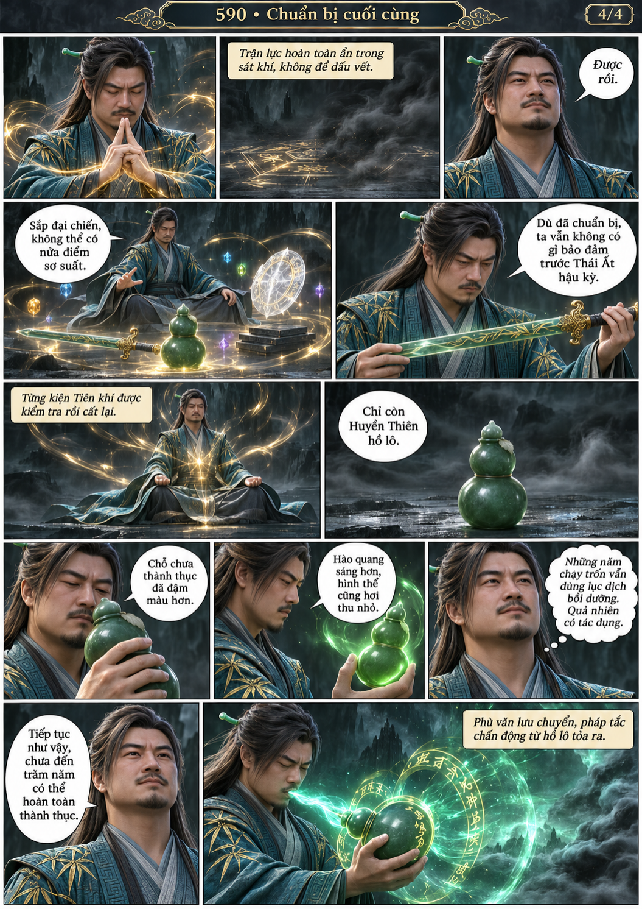

# Chương 590: Chuẩn bị cuối cùng

4 trang PNG riêng, tỉ lệ A4 dọc; chuyển thể từ văn bản người dùng đính kèm, có thoại, suy nghĩ và lời dẫn. Dùng model tham chiếu trong bộ nhớ dự án.

[PDF A4](chuong-590.pdf) · [Văn bản nguồn](SOURCE.txt)

Phệ Kim Tiên tỉnh sau hai mươi năm và tiếp tục đuổi. Hàn Lập dùng một tháng chuẩn bị trận địa, phối hợp Giải Đạo Nhân và kiểm tra Huyền Thiên hồ lô.

