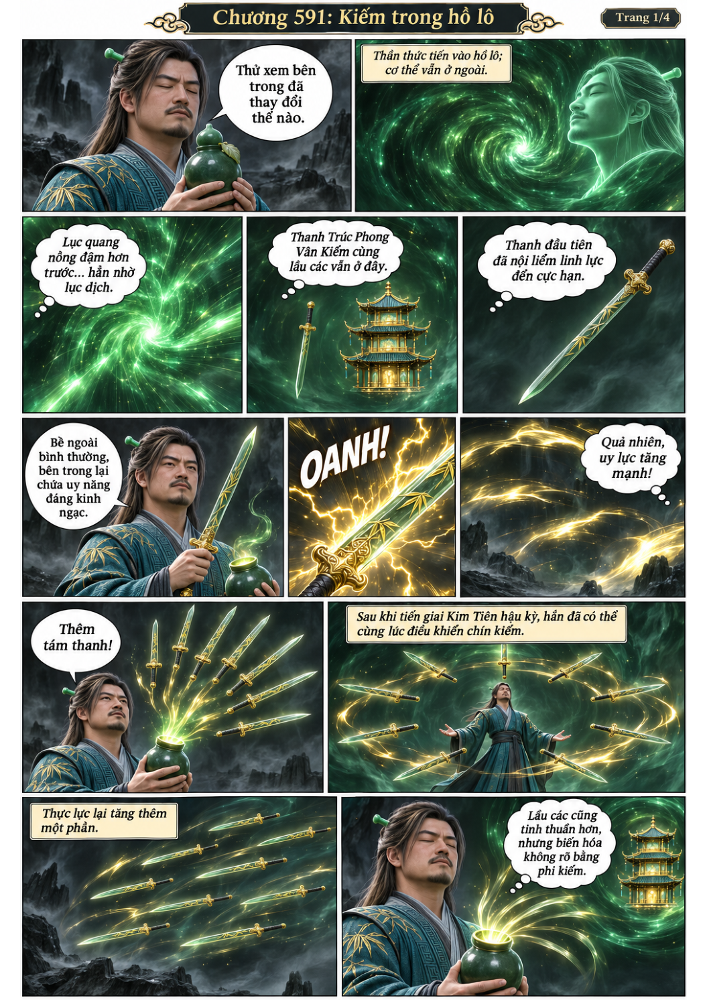
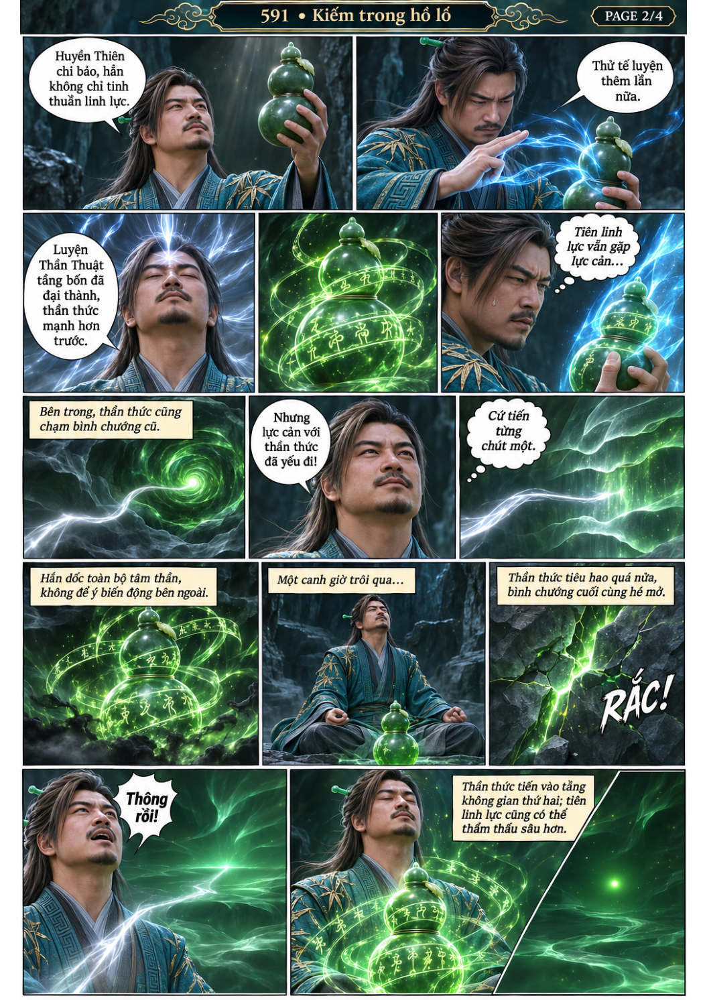
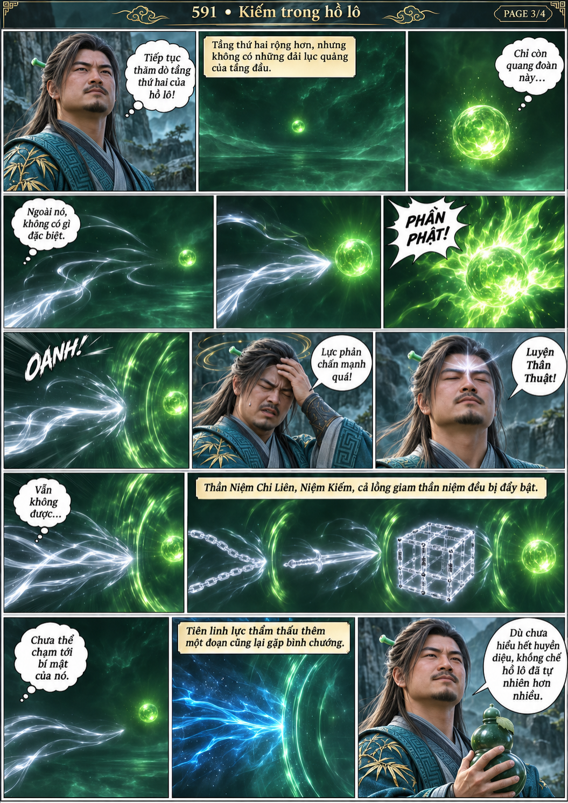
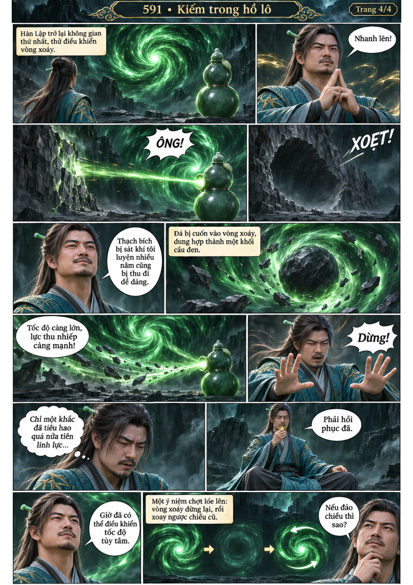

# Chương 591: Kiếm trong hồ lô

4 trang PNG riêng, tỉ lệ A4 dọc; chuyển thể từ văn bản người dùng đính kèm, có thoại, suy nghĩ và lời dẫn. Dùng model tham chiếu trong bộ nhớ dự án.

[PDF A4](chuong-591.pdf) · [Văn bản nguồn](SOURCE.txt)

Hàn Lập thử uy lực chín phi kiếm, mở thêm tầng nội cảnh hồ lô và tăng khả năng thu nhiếp, rồi thử đảo chiều vòng xoáy.

