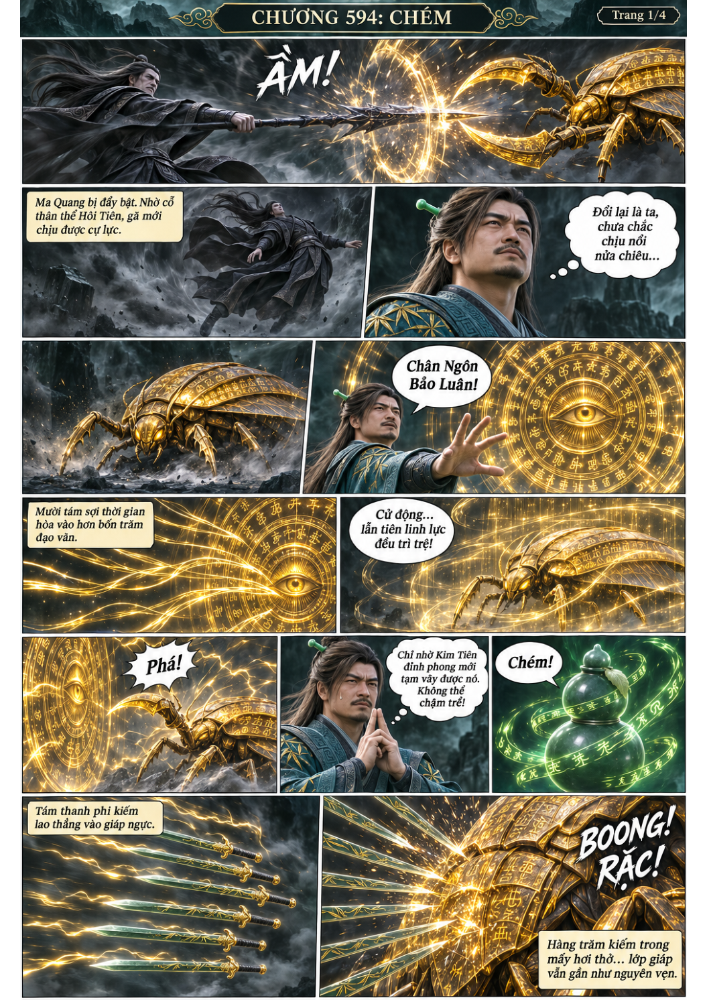
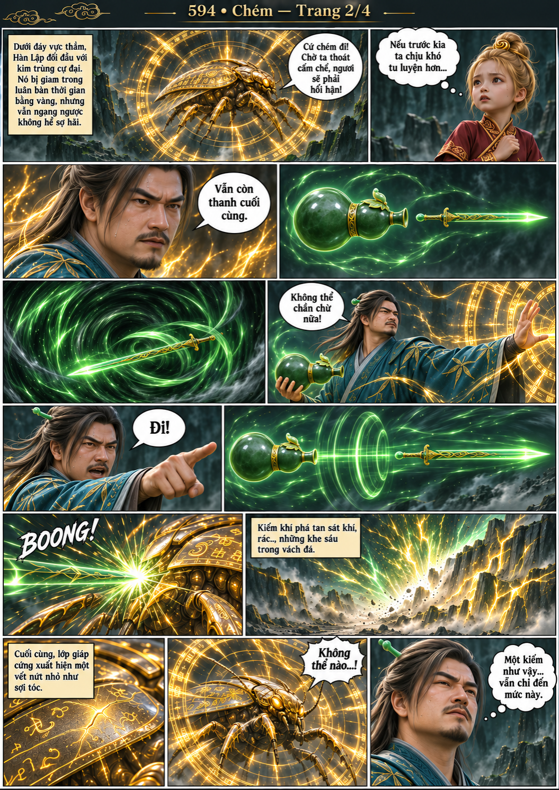
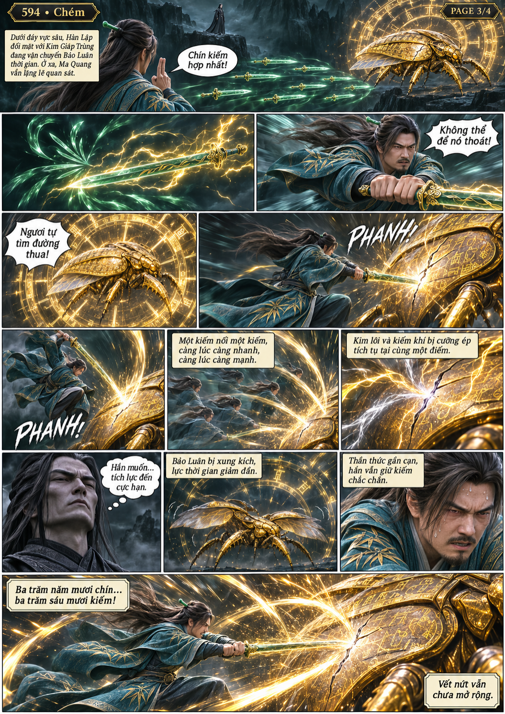
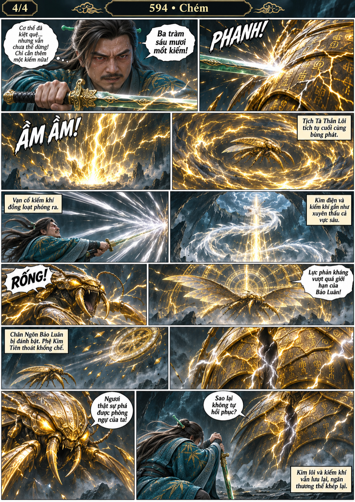

# Chương 594: Chém

4 trang PNG riêng, tỉ lệ A4 dọc; chuyển thể từ văn bản người dùng đính kèm, có thoại, suy nghĩ và lời dẫn. Dùng model tham chiếu trong bộ nhớ dự án.

[PDF A4](chuong-594.pdf) · [Văn bản nguồn](SOURCE.txt)

Hàn Lập dùng Bảo Luân khống chế địch, phóng kiếm thứ chín bằng hồ lô rồi hợp chín kiếm, dồn 361 nhát vào một điểm phá lớp giáp.

