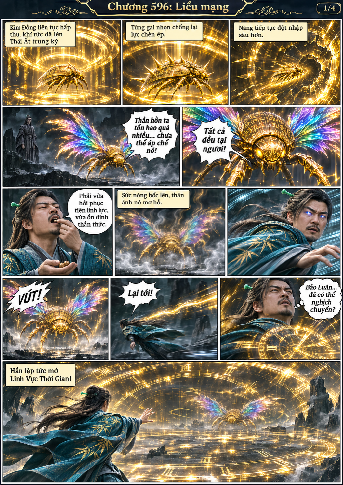
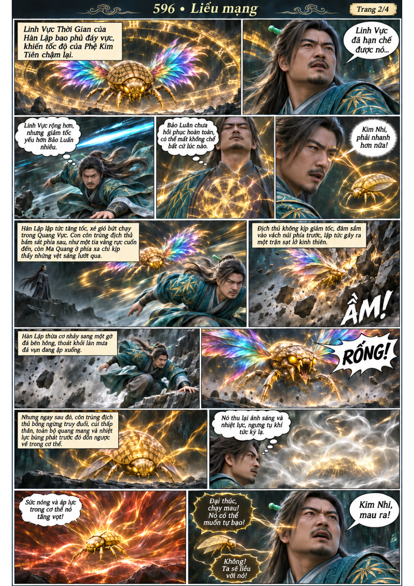
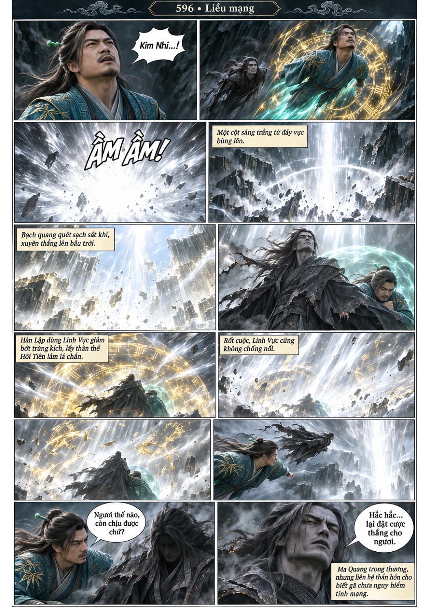
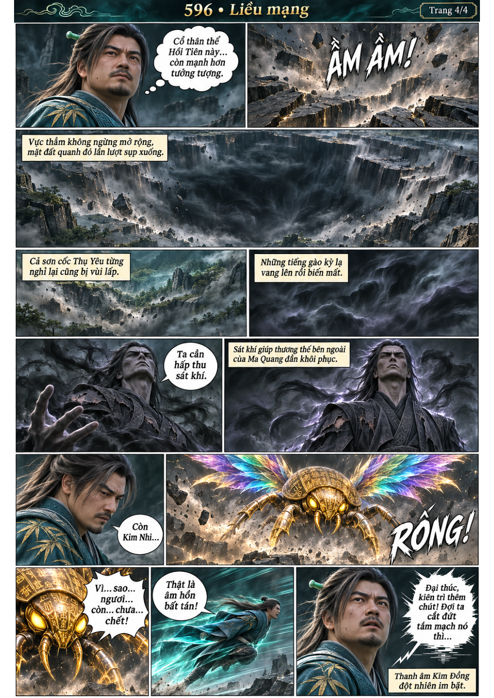

# Chương 596: Liều mạng

4 trang PNG riêng, tỉ lệ A4 dọc; chuyển thể từ văn bản người dùng đính kèm, có thoại, suy nghĩ và lời dẫn. Dùng model tham chiếu trong bộ nhớ dự án.

[PDF A4](chuong-596.pdf) · [Văn bản nguồn](SOURCE.txt)

Kim Đồng tiến tới Thái Ất trung kỳ trong thân địch. Sau vụ bùng nổ, Ma Quang che chắn cho Hàn Lập thoát ra; Phệ Kim Tiên vẫn đuổi tới và tiếng Kim Đồng đột ngột ngắt.

