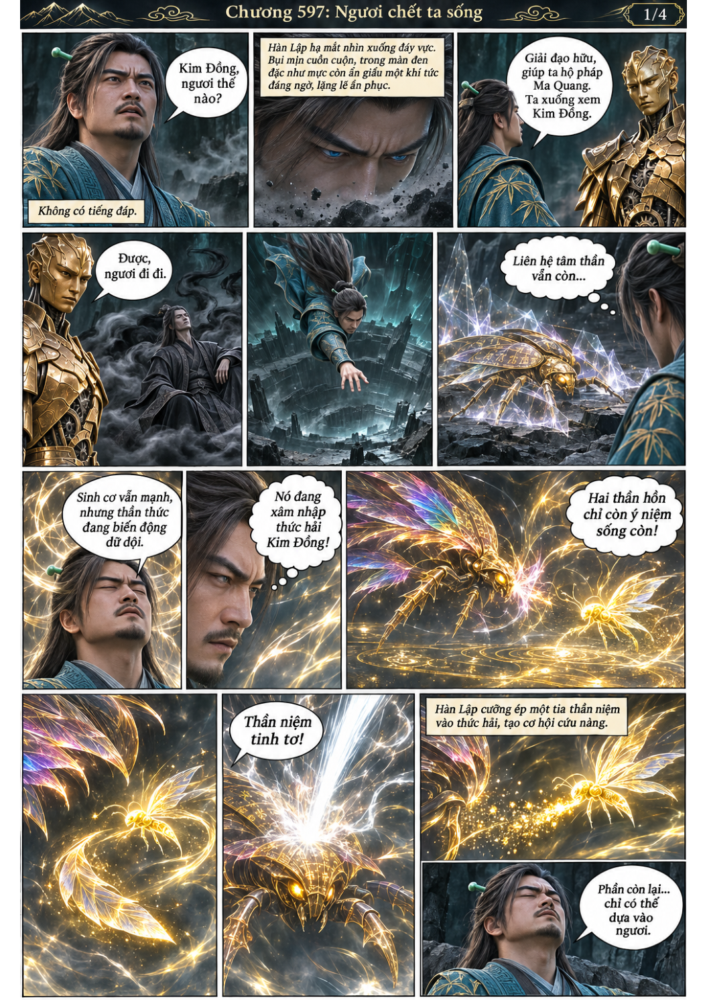
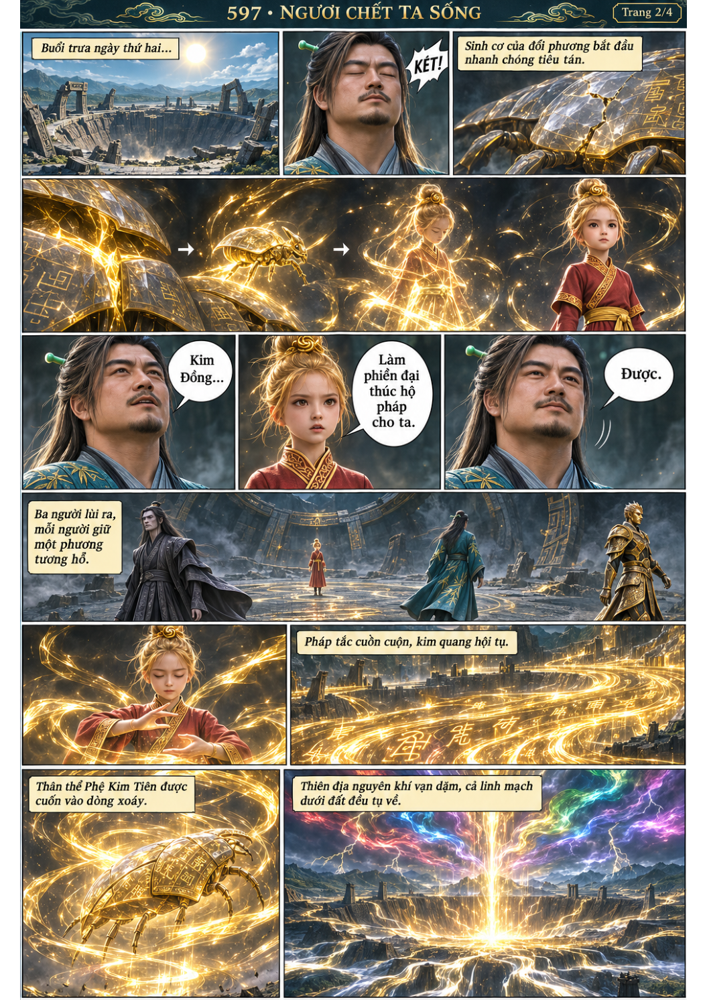
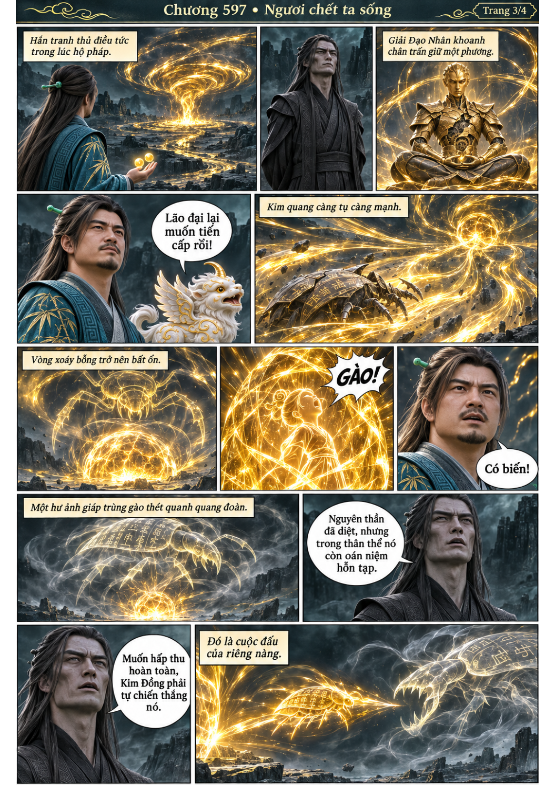
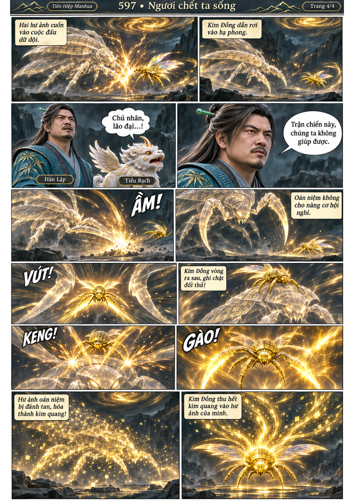

# Chương 597: Ngươi chết ta sống

4 trang PNG riêng, tỉ lệ A4 dọc; chuyển thể từ văn bản người dùng đính kèm, có thoại, suy nghĩ và lời dẫn. Dùng model tham chiếu trong bộ nhớ dự án.

[PDF A4](chuong-597.pdf) · [Văn bản nguồn](SOURCE.txt)

Hàn Lập trợ một tia thần niệm giúp Kim Đồng thắng cuộc đấu thần hồn. Nàng tiếp tục hấp thu thân địch và tự đánh tan oán niệm còn sót.

