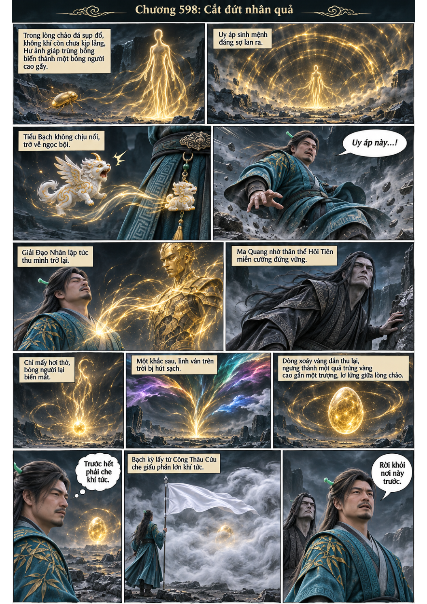
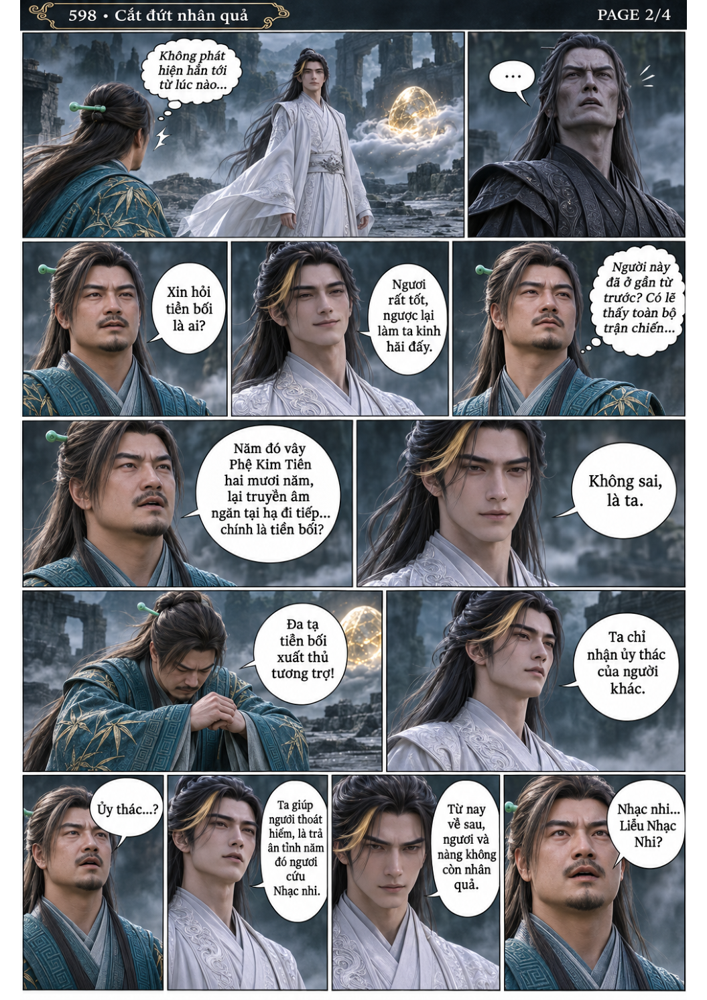
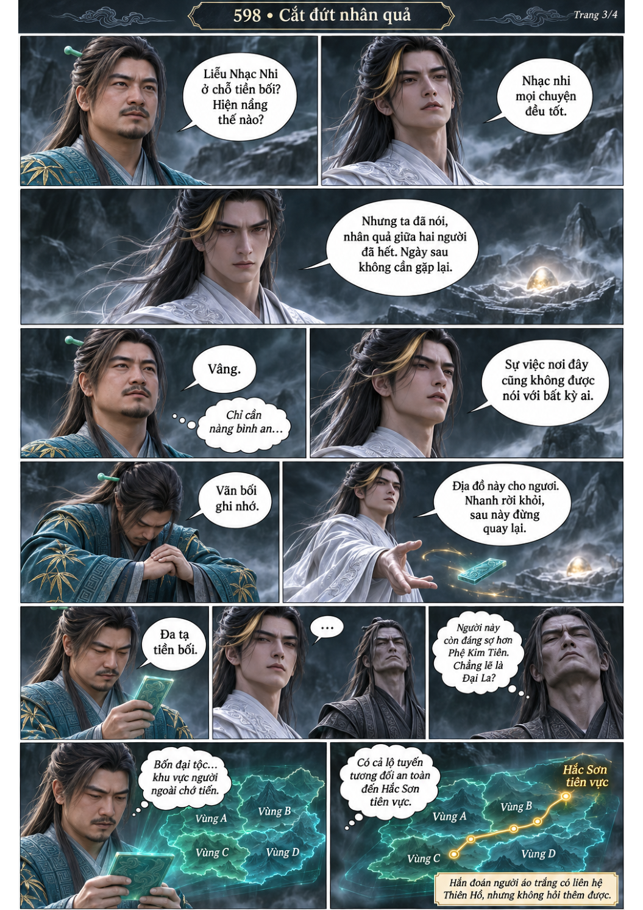
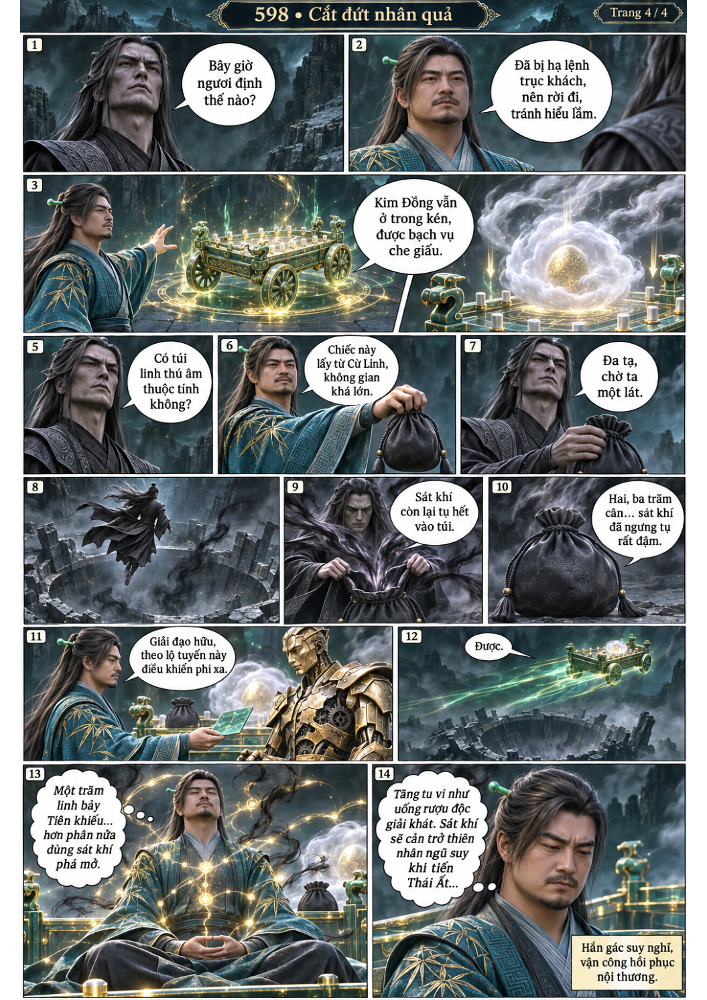

# Chương 598: Cắt đứt nhân quả

4 trang PNG riêng, tỉ lệ A4 dọc; chuyển thể từ văn bản người dùng đính kèm, có thoại, suy nghĩ và lời dẫn. Dùng model tham chiếu trong bộ nhớ dự án.

[PDF A4](chuong-598.pdf) · [Văn bản nguồn](SOURCE.txt)

Nam tử áo trắng xác nhận đã giúp vì ân tình Liễu Nhạc Nhi, yêu cầu cắt nhân quả và rời đi. Nhóm mang kén Kim Đồng theo địa đồ đến Hắc Sơn tiên vực.

